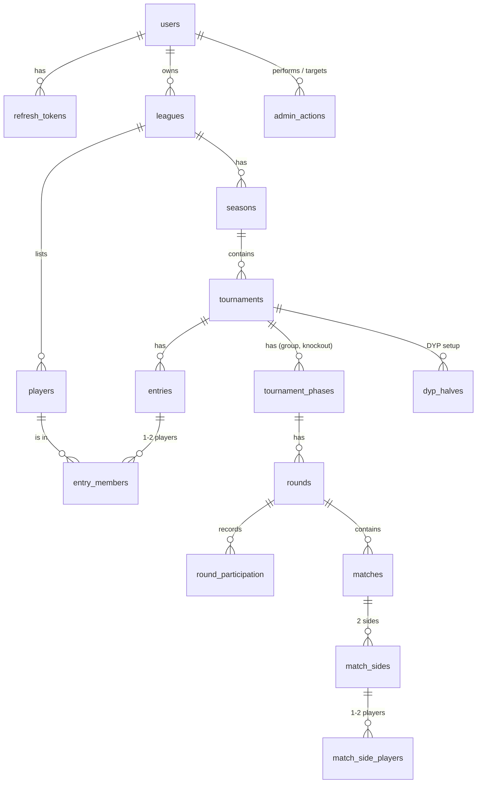

# TourneyHub — MVP Data Model

| | |
|---|---|
| Status | Proposed — awaiting review by another developer |
| Date | 2026-10-17, revised 2026-10-20 after the first review |
| Scope | PostgreSQL schema for the MVP in `PRD.md`: the tables, their relationships and the key decisions behind them. Column lists show what matters for review; exact types, names and the first Alembic migration are settled during implementation within these rules. |

The schema follows the proposed ADRs in `ADR.md`, in particular ADR-002 (PostgreSQL), ADR-006 (authentication), ADR-007 (instance admin), ADR-008 (API conventions and locking), ADR-009 (pure engine, derived data computed on read), ADR-010 (lots) and ADR-011 (pairing). Requirement IDs (FR-, BR-) refer to `PRD.md`.

## 1. Key decisions

| # | Decision | Why |
|---|---|---|
| D1 | **Only source data is stored.** Standings, BH1, BH2, score difference, places, season standings, the league ranking and the sides of later knockout matches are computed by the engine on every read. | ADR-009. Derived data can never drift from results; corrections need no recalculation. |
| D2 | **A match side is a list of players**, optionally tied to an entry. Fixed entries (a player or a pair) exist for seeding and standings; Monster DYP group rounds have sides with players and no entry. | One model covers Singles, Doubles, DYP and Monster DYP, whose teams change every round (BR-060). |
| D3 | **Tournament settings are typed columns**, and each phase (group, knockout) is a row in `tournament_phases`. | MVP settings are few and fixed; CHECK constraints reject impossible combinations. |
| D4 | **Knockout progression is derived from positions.** All bracket matches are created when the knockout is generated, but sides are stored only for the first round; later sides are computed from winners. | No cascade on result changes (BR-094) and no cyclic foreign keys. |
| D5 | **Per-round participation is stored** for group phases: played, sat out, disabled, not yet joined. | Sit-out counts and points (BR-058, BR-063, BR-071) and missed rounds of disabled and late players (BR-064, BR-067) depend on why an entry did not play in each past round. |
| D6 | **Hard delete, except players.** Deleting a league or a tournament removes everything under it (FR-013, FR-038). A removed player is only marked removed and keeps their history (BR-002). | Matches the PRD; no `deleted_at` filters everywhere. |
| D7 | **History only for admin actions.** `admin_actions` records who did what to whom and when (ADR-007). Matches keep only the time of the last result entry. | The organizer is the only person changing a league in the MVP. |
| D8 | **Draws are stored, lots are seeded.** Tournaments carry an immutable random seed and a draw counter; every lot, including the league ranking's (BR-020), uses the tournament's seed (ADR-010). | Reproducible draws; lots inside computed standings give the same answer on every read. |

## 2. Conventions

- **Naming:** `snake_case`, plural table names, foreign keys named `<singular>_id`, timestamps end in `_at`.
- **Primary keys:** `uuid`, UUIDv7, generated by the application (e.g. with `uuid-utils`). No `serial`, no database default. Creating a league or a tournament takes its id from the client, so that a repeated request hits the existing primary key: the API returns the existing row only if it belongs to the same organizer, has the same parent (the organizer for a league, the season for a tournament) and, for a tournament, the same type; otherwise it answers 409 (ADR-008). The API accepts only UUIDv7 values there and does not trust the timestamp inside them: `created_at` is set by the server, and nothing relies on the order of client-supplied ids.
- **Enumerations:** `text` with `CHECK (col IN (…))`, not PostgreSQL enums, so adding a value needs no `ALTER TYPE`. A test checks that each CHECK matches its Python `StrEnum`.
- **Time:** instants are `timestamptz`, stored in UTC. The tournament date (FR-030) is a plain `date`.
- **Numbers:** scores and placement points are `int`. Season points are whole numbers because BR-111 rounds down.
- **Timestamps:** `created_at` on every table; `updated_at` on tables whose rows are edited, set by the application.
- **Deletes:** two kinds of foreign keys.
  - A child that its parent owns is `ON DELETE CASCADE`: league → season → tournament → phase → round → match → side → side players, and below a tournament also its entries, their members, the DYP halves and the round participation rows.
  - A reference that does not own anything is `NO ACTION DEFERRABLE INITIALLY DEFERRED`: the three references to `players` (`entry_members`, `dyp_halves`, `match_side_players`) and `match_sides.entry_id`. The check runs at commit, after the cascades have removed every referencing row. Deleting a league, a tournament or a knockout therefore succeeds whatever the order of its statements, while deleting a player who still has history, or an entry that still has match sides, fails. This makes D6 a database rule: a player with history disappears only with its league, because removing a player only sets `removed_at`. The application never issues a `DELETE` on `players` outside the league delete.
  - With an immediate check (`RESTRICT` or plain `NO ACTION`), deleting a league or a tournament fails, because the cascade reaches `players` and `entries` before the rows that reference them (verified on PostgreSQL). With `CASCADE` on these references, a stray `DELETE` of one player or entry would silently take match sides and side players with it.
  - The API treats a foreign-key violation raised at commit as a bug: it returns 500 with a stable code and logs the constraint name.
  - ORM relationships along these foreign keys use `passive_deletes='all'` or have no back-reference. By default SQLAlchemy sets a nullable foreign key to `NULL` when the parent is deleted, which would let a stray delete of an entry pass the deferred check on `match_sides.entry_id`.
  - Integration tests that run in a transaction and roll it back never reach a real commit. The test session's commit (a savepoint release in that pattern) therefore runs `SET CONSTRAINTS ALL IMMEDIATE` and then `SET CONSTRAINTS ALL DEFERRED`, so a violation shows up at the operation that caused it, as it would at a real commit. Running `SET CONSTRAINTS ALL IMMEDIATE` at the start of a transaction instead would make the cascading deletes fail like an immediate check.
  - References to `users` are `ON DELETE RESTRICT` unless noted. Until organizers can delete their own account (RM-31), the instance admin deletes an account by hand: first the organizer's leagues, then the user, then the `auth_attempts` rows whose `key` is the user's email, since they reference nothing. Refresh tokens go with the user, and `admin_actions` keeps its rows with the reference set to `NULL`.
- **Concurrency:** no version columns. Every operation that changes data inside a league locks the league row first and then, if it touches a tournament, the tournament row (`SELECT … FOR UPDATE`, ADR-008). Rules spanning a season and its tournaments depend on this (BR-010, BR-011, BR-095, FR-038), and the fixed order rules out deadlocks; with one organizer per league there is almost no waiting. With only the tournament lock, clearing a result in a finished tournament and starting a new season can both commit and leave a tournament in progress inside a closed season (reproduced on PostgreSQL).
- **Repeated requests:** the locks do not help when a client repeats a request whose response was lost after the first attempt had committed, or when a second device acts on a stale screen. Operations that are unsafe to repeat state what they expect; the application checks it under the lock and answers 409 on a mismatch (ADR-008):
  - a round is deleted by `rounds.id`, never as "the newest round" (FR-046);
  - adding a round carries the expected `round_no`, and the unique `(phase_id, round_no)` also catches a duplicate (FR-040);
  - starting a season carries the current season's `number` (FR-021);
  - "shuffle again" and "new DYP draw" carry the expected `draw_counter`;
  - creating a league or a tournament uses a client-supplied id (see Primary keys).

  Changing the entries in setup carries no expected state: a retried add is caught by the unique `(tournament_id, stage, player_id)`, and a retried remove gets 404.

  Every other operation is safe to repeat: it sets a target state (`disabled: true`, never a toggle; the full seed order, never "move up"), deletes by id, or is caught by a unique constraint or by the tournament state. A full seed order that does not list exactly the current entries of the stage gets 409. A repeated delete by id gets 404, which the frontend treats like a 409: it reloads the state instead of showing an error.
- **Case-insensitive text:** email addresses and player names are compared with `lower()`. The database is created with PostgreSQL 17's built-in locale provider: `initdb --locale-provider=builtin --builtin-locale=C.UTF-8`, passed as `POSTGRES_INITDB_ARGS` to the image. `lower()` then uses Unicode case mapping, so `Č` folds to `č`, and the `lower()` unique indexes do not depend on the image's glibc version. The behaviour is stable within a PostgreSQL major version, so the release notes are checked before a major upgrade. Text sorts by code point; a query that must list names in Czech order uses `COLLATE "cs-x-icu"`. A test checks the folding: a database created with the plain `C` locale does not fold `Č` at all.
- **What the database checks:** single-row and same-table invariants (CHECK, UNIQUE, foreign keys). Rules spanning several rows or tables — e.g. "no new season while a tournament is unfinished" (BR-010) or "a closed season cannot change" (BR-011) — are enforced by the application under the league and tournament locks and covered by tests, including invariant queries run after every integration test (§5).

## 3. Overview

Standalone tables: `instance_settings` (one row) and `auth_attempts` (rate limiting).

## 4. Tables

### 4.1 Accounts and administration

**`users`** — organizers and admins (FR-001–FR-007).

| Column | Notes |
|---|---|
| `id` | |
| `email` | Unique on `lower(email)` (FR-002). |
| `display_name` | |
| `password_hash` | Argon2id (ADR-006). |
| `is_admin` | `bool`, default `false`. Set only by the CLI (ADR-007). Read from this row on every admin request, never from the access token (ADR-006). |
| `must_change_password` | `bool`, default `false`. Set by an admin password reset (FR-006), cleared by a password change. While set, the API allows only `/api/v1/auth/*` and `GET /api/v1/me` and answers everything else with 403 `password_change_required`; it is read from this row on every request (ADR-006). |
| `language` | `en` or `cs`; the remembered UI language (FR-081). |
| `created_at`, `updated_at` | |

**`refresh_tokens`** — rotating refresh tokens (ADR-006).

| Column | Notes |
|---|---|
| `id` | |
| `user_id` | FK `users`, `ON DELETE CASCADE`. |
| `family_id` | `uuid`; all tokens of one login share it. Indexed. The refresh endpoint locks the family's rows (`SELECT … FOR UPDATE`) before reading them, so presentations within one family are handled one at a time. |
| `parent_id` | FK `refresh_tokens`, nullable, `ON DELETE SET NULL`: the token this one was rotated from. Indexed. Siblings are tokens with the same `family_id` and the same non-null `parent_id`; a normal rotation revokes the presented token's unrotated siblings. A parent expires before its children, hence `SET NULL`. |
| `token_hash` | `bytea`, SHA-256 of the token. Unique. |
| `expires_at` | 90 days after issue; each rotation issues a new token with a new expiry, so a device in use stays logged in (ADR-006). Rows past `expires_at` are deleted regularly; rotated rows stay until then, because reuse detection needs them. |
| `rotated_at` | Set when this token was exchanged for a new one. Presenting it again within 60 seconds of `rotated_at` issues another new token in the same family and leaves `rotated_at` unchanged; this covers two tabs refreshing at once and an immediate retry after a lost response. Only hashes are stored, so the earlier replacement cannot be sent again. Presenting it later revokes the family. |
| `revoked_at` | Set on logout, password change, admin reset, detected reuse or a sibling's normal rotation. A revoked or expired token gets 401 and changes nothing, even within the 60-second window. |
| `created_at` | |

**`auth_attempts`** — counters for login and sign-up limits (ADR-006).

| Column | Notes |
|---|---|
| `id` | |
| `kind` | `login_email`, `login_ip`, `signup_ip`. |
| `key` | The email (lower-cased) or the client IP from `X-Forwarded-For`, trusted only from Caddy (ADR-006); an IPv6 address is stored as its /64 prefix. |
| `succeeded` | `bool`. |
| `created_at` | Index on `(kind, key, created_at)`. Rows older than the longest window are deleted by the application. |

**`instance_settings`** — exactly one row (`id smallint PRIMARY KEY CHECK (id = 1)`).

| Column | Notes |
|---|---|
| `signup_code` | `text`, nullable. `NULL` means sign-up is closed (ADR-007). Stored in plain text so the admin can see and share it; it gates sign-up only and protects no existing account. Sign-up compares it in constant time with `secrets.compare_digest` on the UTF-8 bytes; on `str` that function raises `TypeError` for non-ASCII input such as a Czech letter. |
| `updated_at` | |

**`admin_actions`** — the record of admin actions (ADR-007).

| Column | Notes |
|---|---|
| `id` | |
| `source` | `web` or `cli`. |
| `admin_user_id` | FK `users`, nullable, `ON DELETE SET NULL`. `NULL` for CLI actions; on a `web` row it means the admin's account was deleted. |
| `action` | `set_signup_code`, `reset_password` (web); `create_admin`, `grant_admin`, `revoke_admin` (CLI). |
| `target_user_id` | FK `users`, nullable, `ON DELETE SET NULL`. `NULL` for `set_signup_code`; on other rows it means the target's account was deleted. |
| `created_at` | |

The CHECK constraints work in one direction only, because `SET NULL` must be able to clear a reference when an account is deleted (§2): `source = 'web' OR admin_user_id IS NULL` (a CLI action has no admin) and `action <> 'set_signup_code' OR target_user_id IS NULL` (setting the code has no target). A web action cannot be recorded without a logged-in admin, so `source` tells a deleted account from a CLI action.

The sign-up code itself is never written to `admin_actions`.

### 4.2 Leagues, players and seasons

**`leagues`** (FR-010–FR-013, FR-070).

| Column | Notes |
|---|---|
| `id` | |
| `owner_user_id` | FK `users`. One organizer per league in the MVP; co-organizers (RM-01) will add a membership table. |
| `name` | |
| `draws_allowed` | `bool` (FR-011, BR-090). |
| `share_token` | `text`, unique; at least 128 random bits, URL-safe (FR-071, ADR-008). |
| `created_at`, `updated_at` | |

**`players`** — a league's player list (FR-012, BR-001, BR-002).

| Column | Notes |
|---|---|
| `id` | |
| `league_id` | FK `leagues`, `ON DELETE CASCADE`. |
| `name` | Unique on `(league_id, lower(name))`, **including removed players** (ADR-002). Re-adding a removed player's name restores that player. |
| `removed_at` | `NULL` while the player is on the list. |
| `created_at`, `updated_at` | |

**`seasons`** (FR-020–FR-022, BR-010–BR-012).

| Column | Notes |
|---|---|
| `id` | |
| `league_id` | FK `leagues`, `ON DELETE CASCADE`. |
| `number` | 1, 2, …; unique on `(league_id, number)`. |
| `name` | Nullable. `NULL` means the default name, rendered in the UI language from `number` ("Season 2" / "Sezóna 2"); set when the organizer renames it (FR-020). |
| `state` | `active` or `closed`. At most one active season per league: partial unique index on `(league_id) WHERE state = 'active'`. |
| `placement_points` | `int[]`, the season's placement points table, e.g. `{10,8,6,4,2}` (FR-011). CHECK via an immutable SQL helper function: one-dimensional, not empty, no `NULL` elements, no negative values, non-increasing. |
| `started_at`, `closed_at` | |

The placement points table lives only on seasons. The league settings screen edits the active season's table, a new season starts with a copy of the previous season's table, and a closed season's table no longer changes (BR-012). This is the "season keeps its own copy" of ADR-009 without a second copy on `leagues`.

### 4.3 Tournaments and phases

**`tournaments`** (FR-030–FR-039).

| Column | Notes |
|---|---|
| `id` | |
| `season_id` | FK `seasons`, `ON DELETE CASCADE`. |
| `name`, `date` | `date` is the calendar date on the organizer's device, sent by the client, which defaults it to today (FR-030); it is never derived from a UTC timestamp, so a tournament at 23:30 in Prague stays on its day. |
| `type` | `singles`, `doubles`, `dyp`, `monster_dyp`. |
| `state` | `setup`, `in_progress`, `finished`. |
| `seeding_method` | `ranking` or `random` (FR-034); not used by Monster DYP. |
| `rng_seed` | `bytea`, 16 bytes, immutable (ADR-010). |
| `draw_counter` | `int`, incremented on each new draw: "shuffle again", "new DYP draw", or a draw forced by a change to the entries in setup (ADR-010). |
| `created_at`, `updated_at` | |

**`tournament_phases`** — at most one group phase and one knockout per tournament (FR-031).

| Column | Notes |
|---|---|
| `id` | |
| `tournament_id` | FK `tournaments`, `ON DELETE CASCADE`. Unique on `(tournament_id, kind)`. |
| `kind` | `group` or `knockout`. |
| `format` | `round_robin`, `swiss`, `monster_dyp` (group) or `single_elimination` (knockout). |
| `round_robin_legs` | `1` or `2`; round robin only. |
| `sit_out_points` | `0` or `1`; group phases only (FR-039, BR-071). |
| `tiebreakers` | `text[]` of `score_difference`, `bh1`, `bh2` in the organizer's order; Swiss and Monster DYP only (FR-043). CHECK: `tiebreakers <@ ARRAY['score_difference','bh1','bh2']`, and no duplicates via an immutable helper function (a CHECK cannot contain a subquery). |
| `qualifiers` | Number of qualifying entries (FR-045, BR-080). Set only on a knockout that follows a group phase. |
| `third_place_match` | `bool`; knockout only. |
| `monster_knockout_mode` | `seeded_pairs`, `singles`, `a_little_mercy`, `lord_have_mercy` (BR-081–BR-084). Set only on a knockout that follows a Monster DYP group phase. |
| `created_at` | |

CHECK constraints tie the columns to `kind` and `format`: e.g. a `group` phase has `sit_out_points` and no `third_place_match`; `round_robin_legs` is set only for `round_robin`; `tiebreakers` only for `swiss` and `monster_dyp`; `qualifiers` and `monster_knockout_mode` only on `knockout` rows. Rules that need another row or the tournament type are checked by the application: `qualifiers` is set exactly when the tournament also has a group phase, `monster_knockout_mode` exactly when that group phase is `monster_dyp`, and Monster DYP always has a `monster_dyp` group phase.

A knockout without a group phase is created in setup. A knockout after a group phase is created when the organizer starts it (FR-045). Deleting it (FR-046, BR-087) removes the phase row, which cascades to its rounds and matches; its `knockout` entries hang off `tournaments`, so the application deletes them in the same transaction, in either order (§2).

The helper functions used by CHECK constraints are created in the first migration, before the tables that use them.

### 4.4 Entries

**`entries`** — whoever takes a place in a phase: a player or a pair (glossary "Entry").

| Column | Notes |
|---|---|
| `id` | |
| `tournament_id` | FK `tournaments`, `ON DELETE CASCADE`. |
| `stage` | `main` or `knockout`. `main` entries play the tournament's first phase. `knockout` entries are created only when a knockout follows a group phase. |
| `kind` | `player` or `pair`. |
| `seed` | `int`, nullable until seeded. Unique on `(tournament_id, stage, seed)`, `DEFERRABLE INITIALLY DEFERRED` so that seeds can be swapped in one transaction (FR-034). Cleared and set again whenever the entries change in setup, which also discards a hand reordering (ADR-010). |
| `source_entry_id` | FK `entries`, nullable, `ON DELETE CASCADE`. For a knockout entry that continues one group-phase entry — after a round robin or Swiss (BR-085), and in the Monster DYP *Singles* mode (BR-082) — that entry. `NULL` for pairs formed after Monster DYP, whose players are found through `entry_members`. Used to place non-qualifiers after the knockout (BR-103). |
| `is_top_player` | `bool`; marked as a top player by the organizer (FR-041). See "Top players" below. |
| `is_disabled` | `bool`; the current state (FR-044, BR-064). The history is in `round_participation`. Deleting a round does not change it; going back to setup clears it, since disabling exists only while rounds are played (FR-044). |
| `created_at` | |

Additional constraint: **`UNIQUE (id, tournament_id, stage)`**, not deferrable, so that `entry_members` can reference it with a composite foreign key. `stage` never changes after an entry is created.

`stage` is used instead of a phase FK because `main` entries exist in setup, before any round, and because a knockout without a group phase also uses `main` entries.

A late entry (BR-067) is an ordinary `main` entry added while the tournament is in progress; which rounds it missed is recorded in `round_participation` (§4.5).

**Top players** (BR-061, FR-041). The number of matches can change between rounds 1 and 2 (a disabled or late player), and BR-063 can draw a top player to sit out, so a fixed set of top players does not always match the number of groups. The proposed rule, not yet in `PRD.md`: in rounds 1 and 2 of a Monster DYP, the engine first picks who sits out, then takes as top players the first M playing players, where M is the round's number of matches, in this order: players marked by the organizer, then the others, each in league-ranking order. A top player who sits out or is disabled is replaced by the next one, so every group has exactly one. Without marks this is the league-ranking rule of FR-041. `is_top_player` therefore stores only the organizer's marks.

Two points are left to the PRD owner and change only the engine, not the tables: which M players count when more are marked than there are matches (league ranking, as proposed, or the current standing), and whether top players are exempt from the sit-out lot in rounds 1 and 2. The second decides §5.2 step 2 ("the 3 best-ranked players are in different matches"): with BR-063 as written, one of them sits out in about 40% of draws, so §5.2 cannot be an exact test vector (ADR-012) without the exemption.

**`entry_members`** — the 1–2 players of an entry.

| Column | Notes |
|---|---|
| `entry_id` | Composite FK `(entry_id, tournament_id, stage)` → `entries (id, tournament_id, stage)`, `ON DELETE CASCADE`. |
| `tournament_id`, `stage` | Copied from the entry so that the next constraint can be expressed. |
| `player_id` | FK `players`, `NO ACTION DEFERRABLE INITIALLY DEFERRED` (§2). |

Primary key `(entry_id, player_id)`. **Unique on `(tournament_id, stage, player_id)`**: a player is in at most one entry per stage, which enforces BR-003 in the database. That an entry of kind `player` has one member and of kind `pair` two different members (BR-030) is checked by the application.

**`dyp_halves`** — DYP setup before the pairs are drawn (FR-033, BR-031–BR-033).

| Column | Notes |
|---|---|
| `tournament_id` | FK `tournaments`, `ON DELETE CASCADE`. |
| `player_id` | FK `players`, deferred (§2). Primary key `(tournament_id, player_id)`. |
| `half` | `top`, `bottom` or `left_out`. |

The drawn pairs are stored as `pair` entries. The left-out player has no entry and does not play (BR-031). When the entries change in setup (ADR-010), halves computed from the league ranking are rewritten and drawn again; hand-set rows are kept, a removed player's row is deleted, and the organizer completes the halves before the pairs can be drawn.

### 4.5 Rounds, matches and results

**`rounds`** — a round of a group phase, or a round of the bracket.

| Column | Notes |
|---|---|
| `id` | |
| `phase_id` | FK `tournament_phases`, `ON DELETE CASCADE`. |
| `round_no` | 1, 2, …; unique on `(phase_id, round_no)`. A double round robin continues the numbering in its second half. |
| `created_at` | |

**`round_participation`** — group phases only (D5).

| Column | Notes |
|---|---|
| `round_id` | FK `rounds`, `ON DELETE CASCADE`. |
| `entry_id` | FK `entries`, `ON DELETE CASCADE`. Primary key `(round_id, entry_id)`. A `main` entry of the round's tournament; the application ensures this (§5). |
| `status` | `played`, `sat_out`, `disabled`, `not_joined`. |

- Every round of a group phase has exactly one row for every `main` entry that exists. Generating a round writes a row per entry. In a Swiss or Monster DYP, adding a late entry writes `not_joined` rows for every round that already exists, so the rows alone tell which rounds it missed.
- A round robin has its whole schedule from the start, so a late entry (BR-054) is added together with the reschedule, in one transaction. The reschedule moves only matches without a result, keeps every match that has a result in its round, and can add rounds. Rows of entries whose match in a round already has a result stay. All other rows of the rewritten rounds, the late entry's rows (`not_joined` where it cannot play any more) and every row of a new round are written to match the new schedule.
- Deleting the newest round (FR-046, BR-066) deletes its rows with it. A late entry added before that round keeps its entry and plays from the next round generated. Deleting round 1 takes the tournament back to setup (FR-046): all rounds and their rows are gone, entries added late become ordinary entries of the setup, so the seeding and draws are made again (ADR-010), and every entry's disabled flag is cleared.

**`matches`**

| Column | Notes |
|---|---|
| `id` | |
| `round_id` | FK `rounds`, `ON DELETE CASCADE`. |
| `position` | Order within the round; in a bracket, the slot used to derive progression (D4). Unique on `(round_id, kind, position)`. |
| `kind` | `standard` or `third_place`. |
| `outcome` | `side_1`, `side_2`, `draw`, or `NULL` while there is no result. |
| `is_walkover` | `bool` (FR-052). |
| `score_1`, `score_2` | `int`, nullable, `>= 0` (FR-051). |
| `result_entered_at` | `timestamptz`, nullable. |
| `created_at` | |

CHECK constraints keep a result consistent within the row (BR-092, BR-093): no result → no scores and not a walkover; both scores or neither; a walkover has a winner and no scores; `side_1` wins → `score_1 > score_2` when scores are present, and the reverse for `side_2`; a draw is not a walkover and has equal scores if any. Whether draws are allowed (BR-090) and whether scores are required (BR-092) depend on the league and the phase, so the application checks them.

**`match_sides`** — the two sides of a match, where they are stored.

| Column | Notes |
|---|---|
| `match_id` | FK `matches`, `ON DELETE CASCADE`. |
| `side` | `1` or `2`. Primary key `(match_id, side)`. |
| `entry_id` | FK `entries`, nullable, `NO ACTION DEFERRABLE INITIALLY DEFERRED` (§2). `NULL` for a Monster DYP group-round team and for a bye. The entry belongs to the match's tournament and has the stage the phase plays: `knockout` in a knockout after a group phase, `main` otherwise. The application ensures this (§5). |
| `is_bye` | `bool`. A bye side has no entry and no players (BR-041). CHECK `NOT is_bye OR entry_id IS NULL`; "no players" spans two tables and is checked by the application. |

**`match_side_players`** — the players on a side.

| Column | Notes |
|---|---|
| `match_id`, `side` | FK → `match_sides`, `ON DELETE CASCADE`. |
| `player_id` | FK `players`, deferred (§2). Primary key `(match_id, side, player_id)`. Unique on `(match_id, player_id)`: nobody plays on both sides. |

Players are listed for every stored side, including sides that have an entry, so that group-phase statistics such as BH1 and BH2 (BR-073), which Monster DYP needs per player, read the same way for every format. They are written together with the side and change later in two cases: when a late entry replaces a bye (BR-045), the side gets its entry and its players are inserted; when a round robin is rescheduled for a late entry (BR-054), the matches without a result are rewritten together with their sides. An invariant query in the integration tests checks that the players of every side with an entry equal that entry's members (§5). Knockout sides after round 1 are not stored, so anything listing a player's knockout matches goes through the engine.

**Which sides are stored.** Group-phase matches store both sides. Bracket matches store sides only in round 1, including byes. The sides of every later bracket match, including the third-place match, are computed by the engine from the round-1 sides and the stored winners. Because BR-094 forbids changing a result while a later match it feeds has one, a stored result always refers to the sides the engine derives for it.

**Byes.** A round-1 match with a bye side is stored so that the bracket has its full shape, but it is not a match in the PRD's sense (BR-041). It keeps `outcome = NULL`; the engine treats the other side as having gone through. Checks such as "every knockout match has a result" (FR-037) and "every first-round match has a result" (BR-045) skip matches with a bye side. When a late entry replaces the bye (BR-045), only the side is rewritten and the match becomes an ordinary match without a result.

## 5. What the database enforces, and what the application does

| Rule | Where |
|---|---|
| Unique email, unique player name per league (FR-002, BR-001) | Unique indexes on `lower()` |
| One active season per league | Partial unique index |
| A player at most once per stage of a tournament (BR-003) | Unique `(tournament_id, stage, player_id)` |
| Unique seeds per stage | Deferrable unique |
| Valid settings per phase kind and format (FR-031, FR-039, FR-043, FR-045) | CHECK on `tournament_phases` |
| `qualifiers` only with a group phase, `monster_knockout_mode` only after Monster DYP (FR-045, BR-081–BR-084) | Application |
| Placement points non-increasing, not negative (FR-011) | CHECK on `seasons` |
| Result consistent with scores and walkover (BR-092, BR-093) | CHECK on `matches` |
| A bye side has no entry (BR-041) | CHECK on `match_sides` |
| A CLI action has no admin; setting the sign-up code has no target | One-way CHECKs on `admin_actions` |
| A player row is deleted only with its league (D6); an entry with matches is not deleted on its own | Deferred foreign keys (§2) |
| No new season with an unfinished tournament (BR-010); closed seasons frozen (BR-011) | Application, under the league lock, which every write in a league takes before the tournament lock |
| Draws allowed, scores required, result locking (BR-053, BR-065, BR-090, BR-092, BR-094) | Application, under the league and tournament locks |
| Repeated and stale requests (FR-021, FR-040, FR-046, new draws, creating a league or a tournament) | Application: expected state checked under the lock, 409 on a mismatch; client-supplied ids for creates (§2) |
| Entries in `round_participation` and `match_sides` belong to the same tournament and have the phase's stage; `source_entry_id` stays in the tournament; players in entries, DYP halves and sides belong to the tournament's league | Application: every id in a request is loaded through the league and tournament the operation locked |
| A side's players equal its entry's members (D2); a bye side has no players | Application, checked by invariant queries |
| Entry sizes per kind (BR-030), DYP half sizes (BR-032), minimum entries (FR-032) | Application |
| A player in an unfinished tournament cannot be removed (BR-002) | Application |
| One `round_participation` row per entry per group round | Application, when generating rounds and adding late entries; checked by an invariant query |
| Deleting a knockout's entries together with the knockout phase (BR-087) | Application, in the same transaction |

Loading every id through the locked league and tournament also stops an organizer from reaching another league with an id that never reaches these tables, for example when disabling an entry (FR-044). A database-only check would need `tournament_id` and the stage copied into `tournament_phases`, `rounds`, `matches`, `round_participation` and `match_sides`, and would still not cover that case.

**Invariant queries.** Every integration test ends with a set of SQL queries, each returning the rows that break one rule; all of them must return nothing:

- entries in `round_participation` or `match_sides` from another tournament or with the wrong stage;
- a `source_entry_id` pointing into another tournament;
- players in `entry_members`, `dyp_halves` or `match_side_players` from another league;
- side players that differ from the members of the side's entry;
- bye sides with players;
- group rounds without exactly one `round_participation` row per `main` entry.

The deferred foreign keys (§2) are checked at each simulated commit, so the invariant queries see a state that passed them.

## 6. Left out on purpose

- Organizations, memberships, row-level security, payments, payouts, outbox, notifications and idempotency keys from the earlier data model: none is in the MVP (PRD §4.2). Repeated requests are handled by expected-state checks and client-supplied ids instead (§2).
- Persisted standings and season standings: computed on read (D1).
- A general audit log and a history of result changes (D7).
- Soft delete beyond players (D6).
- Version columns for optimistic locking: the league and tournament locks cover the MVP's single organizer per league (ADR-008).

## 7. Left to the implementation

- Exact column types and lengths beyond what is stated, index names, and the order of migrations.
- Further indexes for the read paths, chosen from query plans once the screens exist.
- The rate-limit windows and thresholds behind `auth_attempts`.
