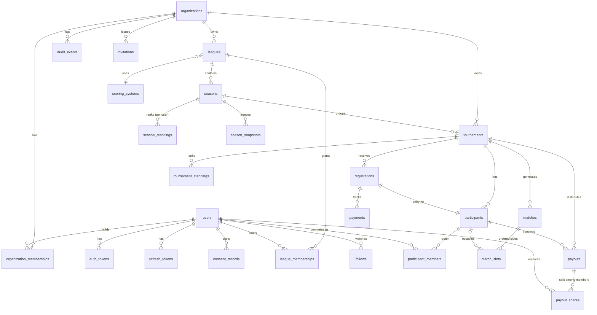

# TourneyHub — Data Model (PostgreSQL)

> **Status: `DRAFT — AWAITING OWNER REVIEW`.** No SQLAlchemy model or Alembic migration may be written until the owner flips this to `APPROVED` (see `CLAUDE.md` §5, gate G1). Review comments go inline as `<!-- REVIEW: ... -->` or in §11.
>
> Companion documents: [`PRD.md`](./PRD.md) (requirements the schema serves), [`ADR.md`](./ADR.md) (ADR-004 modular monolith, ADR-006 tenancy/RLS, ADR-009 schema conventions), [`ROADMAP.md`](./ROADMAP.md) (future modules whose seams are reserved here).

---

## 0. How to read this document

- Every table lists **columns**, **constraints**, **indexes**, and the **module** that owns it. A module may only write to its own tables (ADR-004); reads across modules go through the owning module's application service, never raw joins from another module.
- **Scope tags:** `MVP` = required for the MVP; `SEAM` = column/table exists at MVP only so a `ROADMAP.md` module can be added without a breaking migration; `V1`/`FUTURE` = *not* created at MVP, listed so reviewers can see the shape it will take.
- Type shorthand: `uuid` (v7, app-generated), `text`, `citext`, `int`, `bigint`, `bool`, `jsonb`, `tstz` = `timestamptz`.
- Requirement references (`FR-xxx`, `BR-xxx`, `NFR-xxx`) point into `PRD.md`.

## 1. Conventions (ADR-009)

| Concern | Rule |
|---|---|
| Naming | `snake_case`, plural table names, `<table>_id` FKs, `*_at` for timestamps, `*_minor` for money amounts. |
| Primary keys | `id uuid` — UUIDv7, generated in the application (time-ordered, index-friendly). Never `serial`. |
| Tenancy | Every tenant-scoped table has `organization_id uuid NOT NULL REFERENCES organizations(id)`. It is **immutable** after insert (trigger raises on change). Composite indexes lead with `organization_id`. Row-Level Security is enabled on every tenant-scoped table (ADR-006). |
| Time | `timestamptz` only, always UTC (NFR-022). `created_at NOT NULL DEFAULT now()`, `updated_at NOT NULL DEFAULT now()` maintained by the ORM. |
| Enumerations | `text` + `CHECK (col IN (...))`. No native PG enums (adding a value would need `ALTER TYPE`; a CHECK is a plain migration). Values are `snake_case`. |
| Money | `amount_minor bigint` + `currency char(3)` (ISO-4217 upper-case). No `numeric`, `float`, `double` anywhere (BR-008). |
| Optimistic concurrency | `version int NOT NULL DEFAULT 1` on every mutable aggregate root; incremented on each write; exposed as `ETag` (NFR-023, ADR-003). |
| Soft delete | `deleted_at tstz NULL` on organizations, users, leagues, tournaments. Default queries exclude soft-deleted rows. Hard purge by retention job. |
| Config blobs | `jsonb` with a versioned shape (`{"v": 1, ...}`), validated by a Pydantic schema in the owning module. Never queried by key in hot paths. |
| Derived state | Standings/payouts are **persisted derived state**, always reproducible by the pure recompute function (ADR-002). They never become a source of truth. |
| Audit | Before/after JSON for security/finance/admin mutations goes to `audit_events` (tenant) or `platform_audit_events` (global). Result edit history relies on audit rows, not a separate history table. |
| Extensions | `citext` (case-insensitive emails/slugs), `pgcrypto` not required (hashing happens in app). |

## 2. Module ownership map

| Module | Tables owned | Depends on (reads via services) |
|---|---|---|
| `platform` | `organizations`, `organization_memberships`, `audit_events`, `platform_audit_events`, `outbox_events`, `notification_deliveries`, `idempotency_keys` | — |
| `identity` | `users`, `auth_tokens`, `refresh_tokens`, `consent_records` | `platform` |
| `invitations` | `invitations`, `follows` | `platform`, `identity`, `leagues`, `tournaments` |
| `leagues` | `leagues`, `league_memberships`, `seasons`, `scoring_systems`, `season_standings`, `season_snapshots` | `platform`, `identity` |
| `tournaments` | `tournaments`, `participants`, `participant_members`, `registrations`, `matches`, `match_slots`, `tournament_standings` | `leagues`, `identity`, `platform` |
| `finance` | `payments`, `payouts`, `payout_shares` | `tournaments`, `identity`, `platform` |
| `realtime` | *(none — Redis pub/sub + `outbox_events`)* | `platform` |
| `reporting` (V1) | *(views only)* | all |

## 3. Entity-relationship overview



## 4. Platform module

### 4.1 `organizations` — tenant root `MVP`

| Column | Type | Constraints | Notes |
|---|---|---|---|
| id | uuid | PK | |
| name | text | NOT NULL, len 2..80 | |
| slug | citext | NOT NULL, UNIQUE, `^[a-z0-9](?:[a-z0-9-]{1,61}[a-z0-9])?$` | Used in public URLs. |
| state | text | NOT NULL, CHECK IN (`active`,`suspended`,`archived`) | PRD §10.9. Deleted = `deleted_at`. |
| plan | text | NOT NULL DEFAULT `'free'` | `SEAM` for entitlements (FR-156, ROADMAP M-ENT). Not enforced at MVP. |
| branding | jsonb | NULL | `SEAM` for white-label (ROADMAP M-BRAND). Unused at MVP. |
| settings | jsonb | NOT NULL DEFAULT `'{"v":1}'` | Org defaults: default currency, default timezone, locale. |
| is_default | bool | NOT NULL DEFAULT false | Self-host seeded org. Partial unique index `WHERE is_default` (at most one). |
| version | int | NOT NULL DEFAULT 1 | |
| created_at / updated_at | tstz | NOT NULL | |
| deleted_at | tstz | NULL | |

Indexes: `UNIQUE(slug)`, `UNIQUE(is_default) WHERE is_default`, `(state)`.
Not tenant-scoped itself (it *is* the tenant). Platform-admin only for list/suspend (FR-155).

### 4.2 `organization_memberships` `MVP`

| Column | Type | Constraints | Notes |
|---|---|---|---|
| id | uuid | PK | |
| organization_id | uuid | NOT NULL FK | |
| user_id | uuid | NOT NULL FK users | |
| role | text | NOT NULL CHECK IN (`owner`,`member`) | `admin` reserved as a future value (widen CHECK). |
| state | text | NOT NULL CHECK IN (`active`,`removed`) DEFAULT `active` | Keep row for audit when removed. |
| created_at / updated_at | tstz | | |

Constraints: `UNIQUE(organization_id, user_id)`.
Indexes: `(user_id)` (resolve a user's orgs), `(organization_id, role) WHERE state='active'`.
Invariant BR-013 (≥1 `owner` per org) is enforced in the application service + a deferred constraint trigger `org_has_owner()` that raises if a transaction would leave an active org with zero active owners. <!-- REVIEW: trigger vs app-only? Recommend both (belt and braces). -->

### 4.3 `audit_events` — tenant-scoped, append-only `MVP`

| Column | Type | Constraints | Notes |
|---|---|---|---|
| id | uuid | PK | |
| organization_id | uuid | NOT NULL FK | |
| actor_user_id | uuid | NULL FK users | NULL = system job. |
| actor_kind | text | NOT NULL CHECK IN (`user`,`system`,`platform_admin`) | |
| action | text | NOT NULL | Stable dotted key e.g. `match.result_overridden`, `payout.approved`. Catalog lives in `spec/audit-actions.md` (created with the first audit slice). |
| target_type | text | NOT NULL | Table name of the aggregate. |
| target_id | uuid | NOT NULL | |
| before | jsonb | NULL | |
| after | jsonb | NULL | |
| metadata | jsonb | NULL | Reason, warnings, correlation id. |
| ip | inet | NULL | Purged by retention job (A-014). |
| user_agent | text | NULL | |
| occurred_at | tstz | NOT NULL DEFAULT now() | |

Indexes: `(organization_id, occurred_at DESC)`, `(organization_id, target_type, target_id, occurred_at DESC)`.
`UPDATE`/`DELETE` revoked from the app role (FR-121). Retention purge runs as a privileged job.

### 4.4 `platform_audit_events` — global, append-only `MVP`

Same columns as 4.3 **without** `organization_id`, plus `organization_id_ref uuid NULL` (informational, no FK, no RLS) for events *about* an org (suspend/reactivate, bootstrap admin, user ban). Kept separate so `audit_events` can stay strictly non-null-tenant (NFR-004).

### 4.5 `outbox_events` — transactional outbox `MVP`

| Column | Type | Constraints | Notes |
|---|---|---|---|
| id | uuid | PK | |
| organization_id | uuid | NULL FK | NULL only for identity-level events (verification email, reset). Realtime fan-out **must** filter by org. |
| aggregate_type | text | NOT NULL | e.g. `tournament` |
| aggregate_id | uuid | NOT NULL | |
| aggregate_version | int | NOT NULL | Monotonic per aggregate → dedup key (ADR-002 §3). |
| event_type | text | NOT NULL | e.g. `tournament.match_result_recorded` |
| payload | jsonb | NOT NULL | |
| occurred_at | tstz | NOT NULL DEFAULT now() | |
| published_at | tstz | NULL | |
| attempts | int | NOT NULL DEFAULT 0 | |
| next_attempt_at | tstz | NOT NULL DEFAULT now() | Exponential backoff. |
| last_error | text | NULL | |

Constraints: `UNIQUE(aggregate_type, aggregate_id, aggregate_version, event_type)`.
Indexes: `(next_attempt_at) WHERE published_at IS NULL` (relay poll with `FOR UPDATE SKIP LOCKED`).
Published rows older than 7 days are deleted by the retention job.

### 4.6 `notification_deliveries` `MVP`

| Column | Type | Constraints | Notes |
|---|---|---|---|
| id | uuid | PK | |
| outbox_event_id | uuid | NOT NULL FK | Dedup: one delivery per (event, channel, recipient). |
| organization_id | uuid | NULL FK | Mirrors outbox. |
| channel | text | NOT NULL CHECK IN (`email`) | More channels = widen CHECK (ROADMAP M-NOTIF). |
| recipient | text | NOT NULL | Email address at send time (purged on erasure → `[redacted]`). |
| template | text | NOT NULL | e.g. `invitation.league` |
| status | text | NOT NULL CHECK IN (`queued`,`sent`,`failed`,`bounced`) | |
| provider | text | NOT NULL | `smtp` \| `resend` \| `postmark` \| ... |
| provider_message_id | text | NULL | |
| attempts | int | NOT NULL DEFAULT 0 | |
| last_error | text | NULL | |
| sent_at | tstz | NULL | |
| created_at | tstz | NOT NULL | |

Constraints: `UNIQUE(outbox_event_id, channel, recipient)`.

### 4.7 `idempotency_keys` `MVP`

| Column | Type | Constraints | Notes |
|---|---|---|---|
| id | uuid | PK | |
| user_id | uuid | NOT NULL FK users | Scope of the key. |
| organization_id | uuid | NULL FK | Set for tenant-scoped endpoints. |
| idempotency_key | text | NOT NULL | Client-supplied header. |
| request_hash | text | NOT NULL | SHA-256 of method+path+body; mismatch → 422 `idempotency_key_reused`. |
| response_status | int | NOT NULL | |
| response_body | jsonb | NULL | Replayed verbatim. |
| created_at | tstz | NOT NULL | |
| expires_at | tstz | NOT NULL | 24 h. |

Constraints: `UNIQUE(user_id, idempotency_key)`.

## 5. Identity module (global, not tenant-scoped)

### 5.1 `users` `MVP`

| Column | Type | Constraints | Notes |
|---|---|---|---|
| id | uuid | PK | |
| email | citext | NULL, UNIQUE | NULL after erasure (tombstone). |
| email_verified_at | tstz | NULL | BR-009 gate = `IS NOT NULL`. |
| password_hash | text | NULL | Argon2id PHC string. NULL after erasure. |
| state | text | NOT NULL CHECK IN (`pending_verification`,`active`,`inactive`,`suspended`,`banned`,`deleted`) | FR-010, PRD §10.8. |
| display_name | text | NOT NULL, len 2..40 | `"Deleted player #<short-id>"` after erasure. |
| avatar_url | text | NULL | |
| bio | text | NULL, len ≤ 500 | |
| locale | text | NOT NULL DEFAULT `'en'` | BCP-47. |
| timezone | text | NOT NULL DEFAULT `'UTC'` | IANA name. |
| profile_visibility | text | NOT NULL CHECK IN (`public`,`members_only`,`private`) DEFAULT `public` | FR-135. |
| is_platform_admin | bool | NOT NULL DEFAULT false | InstanceAdmin / platform operator (FR-009). ≥1 enforced in app (FR-009c). |
| bootstrap_source | text | NULL CHECK IN (`env`,`token`,`first_user`,`granted`) | How platform admin was obtained (FR-009c audit). |
| last_login_at | tstz | NULL | Drives `inactive` flag (V1, FR-013). |
| failed_login_count | int | NOT NULL DEFAULT 0 | Lockout/backoff (NFR-009). |
| locked_until | tstz | NULL | |
| anonymized_at | tstz | NULL | Erasure executed (FR-130). Irreversible. |
| version | int | NOT NULL DEFAULT 1 | |
| created_at / updated_at | tstz | | |
| deleted_at | tstz | NULL | Soft-delete request time; purge job hard-anonymizes after grace (A-014). |

Indexes: `UNIQUE(email)`, `(state)`, `(is_platform_admin) WHERE is_platform_admin`.
Constraint: `CHECK (state <> 'deleted' OR anonymized_at IS NOT NULL OR deleted_at IS NOT NULL)`.

### 5.2 `auth_tokens` — single-use, time-limited `MVP`

| Column | Type | Constraints | Notes |
|---|---|---|---|
| id | uuid | PK | |
| user_id | uuid | NOT NULL FK | |
| purpose | text | NOT NULL CHECK IN (`email_verification`,`password_reset`,`email_change`) | |
| token_hash | text | NOT NULL, UNIQUE | SHA-256 of the random token; raw token only in the email. |
| expires_at | tstz | NOT NULL | Verification 24 h, reset 1 h. |
| consumed_at | tstz | NULL | Single use (FR-005). |
| created_at | tstz | NOT NULL | |
| metadata | jsonb | NULL | e.g. new email for `email_change`. |

Indexes: `(user_id, purpose) WHERE consumed_at IS NULL`.

### 5.3 `refresh_tokens` — rotating families `MVP`

| Column | Type | Constraints | Notes |
|---|---|---|---|
| id | uuid | PK | |
| user_id | uuid | NOT NULL FK | |
| family_id | uuid | NOT NULL | One family per login; reuse of a rotated token revokes the whole family. |
| token_hash | text | NOT NULL, UNIQUE | |
| expires_at | tstz | NOT NULL | 30 d sliding. |
| revoked_at | tstz | NULL | |
| replaced_by_id | uuid | NULL FK self | |
| ip | inet | NULL | Purged on erasure. |
| user_agent | text | NULL | |
| created_at | tstz | NOT NULL | |

Indexes: `(user_id) WHERE revoked_at IS NULL`, `(family_id)`.

### 5.4 `consent_records` `MVP`

| Column | Type | Constraints | Notes |
|---|---|---|---|
| id | uuid | PK | |
| user_id | uuid | NOT NULL FK | |
| policy_kind | text | NOT NULL CHECK IN (`privacy_policy`,`terms`) | |
| policy_version | text | NOT NULL | e.g. `2026-09-01`. |
| accepted_at | tstz | NOT NULL | |
| ip | inet | NULL | |

Constraints: `UNIQUE(user_id, policy_kind, policy_version)`. Rows survive erasure with `ip` nulled (legal proof of consent).

## 6. Invitations module

### 6.1 `invitations` `MVP`

One table for both league invitations (FR-014) and team roster invitations (FR-044), discriminated by `scope_type`.

| Column | Type | Constraints | Notes |
|---|---|---|---|
| id | uuid | PK | |
| organization_id | uuid | NOT NULL FK | |
| scope_type | text | NOT NULL CHECK IN (`league`,`roster`) | |
| league_id | uuid | NULL FK leagues | Required when `scope_type='league'`. |
| participant_id | uuid | NULL FK participants | Required when `scope_type='roster'`. |
| role | text | NOT NULL CHECK IN (`organizer`,`player`,`member`) | League role, or `member` for roster. Immutable post-issue (PRD §14). |
| kind | text | NOT NULL CHECK IN (`email`,`link`) | Shareable link invites have no email. |
| email | citext | NULL | Required for `kind='email'`. |
| invitee_user_id | uuid | NULL FK users | Resolved on signup/accept (FR-017). |
| token_hash | text | NOT NULL UNIQUE | |
| state | text | NOT NULL CHECK IN (`pending`,`accepted`,`declined`,`revoked`,`expired`) | FR-015. |
| expires_at | tstz | NOT NULL | Default now()+14 d (A-005). |
| max_acceptances | int | NULL | `SEAM` for multi-use links (FR-018, V1). |
| acceptance_count | int | NOT NULL DEFAULT 0 | |
| created_by_user_id | uuid | NOT NULL FK users | |
| responded_by_user_id | uuid | NULL FK users | |
| created_at / responded_at | tstz | | |

Constraints: `CHECK ((scope_type='league') = (league_id IS NOT NULL))`, `CHECK ((scope_type='roster') = (participant_id IS NOT NULL))`, `CHECK (kind<>'email' OR email IS NOT NULL)`.
Indexes: `(organization_id, league_id, state)`, `(email) WHERE state='pending'`, `(invitee_user_id) WHERE state='pending'`.

### 6.2 `follows` `MVP` (FR-028b)

| Column | Type | Constraints | Notes |
|---|---|---|---|
| id | uuid | PK | |
| organization_id | uuid | NOT NULL FK | Org of the followed target. |
| user_id | uuid | NOT NULL FK users | |
| target_type | text | NOT NULL CHECK IN (`league`,`tournament`) | |
| target_id | uuid | NOT NULL | Polymorphic (no FK); cleaned by owning module on delete. |
| created_at | tstz | NOT NULL | |

Constraints: `UNIQUE(user_id, target_type, target_id)`. Index `(user_id)`.
<!-- REVIEW: polymorphic target without FK is a deliberate trade-off; alternative is two nullable FK columns with a CHECK. -->

## 7. Leagues module

### 7.1 `leagues` `MVP`

| Column | Type | Constraints | Notes |
|---|---|---|---|
| id | uuid | PK | |
| organization_id | uuid | NOT NULL FK | |
| name | text | NOT NULL, len 2..80 | |
| slug | citext | NOT NULL | Public URL `/o/{org}/l/{league}`. |
| description | text | NULL, ≤ 2000 | Sanitized on output (XSS). |
| discipline_name | text | NULL | Default for tournaments in this league (A-019). |
| visibility | text | NOT NULL CHECK IN (`public`,`unlisted`,`private`) | FR-026. |
| join_policy | text | NOT NULL CHECK IN (`open`,`approval`,`invite_only`) DEFAULT `invite_only` | FR-023 "if allowed". |
| scoring_system_id | uuid | NOT NULL FK scoring_systems | FR-025. |
| state | text | NOT NULL CHECK IN (`active`,`archived`) | PRD §10.6; deleted = `deleted_at`. |
| settings | jsonb | NOT NULL DEFAULT `'{"v":1}'` | Default `team_size`, `result_model`, timezone, etc. |
| version | int | NOT NULL DEFAULT 1 | |
| created_at / updated_at | tstz | | |
| deleted_at | tstz | NULL | |

Constraints: `UNIQUE(organization_id, slug)`.
Indexes: `(organization_id, state)`, `(visibility) WHERE visibility='public' AND deleted_at IS NULL` (discovery, FR-026a).
**League owner** is *not* a column: it is the unique `league_memberships` row with `role='owner'` (single source of truth, BR-001).

### 7.2 `league_memberships` `MVP`

| Column | Type | Constraints | Notes |
|---|---|---|---|
| id | uuid | PK | |
| organization_id | uuid | NOT NULL FK | |
| league_id | uuid | NOT NULL FK | |
| user_id | uuid | NOT NULL FK users | |
| role | text | NOT NULL CHECK IN (`owner`,`organizer`,`player`) | FR-007. Spectator is not a role (FR-028a). `viewer` reserved (ROADMAP). |
| state | text | NOT NULL CHECK IN (`active`,`left`,`removed`) | Keep history (FR-032). |
| joined_at | tstz | NOT NULL | |
| left_at | tstz | NULL | |
| created_at / updated_at | tstz | | |

Constraints: `UNIQUE(league_id, user_id)`; `UNIQUE(league_id) WHERE role='owner' AND state='active'` (exactly one owner, BR-001).
Indexes: `(organization_id, user_id)`, `(league_id, role) WHERE state='active'`.

### 7.3 `seasons` `MVP`

| Column | Type | Constraints | Notes |
|---|---|---|---|
| id | uuid | PK | |
| organization_id | uuid | NOT NULL FK | |
| league_id | uuid | NOT NULL FK | |
| name | text | NOT NULL | |
| state | text | NOT NULL CHECK IN (`upcoming`,`active`,`closed`,`cancelled`) | PRD §10.7. |
| starts_at / ends_at | tstz | NULL | Informational. |
| activated_at / closed_at | tstz | NULL | |
| scoring_system_id | uuid | NULL FK | Override; NULL → league's. Frozen copy stored in snapshot at close. |
| version | int | NOT NULL DEFAULT 1 | |
| created_at / updated_at | tstz | | |

Constraints: `UNIQUE(league_id) WHERE state='active'` (BR-002 — the DB is the primary guard).
Indexes: `(organization_id, league_id, state)`.

### 7.4 `scoring_systems` `MVP`

| Column | Type | Constraints | Notes |
|---|---|---|---|
| id | uuid | PK | |
| organization_id | uuid | NOT NULL FK | Presets are code constants; creating a league copies a preset into an org-owned row. |
| name | text | NOT NULL | |
| preset_key | text | NULL | `chess` \| `football` \| `winner_takes_rank`; NULL = custom (V1 editing). |
| config | jsonb | NOT NULL | PRD §12.1 shape, validated by `ScoringConfig` schema. |
| version | int | NOT NULL DEFAULT 1 | |
| created_at / updated_at | tstz | | |

Indexes: `(organization_id)`.

### 7.5 `season_standings` — derived, per **user** `MVP` (FR-090a)

| Column | Type | Constraints | Notes |
|---|---|---|---|
| id | uuid | PK | |
| organization_id | uuid | NOT NULL FK | |
| season_id | uuid | NOT NULL FK | |
| user_id | uuid | NOT NULL FK users | Per-player (team points credited to each member). |
| rank | int | NOT NULL | Dense, total order. |
| points_milli | int | NOT NULL | Scoring points in thousandths (1 point = `1000`) — see note below. |
| played / wins / draws / losses / byes | int | NOT NULL DEFAULT 0 | |
| points_scored / points_conceded | int | NOT NULL DEFAULT 0 | For `score` result models. |
| tie_break_data | jsonb | NULL | Which tie-breaker resolved, values. |
| tie_broken_manually | bool | NOT NULL DEFAULT false | ADR-002 §4.3. |
| computed_at | tstz | NOT NULL | |
| source_version | int | NOT NULL | Season aggregate version at compute time. |

Constraints: `UNIQUE(season_id, user_id)`, `UNIQUE(season_id, rank)`.
**Points precision:** scoring points can be fractional (chess ½), so `points_milli` stores **thousandths** (1 point = `1000`). Integer arithmetic keeps ranking deterministic and byte-identical across Python, SQL and TypeScript. <!-- REVIEW: confirm thousandths vs numeric(9,3). Recommend integer. -->

### 7.6 `season_snapshots` — immutable at close `MVP` (FR-091, BR-003)

| Column | Type | Constraints | Notes |
|---|---|---|---|
| id | uuid | PK | |
| organization_id | uuid | NOT NULL FK | |
| season_id | uuid | NOT NULL FK, UNIQUE | One snapshot per closed season. |
| scoring_config | jsonb | NOT NULL | Frozen config used. |
| standings | jsonb | NOT NULL | Array of `season_standings` rows incl. display names at close. |
| taken_at | tstz | NOT NULL | |

`UPDATE`/`DELETE` revoked from the app role.

## 8. Tournaments module

### 8.1 `tournaments` `MVP`

| Column | Type | Constraints | Notes |
|---|---|---|---|
| id | uuid | PK | |
| organization_id | uuid | NOT NULL FK | |
| league_id | uuid | NULL FK leagues | NULL = standalone (FR-040). |
| season_id | uuid | NULL FK seasons | Requires `league_id`. |
| name | text | NOT NULL, len 2..80 | |
| slug | citext | NOT NULL | Public URL `/o/{org}/t/{slug}`. |
| description | text | NULL | |
| visibility | text | NOT NULL CHECK IN (`public`,`unlisted`,`private`) | Copied from league on create; standalone sets its own. |
| discipline_name | text | NOT NULL | Free text (A-019). `discipline_id uuid NULL` `SEAM` for catalog (ROADMAP M-DISC). |
| result_model | text | NOT NULL CHECK IN (`winner`,`score`) | `placement` is FUTURE (FR-040b/040d). |
| score_config | jsonb | NULL | `{"v":1,"min":0,"max":null,"allow_draws":false}`; required when `result_model='score'`. |
| best_of | int | NULL CHECK (best_of IS NULL OR best_of BETWEEN 1 AND 99) | Informational (FR-040c). |
| result_entry_mode | text | NOT NULL CHECK IN (`organizer`,`player_self_report`) DEFAULT `organizer` | FR-051. |
| confirm_timeout_seconds | int | NULL | Self-report window (FR-051a). |
| auto_confirm_on_timeout | bool | NOT NULL DEFAULT false | Opt-in (FR-051a). |
| format_type | text | NOT NULL | Registry key: `single_elimination` \| `round_robin` (FR-041). New formats = new key, no schema change (FR-042). |
| format_config | jsonb | NOT NULL DEFAULT `'{"v":1}'` | e.g. `{"third_place_match": true}` / `{"double_round": false}`. |
| team_size | int | NOT NULL CHECK (team_size BETWEEN 1 AND 10) | FR-040a. |
| seeding_method | text | NOT NULL CHECK IN (`random`,`manual`) DEFAULT `random` | `ranking` is V1 (widen CHECK). |
| rng_seed | uuid | NOT NULL | Generated once at create; immutable (NFR-018, ADR-002 §4). |
| state | text | NOT NULL CHECK IN (`draft`,`registration_open`,`registration_closed`,`seeded`,`in_progress`,`completed`,`cancelled`) | PRD §10.1. |
| registration_opens_at / registration_closes_at | tstz | NULL | FR-043. |
| capacity | int | NULL CHECK (capacity >= 2) | FR-043; overflow → waitlist. |
| scoring_system_id | uuid | NULL FK | Round-robin standings config; NULL → league's. App rule: standalone round-robin requires one. |
| currency | char(3) | NULL | Required if `entry_fee_minor` set (BR-007). |
| entry_fee_minor | bigint | NULL CHECK (>= 0) | FR-070. |
| fee_config | jsonb | NULL | `{"v":1,"kind":"percentage","value_bp":1000}` **or** `{"kind":"fixed","amount_minor":2500}` — never both (BR-006). `value_bp` = basis points. |
| prize_config | jsonb | NULL | `{"v":1,"preset":"70_20_10"}` or `{"distribution_bp":[7000,2000,1000]}` (FR-073). |
| started_at / completed_at / cancelled_at | tstz | NULL | |
| cancel_reason | text | NULL | FR-056. |
| bracket_generated_at | tstz | NULL | BR-011 guard. |
| version | int | NOT NULL DEFAULT 1 | Also the realtime `aggregate_version`. |
| created_by_user_id | uuid | NOT NULL FK users | |
| created_at / updated_at | tstz | | |
| deleted_at | tstz | NULL | |

Constraints: `UNIQUE(organization_id, slug)`; `CHECK (season_id IS NULL OR league_id IS NOT NULL)`; `CHECK ((entry_fee_minor IS NULL) = (currency IS NULL))`; `CHECK (result_model <> 'score' OR score_config IS NOT NULL)`.
Indexes: `(organization_id, state)`, `(organization_id, league_id)`, `(season_id)`, `(visibility, state) WHERE visibility='public' AND deleted_at IS NULL`.

### 8.2 `participants` — competitor entry (decoupled from users) `MVP`

| Column | Type | Constraints | Notes |
|---|---|---|---|
| id | uuid | PK | |
| organization_id | uuid | NOT NULL FK | |
| tournament_id | uuid | NOT NULL FK | |
| display_name | text | NOT NULL | Team/pair name, or the player's display name snapshot at registration. Survives user erasure (R-010). |
| captain_user_id | uuid | NULL FK users | NULL after erasure with no remaining member (E-33 auto-transfer first). |
| state | text | NOT NULL CHECK IN (`incomplete`,`complete`,`withdrawn`) | FR-044a; `withdrawn` = FR-055. |
| seed | int | NULL CHECK (seed >= 1) | FR-046; set at `seeded`. |
| final_rank | int | NULL | Denormalized from standings at completion for cheap reads. |
| withdrawn_at | tstz | NULL | |
| version | int | NOT NULL DEFAULT 1 | |
| created_at / updated_at | tstz | | |

Constraints: `UNIQUE(tournament_id, seed)` (deferrable, for manual reorder).
Indexes: `(organization_id, tournament_id, state)`.

### 8.3 `participant_members` — roster `MVP`

| Column | Type | Constraints | Notes |
|---|---|---|---|
| id | uuid | PK | |
| organization_id | uuid | NOT NULL FK | |
| tournament_id | uuid | NOT NULL FK | Denormalized to enforce FR-045 with a unique index. |
| participant_id | uuid | NOT NULL FK | |
| user_id | uuid | NOT NULL FK users | |
| role | text | NOT NULL CHECK IN (`captain`,`member`) | Exactly one captain per participant (partial unique). |
| state | text | NOT NULL CHECK IN (`pending`,`accepted`,`declined`) | Pending until the invitee accepts the roster invite. |
| invited_at | tstz | NOT NULL | |
| responded_at | tstz | NULL | |

Constraints: `UNIQUE(tournament_id, user_id) WHERE state <> 'declined'` (BR-004/FR-045, E-30); `UNIQUE(participant_id) WHERE role='captain'`; `UNIQUE(participant_id, user_id)`.
Roster completeness (`count(accepted) = team_size`) is computed in the application when transitioning `participants.state` to `complete`; rosters lock at registration close.
On user erasure the row stays; identity is read via `users` tombstone (FR-130).

### 8.4 `registrations` — one per participant `MVP`

| Column | Type | Constraints | Notes |
|---|---|---|---|
| id | uuid | PK | |
| organization_id | uuid | NOT NULL FK | |
| tournament_id | uuid | NOT NULL FK | |
| participant_id | uuid | NOT NULL FK, UNIQUE | 1:1. |
| submitted_by_user_id | uuid | NULL FK users | Captain or organizer; NULL after erasure. |
| source | text | NOT NULL CHECK IN (`self`,`organizer`,`invite`) | |
| state | text | NOT NULL CHECK IN (`pending`,`confirmed`,`waitlisted`,`rejected`,`withdrawn`,`forfeited`) | PRD §10.3. |
| payment_status | text | NOT NULL CHECK IN (`none`,`pending`,`paid`,`refunded`,`waived`,`failed`) DEFAULT `none` | FR-071; derived from `payments`, denormalized for list views. |
| waitlist_position | int | NULL | E-16. |
| note | text | NULL | Organizer note. |
| version | int | NOT NULL DEFAULT 1 | |
| created_at / updated_at | tstz | | |
| confirmed_at / withdrawn_at | tstz | NULL | |

Indexes: `(organization_id, tournament_id, state)`, `(tournament_id, waitlist_position) WHERE state='waitlisted'`.

### 8.5 `matches` `MVP`

Competitors live in `match_slots` (ordered sides) so an N-slot free-for-all is additive (FR-040d).

| Column | Type | Constraints | Notes |
|---|---|---|---|
| id | uuid | PK | |
| organization_id | uuid | NOT NULL FK | |
| tournament_id | uuid | NOT NULL FK | |
| round | int | NOT NULL CHECK (round >= 1) | |
| position | int | NOT NULL CHECK (position >= 1) | Slot within the round (test-vector `slot`). |
| label | text | NULL | `R1M2`, `Final`, `3rd place`. |
| kind | text | NOT NULL CHECK IN (`standard`,`third_place`) DEFAULT `standard` | E-27. |
| state | text | NOT NULL CHECK IN (`pending`,`ready`,`in_progress`,`awaiting_confirmation`,`completed`) | PRD §10.2. Walkover = `completed` + `result_kind='walkover'`. |
| result_kind | text | NULL CHECK IN (`played`,`forfeit`,`walkover`) | NULL until a result exists. |
| winner_slot_no | smallint | NULL CHECK IN (1,2) | NULL on draw or no result. |
| is_draw | bool | NOT NULL DEFAULT false | BR-109. |
| next_match_id | uuid | NULL FK matches | Winner advances here … |
| next_match_slot_no | smallint | NULL | … into this slot. |
| loser_next_match_id | uuid | NULL FK matches | For 3rd-place match (E-27) and future double-elim. |
| loser_next_match_slot_no | smallint | NULL | |
| scheduled_at | tstz | NULL | FR-049. |
| venue_label | text | NULL | Table/board/court. |
| result_submitted_by_user_id | uuid | NULL FK users | Self-report author (FR-051a). |
| result_submitted_at | tstz | NULL | |
| confirmation_due_at | tstz | NULL | `submitted_at + confirm_timeout`. |
| disputed_at | tstz | NULL | |
| dispute_reason | text | NULL | |
| completed_at | tstz | NULL | |
| version | int | NOT NULL DEFAULT 1 | ETag for `If-Match`. |
| created_at / updated_at | tstz | | |

Constraints: `UNIQUE(tournament_id, round, position, kind)`; `CHECK (NOT is_draw OR winner_slot_no IS NULL)`.
Indexes: `(organization_id, tournament_id, round)`, `(tournament_id, state)`.

### 8.6 `match_slots` — ordered sides `MVP`

| Column | Type | Constraints | Notes |
|---|---|---|---|
| id | uuid | PK | |
| organization_id | uuid | NOT NULL FK | |
| match_id | uuid | NOT NULL FK | |
| slot_no | smallint | NOT NULL CHECK (slot_no >= 1) | MVP always 1 and 2. |
| participant_id | uuid | NULL FK participants | NULL = TBD (feeder unresolved) or BYE (`is_bye`). |
| is_bye | bool | NOT NULL DEFAULT false | |
| source_match_id | uuid | NULL FK matches | Feeder match. |
| source_kind | text | NULL CHECK IN (`winner`,`loser`) | |
| seed_at_generation | int | NULL | Audit of what seed filled the slot. |
| score | int | NULL | For `result_model='score'`; aggregate for best-of-N. |
| is_forfeit | bool | NOT NULL DEFAULT false | Which side forfeited (FR-054). |
| placement | int | NULL | `SEAM` for free-for-all (FUTURE). |

Constraints: `UNIQUE(match_id, slot_no)`; `CHECK (NOT is_bye OR participant_id IS NULL)`.
Indexes: `(participant_id)` (player schedule), `(source_match_id)`.

### 8.7 `tournament_standings` — derived, per participant `MVP`

| Column | Type | Constraints | Notes |
|---|---|---|---|
| id | uuid | PK | |
| organization_id | uuid | NOT NULL FK | |
| tournament_id | uuid | NOT NULL FK | |
| participant_id | uuid | NOT NULL FK | |
| rank | int | NOT NULL | Dense. Single-elim: by elimination round (+ 3rd place). |
| points_milli | int | NOT NULL DEFAULT 0 | Round-robin points (thousandths). |
| played / wins / draws / losses / byes | int | NOT NULL DEFAULT 0 | |
| points_scored / points_conceded | int | NOT NULL DEFAULT 0 | |
| tie_break_data | jsonb | NULL | |
| tie_broken_manually | bool | NOT NULL DEFAULT false | |
| computed_at | tstz | NOT NULL | |
| source_version | int | NOT NULL | Tournament version at compute. |

Constraints: `UNIQUE(tournament_id, participant_id)`, `UNIQUE(tournament_id, rank)`.

## 9. Finance module

### 9.1 `payments` — money in (manual ledger at MVP) `MVP`

| Column | Type | Constraints | Notes |
|---|---|---|---|
| id | uuid | PK | |
| organization_id | uuid | NOT NULL FK | |
| tournament_id | uuid | NOT NULL FK | |
| registration_id | uuid | NOT NULL FK | |
| amount_minor | bigint | NOT NULL CHECK (>= 0) | |
| currency | char(3) | NOT NULL | Must equal tournament currency (BR-007). |
| status | text | NOT NULL CHECK IN (`pending`,`paid`,`waived`,`failed`,`refunded`) | PRD §10.4. |
| provider | text | NOT NULL DEFAULT `'manual'` | `PaymentProvider` key (FR-082). `stripe` etc. = V1 (ROADMAP M-PAY). |
| provider_ref | text | NULL | External id / receipt no. |
| recorded_by_user_id | uuid | NULL FK users | Organizer who recorded it. |
| paid_at | tstz | NULL | |
| note | text | NULL | |
| version | int | NOT NULL DEFAULT 1 | |
| created_at / updated_at | tstz | | |

Constraints: `UNIQUE(registration_id) WHERE status IN ('pending','paid','waived')` (one live payment per registration; `payment_already_recorded`).
Indexes: `(organization_id, tournament_id, status)`.
`refunds` table (partial refunds with reason) is **V1** (FR-076, ROADMAP M-PAY); at MVP `status='refunded'` is set with an audit row.

### 9.2 `payouts` — money out, per final standing `MVP`

| Column | Type | Constraints | Notes |
|---|---|---|---|
| id | uuid | PK | |
| organization_id | uuid | NOT NULL FK | |
| tournament_id | uuid | NOT NULL FK | |
| participant_id | uuid | NOT NULL FK | |
| rank | int | NOT NULL | |
| amount_minor | bigint | NOT NULL CHECK (>= 0) | Banker's rounding, remainder to top rank (BR-008). |
| currency | char(3) | NOT NULL | |
| status | text | NOT NULL CHECK IN (`calculated`,`approved`,`paid`,`voided`) | PRD §10.5. `approved`/`paid` rows are immutable (ADR-002 §1.4). |
| approved_by_user_id / approved_at | | NULL | |
| paid_at | tstz | NULL | BR-112: only after tournament `completed`. |
| voided_at | tstz | NULL | |
| replaced_by_payout_id | uuid | NULL FK self | Set when voided by recompute. |
| computation | jsonb | NOT NULL | Inputs: pool, distribution, rounding trace (auditability). |
| version | int | NOT NULL DEFAULT 1 | |
| created_at / updated_at | tstz | | |

Constraints: `UNIQUE(tournament_id, rank) WHERE status <> 'voided'`.
Indexes: `(organization_id, tournament_id, status)`.

### 9.3 `payout_shares` — per member split `MVP` (FR-075a)

| Column | Type | Constraints | Notes |
|---|---|---|---|
| id | uuid | PK | |
| organization_id | uuid | NOT NULL FK | |
| payout_id | uuid | NOT NULL FK | |
| user_id | uuid | NULL FK users | NULL after erasure (share stays for the ledger). |
| participant_member_id | uuid | NOT NULL FK | Stable link even when `user_id` is nulled. |
| amount_minor | bigint | NOT NULL CHECK (>= 0) | `floor(amount/team_size)`, remainder to captain. Σ shares = payout. |
| currency | char(3) | NOT NULL | |
| status | text | NOT NULL CHECK IN (`pending`,`paid`,`voided`) | |
| paid_at | tstz | NULL | |
| version | int | NOT NULL DEFAULT 1 | |
| created_at / updated_at | tstz | | |

Constraints: `UNIQUE(payout_id, participant_member_id)`.

## 10. Derived views (no tables)

- `v_player_statistics` (FR-093, P1): per `user_id` × scope (`overall`, `league_id`, `discipline_name`) → `played, wins, losses, draws`, computed from `match_slots` ⨝ `participant_members` ⨝ `matches WHERE state='completed'`. Materialize later if slow (R-004, V1 FR-096).
- `v_public_leagues` (FR-026a): `leagues` ⨝ `organizations` filtered `visibility='public' AND state='active' AND org.state='active'`. Suspended orgs are excluded (BR-014).

## 11. Row-Level Security (ADR-006)

Every table with `organization_id NOT NULL` gets:

```sql
ALTER TABLE <t> ENABLE ROW LEVEL SECURITY;
ALTER TABLE <t> FORCE ROW LEVEL SECURITY;
CREATE POLICY tenant_isolation ON <t>
  USING (organization_id = current_setting('app.current_org_id', true)::uuid);
```

- The API sets `SET LOCAL app.current_org_id = '<uuid>'` at the start of every tenant-scoped transaction (server-resolved, never from the client body).
- Public/anonymous reads (FR-028, FR-061) still run inside an org context resolved from the URL slug.
- Platform-admin and background jobs run with `app.current_org_id` set **per org they touch**; cross-org listing uses a separate `tourneyhub_admin` DB role with `BYPASSRLS`, used only by the admin listing endpoints and the retention job.
- `outbox_events`, `notification_deliveries`, `idempotency_keys` (nullable org) get the policy `organization_id IS NULL OR organization_id = current_org`.
- The **application-layer filter is still the primary guard** (every repository query goes through the tenant-scoped session); RLS is defense in depth so a forgotten `WHERE` cannot leak.

## 12. Migration plan

One Alembic history, revisions prefixed by module and named after the slice: `0001_platform_organizations`, `0002_identity_users`, `0003_leagues_core`, … Every migration is reversible. RLS policies live in the same migration that creates the table. A CI job applies all migrations to an empty Postgres 16 and then runs `alembic check` (no autogenerate drift).

## 13. Review checklist for the owner

- [ ] Two membership tables (`organization_memberships`, `league_memberships`) instead of the PRD's single `Membership` with nullable `league_id`. Accept?
- [ ] League owner and org owner derived from membership rows (no `owner_id` columns). Accept?
- [ ] `match_slots` as a separate table vs `participant_a_id`/`participant_b_id` columns. Accept the slot table (required by FR-040d)?
- [ ] `points_milli` integer thousandths for fractional scoring points. Accept?
- [ ] `platform_audit_events` split from `audit_events`. Accept?
- [ ] RLS as defense in depth (adds `SET LOCAL` per transaction and a `BYPASSRLS` role). Accept?
- [ ] Deferred-trigger for ≥1 org owner (BR-013). Accept trigger, or app-only?
- [ ] `follows.target_id` polymorphic without FK. Accept?
- [ ] `refunds` table postponed to V1 (status `refunded` only at MVP). Accept?
- [ ] Anything missing for a module you already know you want (see `ROADMAP.md` §3 reserved seams)?

Once all boxes are ticked, change the status line at the top to `APPROVED <date>` and commit.
