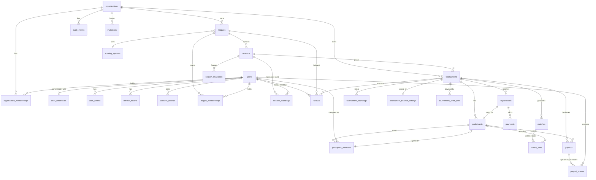

# TourneyHub — Data Model (PostgreSQL)

> **Status: `DRAFT — TWO REVIEW ROUNDS RESOLVED 2026-10-02, AWAITING OWNER SIGN-OFF`.** Round 1: 32 findings (§14). Round 2: a verification pass — documentation consistency plus every PostgreSQL claim tested empirically on 16 — which found one P0 and 13 further defects (§15). No SQLAlchemy model or Alembic migration may be written until the owner flips this to `APPROVED` (see `CLAUDE.md` §5, gate G1). New review comments go inline as `<!-- REVIEW: ... -->` or in §13.
>
> Companion documents: [`PRD.md`](./PRD.md) (requirements the schema serves), [`ADR.md`](./ADR.md) (ADR-004 modular monolith, ADR-006 tenancy/RLS, ADR-009 schema conventions), [`ROADMAP.md`](./ROADMAP.md) (future modules whose seams are reserved here).

---

## 0. How to read this document

- Every table lists **columns**, **constraints**, **indexes**, and the **module** that owns it. A module may only write to its own tables (ADR-004); reads across modules go through the owning module's application service, never raw joins from another module.
- **Scope tags:** `MVP` = required for the MVP; `SEAM` = column/table exists at MVP only so a `ROADMAP.md` module can be added without a breaking migration; `V1`/`FUTURE` = *not* created at MVP, listed so reviewers can see the shape it will take.
- Type shorthand: `uuid` (v7, app-generated), `text`, `citext`, `int`, `bigint`, `bool`, `jsonb`, `tstz` = `timestamptz`.
- Requirement references (`FR-xxx`, `BR-xxx`, `NFR-xxx`) point into `PRD.md`.

## 1. Conventions (ADR-009)

| Concern | Rule |
|---|---|
| Naming | `snake_case`, plural table names, `<table>_id` FKs, `*_at` for timestamps, `*_minor` for money amounts. |
| Primary keys | `id uuid` — UUIDv7, generated in the application via **`uuid-utils`** (`uuid.uuid7()` is stdlib only from Python 3.14). Never `serial`, and never a `DEFAULT gen_random_uuid()` — a DB-side default silently breaks the time ordering that cursor pagination relies on. |
| Tenancy | Every tenant-scoped table has `organization_id uuid NOT NULL`. It is **immutable** after insert (trigger raises on change). Tenant-scoped FKs are **composite** — they carry `organization_id` — so a cross-org row is structurally impossible (§1.1). Composite indexes lead with `organization_id`. Row-Level Security is enabled on every tenant-scoped table (§11, ADR-006). |
| Time | `timestamptz` only, always UTC (NFR-022). `created_at NOT NULL DEFAULT now()`, `updated_at NOT NULL DEFAULT now()` set by the ORM **and** backed by a `set_updated_at()` trigger, because retention jobs and redaction scripts bypass the ORM. |
| Enumerations | `text` + `CHECK (col IN (...))`. No native PG enums (adding a value would need `ALTER TYPE`; a CHECK is a plain migration). Values are `snake_case`. A test asserts every CHECK's value set equals the module's Python `StrEnum` (§12). |
| Money | `amount_minor bigint` + `currency text CHECK (currency ~ '^[A-Z]{3}$')` (ISO-4217 upper-case). No `char(n)` (blank-padded, surprising against `text` parameters), no `numeric`, `float` or `double` anywhere (BR-008). Money and basis points are **never** stored inside `jsonb` — `jsonb` enforces no type and decodes decimals to Python `float`. |
| Optimistic concurrency | `version int NOT NULL DEFAULT 1` on every mutable aggregate root, managed by SQLAlchemy `__mapper_args__ = {"version_id_col": ...}`; exposed as `ETag` (NFR-023, ADR-002). |
| Soft delete | `deleted_at tstz NULL` on organizations, users, leagues, tournaments. Default queries exclude soft-deleted rows. **Every unique constraint on a soft-deletable table is partial (`WHERE deleted_at IS NULL`)** so slugs and emails are released. Hard purge by retention job. |
| Config blobs | `jsonb` with a versioned shape (`{"v": 1, ...}`), validated by a Pydantic schema in the owning module. Never queried by key in hot paths. Permitted for format/UI settings only — never for money (see above). |
| Derived state | Standings/payouts are **persisted derived state**, always reproducible by the pure recompute function (ADR-002). They never become a source of truth. |
| Audit | Before/after JSON for security/finance/admin mutations goes to `audit_events` (tenant) or `platform_audit_events` (global). Result edit history relies on audit rows, not a separate history table. Append-only is enforced by a **trigger**, not by `REVOKE` — see §4.3. |
| Immutability | A single generic trigger function `forbid_column_update()`, parameterised through `TG_ARGV`, guards `organization_id` (all tenant tables), `tournaments.rng_seed`, `created_at`, and `payouts` rows in `approved`/`paid` (ADR-002 §2.1). |
| Extensions | `citext` (case-insensitive emails/slugs), `pgcrypto` not required (hashing happens in app). |
| Partitioning | Indexes, RLS policies, triggers and CHECK constraints declared on a partitioned parent **propagate** to every existing and future partition. **Privileges do not** — `GRANT`/`REVOKE` touch only the ACL of the table they name. Any guarantee on a partitioned table must therefore be a trigger or a policy, never a `REVOKE` (§4.3). |

### 1.1 Composite tenant foreign keys

Plain `child.parent_id → parent(id)` does **not** guarantee that child and parent share an organization; a bug or an `AdminSession` can stitch a row across tenants, and RLS then hides it from both. Every tenant-scoped parent therefore carries a redundant-looking unique key and every child references both columns:

```sql
ALTER TABLE tournaments ADD CONSTRAINT tournaments_id_org_key UNIQUE (id, organization_id);

ALTER TABLE matches ADD CONSTRAINT matches_tournament_fk
  FOREIGN KEY (tournament_id, organization_id)
  REFERENCES tournaments (id, organization_id) ON DELETE CASCADE;
```

The `(id, organization_id)` index is not waste: RLS means every query already filters on `organization_id`, so it doubles as a covering index.

**The rule implies a `UNIQUE (id, organization_id)` on every parent listed below**, and the referencing table cannot be created without it (`ERROR: there is no unique constraint matching given keys for referenced table`). The per-table Constraints lines do not repeat it; this sentence is its single declaration, and §12's schema-objects inventory is built from the list below.

Applied to (child → parent):

| Child | Parent(s) |
|---|---|
| `leagues`, `scoring_systems` | `organizations` |
| `seasons`, `league_memberships` | `leagues` |
| `tournaments` | `leagues`, `seasons` |
| `participants`, `registrations`, `matches`, `tournament_standings` | `tournaments` |
| `registrations`, `match_slots`, `tournament_standings`, `payouts` | `participants` |
| `match_slots` | `matches` |
| `matches` | `matches` (`next_match_id`, `loser_next_match_id`) |
| `participant_members` | `participants` |
| `invitations` | `leagues`, `participants` |
| `follows` | `leagues`, `tournaments` |
| `season_standings`, `season_snapshots` | `seasons` |
| `tournament_finance_settings`, `tournament_prize_tiers`, `payments`, `payouts` | `tournaments` |
| `payments` | `registrations` |
| `payout_shares` | `payouts`, `participant_members` |
| `payouts` | `payouts` (`replaced_by_payout_id`) |

## 2. Module ownership map

| Module | Tables owned | Depends on (reads via services) |
|---|---|---|
| `platform` | `organizations`, `organization_memberships`, `audit_events`, `platform_audit_events`, `outbox_events`, `notification_deliveries`, `idempotency_keys` | — |
| `identity` | `users`, `user_credentials`, `auth_tokens`, `refresh_tokens`, `consent_records` | `platform` |
| `invitations` | `invitations`, `follows` | `platform`, `identity`, `leagues`, `tournaments` |
| `leagues` | `leagues`, `league_memberships`, `seasons`, `scoring_systems`, `season_snapshots` | `platform`, `identity` |
| `tournaments` | `tournaments`, `participants`, `participant_members`, `registrations`, `matches`, `match_slots`, `tournament_standings`, **`season_standings`** | `leagues`, `identity`, `platform` |
| `finance` | `tournament_finance_settings`, `tournament_prize_tiers`, `payments`, `payouts`, `payout_shares` | `tournaments`, `identity`, `platform` |
| `realtime` | *(none — Redis pub/sub + `outbox_events`)* | `platform` |
| `reporting` (V1) | *(views only)* | all |

**Why `tournaments` owns `season_standings`** (not `leagues`, where the entity conceptually sits): ADR-002 §2.1 requires standings to be recomputed **synchronously inside the match-result write transaction**, and states the invariant `persisted_derived == recompute(source)` after *any* commit. Computing season standings from an outbox event would open a window in which that invariant is false and the admin integrity check reports false positives. `tournaments` already depends on `leagues` (DAG-legal) and holds the match data, so it writes both standings tables in one transaction. `GET /seasons/{id}/rankings` is therefore served by the `tournaments` module.

`season_snapshots` stays with `leagues`: it is produced when a season closes (a league operation) and is read from its own payload, never recomputed.

**Why `finance` owns the fee/prize tables:** the DAG is `tournaments ← finance`, so `finance` may read tournaments but `tournaments` may not read finance. Fee and prize configuration are finance data and live in finance-owned tables. The consequence is that a registration list showing payment state is a **finance** endpoint (`GET /tournaments/{id}/registrations?include=payment`) — `registrations` carries no denormalised payment column, because nobody could legally maintain it.

## 3. Entity-relationship overview



## 4. Platform module

### 4.1 `organizations` — tenant root `MVP`

| Column | Type | Constraints | Notes |
|---|---|---|---|
| id | uuid | PK | |
| name | text | NOT NULL, len 2..80 | |
| slug | citext | NOT NULL, `^[a-z0-9](?:[a-z0-9-]{0,61}[a-z0-9])?$` | Used in public URLs. `{0,61}` not `{1,61}`: the latter accepts lengths 1 and ≥3 but rejects two-character slugs. |
| state | text | NOT NULL, CHECK IN (`active`,`suspended`,`archived`) | PRD §10.9. Deleted = `deleted_at`. |
| plan | text | NOT NULL DEFAULT `'free'` | `SEAM` for entitlements (FR-156, ROADMAP M-ENT). Not enforced at MVP. |
| branding | jsonb | NULL | `SEAM` for white-label (ROADMAP M-BRAND). Unused at MVP. |
| settings | jsonb | NOT NULL DEFAULT `'{"v":1}'` | Org defaults: default currency, default timezone, locale. |
| is_default | bool | NOT NULL DEFAULT false | Self-host seeded org. Partial unique index `WHERE is_default` (at most one). |
| version | int | NOT NULL DEFAULT 1 | |
| created_at / updated_at | tstz | NOT NULL | |
| deleted_at | tstz | NULL | |

Indexes: `UNIQUE(slug) WHERE deleted_at IS NULL`, `UNIQUE(is_default) WHERE is_default`, `(state)`.

It *is* the tenant, so it carries no `organization_id` — but it still gets an RLS policy (`id = current_org`, §11.2), otherwise any tenant session could read the full list of tenants. **Creating** an organization is an ordinary self-service request (FR-150) and must stay on `tourneyhub_app`, so `organizations` carries a separate `FOR INSERT WITH CHECK (true)` policy: at creation time no tenant context exists yet and the founder is not a member. Who may create one (authenticated, verified email per BR-009, rate-limited) is an application-level decision, not an RLS one. Platform-admin only for list/suspend (FR-155).

### 4.2 `organization_memberships` `MVP`

| Column | Type | Constraints | Notes |
|---|---|---|---|
| id | uuid | PK | |
| organization_id | uuid | NOT NULL FK | |
| user_id | uuid | NOT NULL FK users | |
| role | text | NOT NULL CHECK IN (`owner`,`member`) | `admin` reserved as a future value (widen CHECK). |
| state | text | NOT NULL CHECK IN (`active`,`removed`) DEFAULT `active` | Keep row for audit when removed. |
| version | int | NOT NULL DEFAULT 1 | ETag for role changes — BR-013 is exactly the invariant where a race hurts. |
| created_at / updated_at | tstz | | |

Constraints: `UNIQUE(organization_id, user_id)`.
Indexes: `(user_id)` (resolve a user's orgs), `(organization_id, role) WHERE state='active'`.
Invariant BR-013 (≥1 `owner` per org) is enforced in the application service **and** by a deferred constraint trigger `org_has_owner()` that raises if a transaction would leave an active org with zero active owners. Belt and braces: the app gives the good error message, the trigger makes the leak impossible.

### 4.3 `audit_events` — tenant-scoped, append-only, partitioned `MVP`

| Column | Type | Constraints | Notes |
|---|---|---|---|
| id | uuid | part of PK | |
| organization_id | uuid | NOT NULL FK | |
| actor_user_id | uuid | NULL FK users | NULL = system job. |
| actor_kind | text | NOT NULL CHECK IN (`user`,`system`,`platform_admin`) | |
| action | text | NOT NULL | Stable dotted key e.g. `match.result_overridden`, `payout.approved`. Catalog lives in `spec/audit-actions.md` (created with the first audit slice). |
| target_type | text | NOT NULL | Table name of the aggregate. |
| target_id | uuid | NOT NULL | |
| before | jsonb | NULL | |
| after | jsonb | NULL | |
| metadata | jsonb | NULL | Reason, warnings, correlation id. |
| ip | inet | NULL | Purged by retention job (A-014). |
| user_agent | text | NULL | |
| occurred_at | tstz | NOT NULL DEFAULT now(), part of PK | |

```sql
CREATE TABLE audit_events (...) PARTITION BY RANGE (occurred_at);
-- PK must include the partition key:
PRIMARY KEY (id, occurred_at)
```

Monthly partitions. Partitioning is done in the first migration on purpose: converting later means rewriting the PK and moving data.

Indexes: `(organization_id, occurred_at DESC)`, `(organization_id, target_type, target_id, occurred_at DESC)` — declared once on the parent; Postgres creates a matching index on every existing **and future** partition automatically.

**Append-only is enforced by a trigger, not by `REVOKE` (FR-121, guardrail #12).** A `REVOKE UPDATE, DELETE` on a partitioned parent reaches only the parent's own ACL; each partition is a real table with its own privileges, and `ALTER DEFAULT PRIVILEGES` (§11.1) grants full DML on every partition at `CREATE TABLE … PARTITION OF` time. `UPDATE audit_events_2026_10 SET …` addressed straight at a partition would therefore succeed, and each new monthly partition would reopen the hole. Triggers, unlike privileges, do propagate:

```sql
CREATE FUNCTION audit_append_only() RETURNS trigger LANGUAGE plpgsql AS $$
BEGIN
  IF current_user <> 'tourneyhub_admin' THEN
    RAISE EXCEPTION 'audit_events is append-only (FR-121)' USING ERRCODE = '42501';
  END IF;
  RETURN COALESCE(NEW, OLD);
END $$;

CREATE TRIGGER audit_append_only BEFORE UPDATE OR DELETE ON audit_events
  FOR EACH ROW EXECUTE FUNCTION audit_append_only();
```

The role test is deliberate: A-014 requires the retention job to null `ip` after 365 days, which is an `UPDATE`, and triggers fire for superusers too (unlike RLS), so a blanket `RAISE` would lock out maintenance as well. `tourneyhub_app` is never granted membership in `tourneyhub_admin`, so it cannot reach the exempt branch. `DROP TABLE <partition>` is not DML and is unaffected.

**Partition lifecycle** (ADR-010 lists it as a worker job): the worker creates next month's partition ahead of time and drops partitions older than the audit horizon (`TOURNEYHUB_AUDIT_RETENTION_DAYS`, default 1095 — distinct from A-014's 365-day **PII** purge, which only nulls `ip`/`user_agent` in place). Creating and dropping a partition is DDL on an owned table, so this job connects as the **migrator** role, not `tourneyhub_admin`; the PII purge runs as `tourneyhub_admin`.

### 4.4 `platform_audit_events` — global, append-only `MVP`

Same columns as 4.3 **without** `organization_id`, plus `organization_id_ref uuid NULL` (informational, no FK, no RLS) for events *about* an org (suspend/reactivate, bootstrap admin, user ban). Kept separate so `audit_events` can stay strictly non-null-tenant (NFR-004). Also partitioned monthly, and it gets its own `audit_append_only` trigger for the same reason (§4.3).

### 4.5 `outbox_events` — transactional outbox `MVP`

| Column | Type | Constraints | Notes |
|---|---|---|---|
| id | uuid | PK | UUIDv7 → time-ordered cursor for the relay. |
| organization_id | uuid | NULL FK | NULL only for identity-level events (verification email, reset). Realtime fan-out **must** filter by org. |
| aggregate_type | text | NOT NULL | e.g. `tournament` |
| aggregate_id | uuid | NOT NULL | |
| aggregate_version | int | NOT NULL | Monotonic per aggregate → dedup key (ADR-002 §2.3). |
| event_type | text | NOT NULL | e.g. `tournament.match_result_recorded` |
| payload | jsonb | NOT NULL | |
| occurred_at | tstz | NOT NULL DEFAULT now() | |
| published_at | tstz | NULL | |
| attempts | int | NOT NULL DEFAULT 0 | |
| next_attempt_at | tstz | NOT NULL DEFAULT now() | Exponential backoff. |
| last_error | text | NULL | |

Constraints: `UNIQUE(aggregate_type, aggregate_id, aggregate_version, event_type)`.
Indexes: `(next_attempt_at) WHERE published_at IS NULL` (relay poll with `FOR UPDATE SKIP LOCKED`).

**Invariant — every outbox emission must bump the aggregate's `version`.** Two events of the same type written for the same aggregate at the same version collide on the unique constraint and abort the whole write transaction. The version bump is not optional bookkeeping; it is what makes the dedup key work.

**Privileges.** `tourneyhub_app` holds `INSERT` only — no `SELECT`. The relay reads and stamps rows as `tourneyhub_admin`. Reason: with a nullable `organization_id`, a tenant-readable outbox would expose every identity event (and its payload) to every tenant.

**Retention.** Published rows are deleted after 7 days — one rule for every event type.

**Raw tokens are scrubbed, not deleted.** A verification or reset email needs the raw token, which is why it cannot be stored hashed, so it travels in the payload. The relay removes it the moment the send succeeds:

```sql
UPDATE outbox_events SET payload = payload - 'token', published_at = now() WHERE id = $1;
```

The window in which a usable token sits in the database is therefore seconds, and `tourneyhub_app` has no `SELECT` here at all. Deleting the whole row instead would be blocked by `notification_deliveries.outbox_event_id` (`NOT NULL FK`), and cascading the delete would destroy the delivery record — i.e. the dedup key and the failure visibility NFR-025 asks for, which is the very thing D12's `[redacted]:{id}` scheme exists to preserve.

### 4.6 `notification_deliveries` `MVP`

| Column | Type | Constraints | Notes |
|---|---|---|---|
| id | uuid | PK | |
| outbox_event_id | uuid | NOT NULL FK | Dedup: one delivery per (event, channel, recipient). |
| organization_id | uuid | NULL FK | Mirrors outbox. |
| channel | text | NOT NULL CHECK IN (`email`) | More channels = widen CHECK (ROADMAP M-NOTIF). |
| recipient | text | NOT NULL | Email address at send time. On erasure rewritten to `[redacted]:{id}` — the id suffix keeps two redacted deliveries of the same event from colliding on the unique constraint. |
| template | text | NOT NULL | e.g. `invitation.league` |
| status | text | NOT NULL CHECK IN (`queued`,`sent`,`failed`,`bounced`) | |
| provider | text | NOT NULL | `smtp` \| `resend` \| `postmark` \| ... |
| provider_message_id | text | NULL | |
| attempts | int | NOT NULL DEFAULT 0 | |
| last_error | text | NULL | |
| sent_at | tstz | NULL | |
| created_at | tstz | NOT NULL | |

Constraints: `UNIQUE(outbox_event_id, channel, recipient)`.
Privileges: not readable by `tourneyhub_app` (it holds recipient email addresses); the worker uses `tourneyhub_admin`.

### 4.7 `idempotency_keys` `MVP`

| Column | Type | Constraints | Notes |
|---|---|---|---|
| id | uuid | PK | |
| user_id | uuid | **NULL** FK users | Nullable so unauthenticated POSTs (`/auth/register`) can be idempotent. |
| organization_id | uuid | NULL FK | Set for tenant-scoped endpoints. |
| idempotency_key | text | NOT NULL | Client-supplied header. |
| request_hash | text | NOT NULL | SHA-256 of method+path+body; mismatch → 422 `idempotency_key_reused`. |
| response_status | int | **NULL** | Filled in before commit (see below). |
| response_body | jsonb | NULL | Replayed verbatim. |
| response_etag | text | NULL | Replayed too — without it the client's next `If-Match` fails with 428. |
| created_at | tstz | NOT NULL | |
| expires_at | tstz | NOT NULL | 24 h. |

Constraints: `UNIQUE NULLS NOT DISTINCT (user_id, idempotency_key)` (PG 15+).

**Protocol — reserve inside the same transaction.** The key row is inserted at the *start* of the transaction that does the work, and the response columns are filled in before commit. A concurrent duplicate then **blocks on the unique index** rather than racing through: when the first transaction commits, the second unblocks, sees the finished row and replays the response. If the first transaction fails, the reservation rolls back with it and the retry proceeds normally — which is the correct semantics for a failed request. No `in_progress` state and no 409 are needed; transaction visibility does the work.

**Two preconditions, both mandatory** (verified empirically on PG 16):

1. **`READ COMMITTED`** (the default). Under `REPEATABLE READ` or `SERIALIZABLE` the unblocked session gets `40001 could not serialize access due to concurrent update` and its transaction is dead — no replay.
2. **`INSERT … ON CONFLICT DO NOTHING`**, never a plain `INSERT`. A plain insert raises `23505` on unblocking, which also aborts the transaction.

The middleware must therefore treat `40001`/`23505` on the reserve step as "retry in a **fresh** transaction", which then finds the committed row and replays. Costs: a long request holds the key's index lock, and the waiting session is exposed to `lock_timeout` / `statement_timeout` / asyncpg `command_timeout` — a timed-out waiter gets `55P03`/`57014`, not a replay, so those timeouts must exceed the slowest idempotent endpoint.

**Scope.** `Idempotency-Key` is honoured on the mutating POSTs listed in ADR-005 (registrations, payments, payouts) plus `POST /auth/register`. Note that `UNIQUE NULLS NOT DISTINCT` puts every unauthenticated caller in **one shared key namespace**, so two unrelated visitors choosing the same key collide into 422 `idempotency_key_reused`; keys for anonymous endpoints must therefore be server-suggested or high-entropy, not user-chosen.

## 5. Identity module (global, not tenant-scoped)

### 5.1 `users` `MVP`

| Column | Type | Constraints | Notes |
|---|---|---|---|
| id | uuid | PK | |
| email | citext | NULL | NULL after erasure (tombstone). |
| email_verified_at | tstz | NULL | BR-009 gate = `IS NOT NULL`. |
| state | text | NOT NULL CHECK IN (`pending_verification`,`active`,`inactive`,`suspended`,`banned`,`deleted`) | FR-010, PRD §10.8. |
| display_name | text | NOT NULL, len 2..40 | `"Deleted player #<short-id>"` after erasure. |
| avatar_url | text | NULL | |
| bio | text | NULL, len ≤ 500 | |
| locale | text | NOT NULL DEFAULT `'en'` | BCP-47. |
| timezone | text | NOT NULL DEFAULT `'UTC'` | IANA name. |
| profile_visibility | text | NOT NULL CHECK IN (`public`,`members_only`,`private`) DEFAULT `public` | FR-135. |
| is_platform_admin | bool | NOT NULL DEFAULT false | InstanceAdmin / platform operator (FR-009). ≥1 enforced in app (FR-009c). |
| bootstrap_source | text | NULL CHECK IN (`env`,`token`,`first_user`,`granted`) | How platform admin was obtained (FR-009c audit). |
| last_login_at | tstz | NULL | Drives `inactive` flag (V1, FR-013). |
| anonymized_at | tstz | NULL | Erasure executed (FR-130). Irreversible. |
| version | int | NOT NULL DEFAULT 1 | |
| created_at / updated_at | tstz | | |
| deleted_at | tstz | NULL | Soft-delete request time; purge job hard-anonymizes after grace (A-014). |

Indexes: `UNIQUE(email) WHERE deleted_at IS NULL`, `(state)`, `(is_platform_admin) WHERE is_platform_admin`.
Constraint: `CHECK (state <> 'deleted' OR anonymized_at IS NOT NULL OR deleted_at IS NOT NULL)`.

**No `password_hash`** — see 5.1a. **No `failed_login_count` / `locked_until`** — lockout counters live in Redis (ADR-008 already puts rate limits there). Keeping them here meant every failed login wrote the hot `users` row and bumped `version`, which broke the ETag of a concurrent `PUT /users/me`: a user editing their bio while someone guessed their password would get a 409.

The partial unique on `email` matters for a concrete case: a user requests deletion, changes their mind during the grace period (A-014), and wants to sign up again — `email` is only nulled at `anonymized_at`, so a full unique would lock them out of their own address.

### 5.1a `user_credentials` `MVP`

| Column | Type | Constraints | Notes |
|---|---|---|---|
| user_id | uuid | PK, FK users ON DELETE CASCADE | **0..1** — a row exists only once a password is set. |
| password_hash | text | NOT NULL | Argon2id PHC string. Row deleted on erasure. |
| algo | text | NOT NULL DEFAULT `'argon2id'` | Supports rehash-on-login when parameters change (ADR-008). |
| updated_at | tstz | NOT NULL | Password change time; revokes sessions. |

Split out so that no `SELECT *` on `users` — in a GDPR export (FR-131), a serializer, a log line or an admin listing — can ever carry a password hash. That is the whole benefit, and it does **not** require hiding the table from the API: login, registration and password reset are ordinary request handlers running as `tourneyhub_app`, so it holds narrow explicit DML here and nothing more:

```sql
REVOKE ALL ON user_credentials FROM tourneyhub_app;
GRANT SELECT, INSERT, UPDATE, DELETE ON user_credentials TO tourneyhub_app;
```

The point is that the hash lives behind a deliberate join that no generic serializer or export walks into — not that it is unreachable.

**0..1, not 1:1.** FR-009a creates the self-host bootstrap admin with no password (it is set through the reset flow), so a `users` row with no credentials row is a legitimate state. Nothing may assume the row exists.

### 5.2 `auth_tokens` — single-use, time-limited `MVP`

| Column | Type | Constraints | Notes |
|---|---|---|---|
| id | uuid | PK | |
| user_id | uuid | NOT NULL FK | |
| purpose | text | NOT NULL CHECK IN (`email_verification`,`password_reset`,`email_change`) | |
| token_hash | text | NOT NULL, UNIQUE | SHA-256 of the random token; raw token only in the email. |
| expires_at | tstz | NOT NULL | Verification 24 h, reset 1 h. |
| consumed_at | tstz | NULL | Single use (FR-005). |
| created_at | tstz | NOT NULL | |
| metadata | jsonb | NULL | e.g. new email for `email_change`. |

Indexes: `(user_id, purpose) WHERE consumed_at IS NULL`, `(expires_at) WHERE consumed_at IS NULL` (retention sweep).

### 5.3 `refresh_tokens` — rotating families `MVP`

| Column | Type | Constraints | Notes |
|---|---|---|---|
| id | uuid | PK | |
| user_id | uuid | NOT NULL FK | |
| family_id | uuid | NOT NULL | One family per login; reuse of a rotated token revokes the whole family. |
| token_hash | text | NOT NULL, UNIQUE | |
| expires_at | tstz | NOT NULL | 30 d sliding. |
| revoked_at | tstz | NULL | |
| replaced_by_id | uuid | NULL FK self | |
| ip | inet | NULL | Purged on erasure. |
| user_agent | text | NULL | |
| created_at | tstz | NOT NULL | |

Indexes: `(user_id) WHERE revoked_at IS NULL`, `(family_id)`.

### 5.4 `consent_records` `MVP`

| Column | Type | Constraints | Notes |
|---|---|---|---|
| id | uuid | PK | |
| user_id | uuid | NOT NULL FK | |
| policy_kind | text | NOT NULL CHECK IN (`privacy_policy`,`terms`) | |
| policy_version | text | NOT NULL | e.g. `2026-09-01`. |
| accepted_at | tstz | NOT NULL | |
| ip | inet | NULL | |

Constraints: `UNIQUE(user_id, policy_kind, policy_version)`. Rows survive erasure with `ip` nulled (legal proof of consent).

## 6. Invitations module

### 6.1 `invitations` `MVP`

One table for both league invitations (FR-014) and team roster invitations (FR-044), discriminated by `scope_type`.

| Column | Type | Constraints | Notes |
|---|---|---|---|
| id | uuid | PK | |
| organization_id | uuid | NOT NULL FK | |
| scope_type | text | NOT NULL CHECK IN (`league`,`roster`) | |
| league_id | uuid | NULL FK leagues | Required when `scope_type='league'`. |
| participant_id | uuid | NULL FK participants | Required when `scope_type='roster'`. |
| role | text | NOT NULL CHECK IN (`organizer`,`player`,`member`) | League role, or `member` for roster. Immutable post-issue (PRD §14). |
| kind | text | NOT NULL CHECK IN (`email`,`link`) | Shareable link invites have no email. |
| email | citext | NULL | Required for `kind='email'`. |
| invitee_user_id | uuid | NULL FK users | Resolved on signup/accept (FR-017). |
| token_hash | text | NOT NULL UNIQUE | SHA-256 of the **full** token, prefix included. |
| state | text | NOT NULL CHECK IN (`pending`,`accepted`,`declined`,`revoked`,`expired`) | FR-015. |
| expires_at | tstz | NOT NULL | Default now()+14 d (A-005). |
| max_acceptances | int | NULL | `SEAM` for multi-use links (FR-018, V1). |
| acceptance_count | int | NOT NULL DEFAULT 0 | |
| created_by_user_id | uuid | NOT NULL FK users | |
| responded_by_user_id | uuid | NULL FK users | |
| created_at / responded_at | tstz | | |

Constraints: `CHECK ((scope_type='league') = (league_id IS NOT NULL))`, `CHECK ((scope_type='roster') = (participant_id IS NOT NULL))`, `CHECK (kind<>'email' OR email IS NOT NULL)`.
Indexes: `(organization_id, league_id, state)`, `(email) WHERE state='pending'`, `(invitee_user_id) WHERE state='pending'`.

**Token shape — `{org_short}.{secret}`.** The table is tenant-scoped and under RLS, but an invitation is accepted *before* the invitee is a member of any organization, so `current_org()` has nothing to resolve from and a lookup by `token_hash` would return nothing. The token therefore carries a base62 organization prefix, and the endpoint is `POST /api/v1/invitations/{token}/accept` — so the organization is resolved **from the URL**, exactly as ADR-006 requires, with no new source of truth and no RLS exemption. The prefix is not a secret (org slugs appear in public URLs) and does not help guess an invitation: security rests on the separate 256-bit `secret`.

### 6.2 `follows` `MVP` (FR-028b)

| Column | Type | Constraints | Notes |
|---|---|---|---|
| id | uuid | PK | |
| organization_id | uuid | NOT NULL FK | Org of the followed target. |
| user_id | uuid | NOT NULL FK users | |
| league_id | uuid | NULL FK leagues ON DELETE CASCADE | |
| tournament_id | uuid | NULL FK tournaments ON DELETE CASCADE | |
| created_at | tstz | NOT NULL | |

Constraints: `CHECK (num_nonnulls(league_id, tournament_id) = 1)` (exclusive arc), `UNIQUE NULLS NOT DISTINCT (user_id, league_id, tournament_id)`. Index `(user_id)`.

`NULLS NOT DISTINCT` is load-bearing, not decoration: the exclusive arc guarantees that one of the two target columns is **always** NULL, and under the default `NULLS DISTINCT` every row would then be unique — the same user could follow the same league any number of times, and the notification fan-out would duplicate with it.

Two nullable FKs rather than a polymorphic `target_type`/`target_id` pair: with only two target types the arc costs one CHECK and buys referential integrity plus cascade deletes, which removes the "cleaned by the owning module on delete" manual sweep that would eventually be forgotten.

## 7. Leagues module

### 7.1 `leagues` `MVP`

| Column | Type | Constraints | Notes |
|---|---|---|---|
| id | uuid | PK | |
| organization_id | uuid | NOT NULL FK | |
| name | text | NOT NULL, len 2..80 | |
| slug | citext | NOT NULL | Public URL `/o/{org}/l/{league}`. |
| description | text | NULL, ≤ 2000 | Sanitized on output (XSS). |
| discipline_name | text | NULL | Default for tournaments in this league (A-019). |
| visibility | text | NOT NULL CHECK IN (`public`,`unlisted`,`private`) | FR-026. |
| join_policy | text | NOT NULL CHECK IN (`open`,`approval`,`invite_only`) DEFAULT `invite_only` | FR-023 "if allowed". |
| scoring_system_id | uuid | NOT NULL FK scoring_systems | FR-025. |
| state | text | NOT NULL CHECK IN (`active`,`archived`) | PRD §10.6; deleted = `deleted_at`. |
| settings | jsonb | NOT NULL DEFAULT `'{"v":1}'` | Default `team_size`, `result_model`, timezone, etc. |
| version | int | NOT NULL DEFAULT 1 | |
| created_at / updated_at | tstz | | |
| deleted_at | tstz | NULL | |

Constraints: `UNIQUE(organization_id, slug) WHERE deleted_at IS NULL`.
Indexes: `(organization_id, state)`, `(visibility) WHERE visibility='public' AND deleted_at IS NULL` (discovery, FR-026a).
**League owner** is *not* a column: it is the unique `league_memberships` row with `role='owner'` (single source of truth, BR-001).

### 7.2 `league_memberships` `MVP`

| Column | Type | Constraints | Notes |
|---|---|---|---|
| id | uuid | PK | |
| organization_id | uuid | NOT NULL FK | |
| league_id | uuid | NOT NULL FK | |
| user_id | uuid | NOT NULL FK users | |
| role | text | NOT NULL CHECK IN (`owner`,`organizer`,`player`) | FR-007. Spectator is not a role (FR-028a). `viewer` reserved (ROADMAP). |
| state | text | NOT NULL CHECK IN (`active`,`left`,`removed`) | Keep history (FR-032). |
| joined_at | tstz | NOT NULL | |
| left_at | tstz | NULL | |
| version | int | NOT NULL DEFAULT 1 | |
| created_at / updated_at | tstz | | |

Constraints: `UNIQUE(league_id, user_id)`; `UNIQUE(league_id) WHERE role='owner' AND state='active'` (exactly one owner, BR-001).
Indexes: `(organization_id, user_id)`, `(league_id, role) WHERE state='active'`.

### 7.3 `seasons` `MVP`

| Column | Type | Constraints | Notes |
|---|---|---|---|
| id | uuid | PK | |
| organization_id | uuid | NOT NULL FK | |
| league_id | uuid | NOT NULL FK | |
| name | text | NOT NULL | |
| state | text | NOT NULL CHECK IN (`upcoming`,`active`,`closed`,`cancelled`) | PRD §10.7. |
| starts_at / ends_at | tstz | NULL | Informational. |
| activated_at / closed_at | tstz | NULL | |
| scoring_system_id | uuid | NULL FK | Override; NULL → league's. Frozen copy stored in snapshot at close. |
| version | int | NOT NULL DEFAULT 1 | |
| created_at / updated_at | tstz | | |

Constraints: `UNIQUE(league_id) WHERE state='active'` (BR-002 — the DB is the primary guard).
Indexes: `(organization_id, league_id, state)`.

### 7.4 `scoring_systems` `MVP`

| Column | Type | Constraints | Notes |
|---|---|---|---|
| id | uuid | PK | |
| organization_id | uuid | NOT NULL FK | Presets are code constants; creating a league copies a preset into an org-owned row. |
| name | text | NOT NULL | |
| preset_key | text | NULL | `chess` \| `football` \| `winner_takes_rank`; NULL = custom (V1 editing). |
| config | jsonb | NOT NULL | PRD §12.1 shape, validated by `ScoringConfig` schema. No money inside. |
| version | int | NOT NULL DEFAULT 1 | |
| created_at / updated_at | tstz | | |

Indexes: `(organization_id)`.

### 7.5 `season_standings` — derived, per **user** `MVP` (FR-090a) · **owned by the `tournaments` module**

> Documented here, next to `seasons`, because that is where the reader looks for it — but the table belongs to `tournaments` (§2), and its migration ships with that module.

| Column | Type | Constraints | Notes |
|---|---|---|---|
| id | uuid | PK | |
| organization_id | uuid | NOT NULL FK | |
| season_id | uuid | NOT NULL FK | |
| user_id | uuid | NOT NULL FK users | Per-player (team points credited to each member). |
| rank | int | NOT NULL | Competition rank. **May repeat** when a tie survives the tie-breakers. |
| order_index | int | NOT NULL | Deterministic unique ordering for display and pagination. |
| points_milli | int | NOT NULL | Scoring points in thousandths (1 point = `1000`) — see note below. |
| played / wins / draws / losses / byes | int | NOT NULL DEFAULT 0 | |
| points_scored / points_conceded | int | NOT NULL DEFAULT 0 | For `score` result models. |
| tie_break_data | jsonb | NULL | Which tie-breaker resolved, values. |
| tie_broken_manually | bool | NOT NULL DEFAULT false | ADR-002 §2.4. |
| computed_at | tstz | NOT NULL | |
| source_version | int | NOT NULL | Season aggregate version at compute time. |

Constraints: `UNIQUE(season_id, user_id)`, `UNIQUE(season_id, order_index)`. **`rank` is deliberately not unique** — see 8.7 for the reasoning.
**Points precision:** scoring points can be fractional (chess ½), so `points_milli` stores **thousandths** (1 point = `1000`). Integer arithmetic keeps ranking deterministic and byte-identical across Python, SQL and TypeScript.

### 7.6 `season_snapshots` — immutable at close `MVP` (FR-091, BR-003)

| Column | Type | Constraints | Notes |
|---|---|---|---|
| id | uuid | PK | |
| organization_id | uuid | NOT NULL FK | |
| season_id | uuid | NOT NULL FK, UNIQUE | One snapshot per closed season. |
| scoring_config | jsonb | NOT NULL | Frozen config used. |
| standings | jsonb | NOT NULL | Array of `{user_id, rank, order_index, points_milli, played, wins, draws, losses, byes, points_scored, points_conceded}`. **No display names.** |
| taken_at | tstz | NOT NULL | |

`UPDATE`/`DELETE` revoked from `tourneyhub_app`.

**Why no names in the snapshot.** The row is immutable, so a frozen display name could never be redacted — which would leave personal data in the database for ever and contradict Decision #2 ("hard-delete identity PII") and FR-130. Names are rendered at read time by joining `users`; an erased user renders as their tombstone (`"Deleted player #4f2a"`). The historical fact (who placed where with how many points) survives intact; only the personal datum you no longer have a right to keep is gone.

## 8. Tournaments module

### 8.1 `tournaments` `MVP`

| Column | Type | Constraints | Notes |
|---|---|---|---|
| id | uuid | PK | |
| organization_id | uuid | NOT NULL FK | |
| league_id | uuid | NULL FK leagues | NULL = standalone (FR-040). |
| season_id | uuid | NULL FK seasons | Requires `league_id`. |
| name | text | NOT NULL, len 2..80 | |
| slug | citext | NOT NULL | Public URL `/o/{org}/t/{slug}`. |
| description | text | NULL | |
| visibility | text | NOT NULL CHECK IN (`public`,`unlisted`,`private`) | Copied from league on create; standalone sets its own. |
| discipline_name | text | NOT NULL | Free text (A-019). `discipline_id uuid NULL` `SEAM` for catalog (ROADMAP M-DISC). |
| result_model | text | NOT NULL CHECK IN (`winner`,`score`) | `placement` is FUTURE (FR-040b/040d). |
| score_config | jsonb | NULL | `{"v":1,"min":0,"max":null,"allow_draws":false}`; required when `result_model='score'`. |
| best_of | int | NULL CHECK (best_of IS NULL OR best_of BETWEEN 1 AND 99) | Informational (FR-040c). |
| result_entry_mode | text | NOT NULL CHECK IN (`organizer`,`player_self_report`) DEFAULT `organizer` | FR-051. |
| confirm_timeout_seconds | int | NULL | Self-report window (FR-051a). |
| auto_confirm_on_timeout | bool | NOT NULL DEFAULT false | Opt-in (FR-051a). |
| format_type | text | NOT NULL | Registry key: `single_elimination` \| `round_robin` (FR-041). New formats = new key, no schema change (FR-042). |
| format_config | jsonb | NOT NULL DEFAULT `'{"v":1}'` | e.g. `{"third_place_match": true}` / `{"double_round": false}`. |
| team_size | int | NOT NULL CHECK (team_size BETWEEN 1 AND 10) | FR-040a. |
| seeding_method | text | NOT NULL CHECK IN (`random`,`manual`) DEFAULT `random` | `ranking` is V1 (widen CHECK). |
| rng_seed | uuid | NOT NULL | Generated once at create; immutable via `forbid_column_update()` (NFR-018, ADR-002 §2.4). |
| state | text | NOT NULL CHECK IN (`draft`,`registration_open`,`registration_closed`,`seeded`,`in_progress`,`completed`,`cancelled`) | PRD §10.1. |
| registration_opens_at / registration_closes_at | tstz | NULL | FR-043. |
| capacity | int | NULL CHECK (capacity >= 2) | FR-043; overflow → waitlist. |
| scoring_system_id | uuid | NULL FK | Round-robin standings config; NULL → league's. App rule: standalone round-robin requires one. |
| started_at / completed_at / cancelled_at | tstz | NULL | |
| cancel_reason | text | NULL | FR-056. |
| bracket_generated_at | tstz | NULL | BR-011 guard. |
| version | int | NOT NULL DEFAULT 1 | Also the realtime `aggregate_version`. |
| created_by_user_id | uuid | NOT NULL FK users | |
| created_at / updated_at | tstz | | |
| deleted_at | tstz | NULL | |

Constraints: `UNIQUE(organization_id, slug) WHERE deleted_at IS NULL`; `CHECK (season_id IS NULL OR league_id IS NOT NULL)`; `CHECK (result_model <> 'score' OR score_config IS NOT NULL)`.
Indexes: `(organization_id, state)`, `(organization_id, league_id)`, `(season_id)`, `(visibility, state) WHERE visibility='public' AND deleted_at IS NULL`, `(registration_closes_at) WHERE state='registration_open'` (the deadline job).

**No money columns here.** `currency`, `entry_fee_minor`, organizer fee and prize distribution live in `tournament_finance_settings` and `tournament_prize_tiers` (§9.1), owned by the `finance` module — see §2.

### 8.2 `participants` — competitor entry (decoupled from users) `MVP`

| Column | Type | Constraints | Notes |
|---|---|---|---|
| id | uuid | PK | |
| organization_id | uuid | NOT NULL FK | |
| tournament_id | uuid | NOT NULL FK | |
| display_name | text | NOT NULL | Team/pair name, or the player's display name snapshot at registration. For `team_size = 1` it is personal data and is rewritten to the user's tombstone on erasure; a team name is not personal data and survives (RK-10, FR-130). |
| captain_user_id | uuid | NULL | See constraint below. NULL after erasure with no remaining member (E-33 auto-transfer first). |
| roster_state | text | NOT NULL CHECK IN (`incomplete`,`complete`) | **Roster completeness only** (FR-044a). The entry lifecycle (`pending`/`confirmed`/`waitlisted`/`withdrawn`/`forfeited`/`rejected`) lives solely in `registrations.state`, per PRD §10.3. |
| seed | int | NULL CHECK (seed >= 1) | FR-046; set at `seeded`. |
| final_rank | int | NULL | Denormalized from standings at completion for cheap reads; shares the tie semantics of 8.7. |
| version | int | NOT NULL DEFAULT 1 | |
| created_at / updated_at | tstz | | |

Constraints:
- `UNIQUE(tournament_id, seed) DEFERRABLE INITIALLY DEFERRED` — the `INITIALLY DEFERRED` is required, not decoration: with the plain `DEFERRABLE` default (`INITIALLY IMMEDIATE`) the very first statement of a seed swap already fails, and only an extra `SET CONSTRAINTS` would save it. Deferred, a two-statement swap commits cleanly, and a swap left inconsistent at `COMMIT` still fails correctly.
  **Consequence, wider than it looks:** a deferrable unique cannot arbitrate `ON CONFLICT` — and it disqualifies *every* `ON CONFLICT` on `participants`, including clauses naming a different column and the bare arbiter-less `ON CONFLICT DO NOTHING`. This table can never use upsert; all writes are explicit `INSERT`/`UPDATE`.
- `FOREIGN KEY (id, captain_user_id) REFERENCES participant_members (participant_id, user_id) DEFERRABLE INITIALLY DEFERRED` — the captain is guaranteed to actually be on the roster.

Indexes: `(organization_id, tournament_id, roster_state)`.

**Why a `captain_user_id` column and not a `role='captain'` row** (the opposite of the league-owner pattern): the composite FK guarantees something neither model did before — that the captain is a roster member. One column, no partial-unique bookkeeping, a read without a subquery, and E-33 (erased captain → captaincy transfers) is a single `UPDATE`. "Captain" is an attribute of one entry, unlike a league role, which is one of a set of roles held by many members.

### 8.3 `participant_members` — roster `MVP`

| Column | Type | Constraints | Notes |
|---|---|---|---|
| id | uuid | PK | |
| organization_id | uuid | NOT NULL FK | |
| tournament_id | uuid | NOT NULL FK | Denormalized to enforce FR-045 with a unique index. |
| participant_id | uuid | NOT NULL FK | |
| user_id | uuid | NOT NULL FK users | |
| state | text | NOT NULL CHECK IN (`pending`,`accepted`,`declined`,`released`) | `pending` until the invitee accepts the roster invite; `released` when the whole entry withdraws (E-31). |
| invited_at | tstz | NOT NULL | |
| responded_at | tstz | NULL | |

Constraints: `UNIQUE(tournament_id, user_id) WHERE state NOT IN ('declined','released')` (BR-004/FR-045, E-30); `UNIQUE(participant_id, user_id)`.

`released` exists for a concrete reason: when a team withdraws (E-31), its `accepted` members must stop blocking their own entry into another team in the same tournament. The withdrawal transitions them to `released`, which the partial unique excludes.

Roster completeness (`count(accepted) = team_size`) is computed in the application when transitioning `participants.roster_state` to `complete`; rosters lock at registration close.
On user erasure the row stays; identity is read via the `users` tombstone (FR-130). The captain is `participants.captain_user_id` (8.2), so there is no `role` column.

### 8.4 `registrations` — one per participant `MVP`

| Column | Type | Constraints | Notes |
|---|---|---|---|
| id | uuid | PK | |
| organization_id | uuid | NOT NULL FK | |
| tournament_id | uuid | NOT NULL FK | |
| participant_id | uuid | NOT NULL FK, UNIQUE | 1:1. |
| submitted_by_user_id | uuid | NULL FK users | Captain or organizer; NULL after erasure. |
| source | text | NOT NULL CHECK IN (`self`,`organizer`,`invite`) | |
| state | text | NOT NULL CHECK IN (`pending`,`confirmed`,`waitlisted`,`rejected`,`withdrawn`,`forfeited`) | PRD §10.3 — the single lifecycle automaton for an entry. |
| waitlist_position | int | NULL | E-16. |
| note | text | NULL | Organizer note. |
| version | int | NOT NULL DEFAULT 1 | |
| created_at / updated_at | tstz | | |
| confirmed_at / withdrawn_at | tstz | NULL | |

Constraints: `UNIQUE INDEX (tournament_id, waitlist_position) WHERE state='waitlisted'` — without it two concurrent writes both claim position 2.

**Not deferrable, deliberately.** There is no such construct: a unique *constraint* cannot carry a `WHERE`, and a partial unique *index* cannot be `DEFERRABLE` (both are syntax errors). The only thing that is simultaneously partial and deferrable is an `EXCLUDE … WHERE …` constraint, which would pull in the `btree_gist` extension and poison every `ON CONFLICT` on this table the way §8.2's constraint does. Waitlist compaction therefore renumbers **top-down** (vacating position *k* shifts *k+1…n* up in descending order), which never transiently collides and needs no deferral.
Indexes: `(organization_id, tournament_id, state)`.

**No `payment_status` column.** It would be finance data in a `tournaments`-owned table, and the DAG (`tournaments ← finance`) means `tournaments` cannot even read `payments` to maintain it. Payment state is served by the `finance` module's composite read (`GET /tournaments/{id}/registrations?include=payment`), which joins `payments` itself — one join, no duplicated state (§2).

### 8.5 `matches` `MVP`

Competitors live in `match_slots` (ordered sides) so an N-slot free-for-all is additive (FR-040d).

| Column | Type | Constraints | Notes |
|---|---|---|---|
| id | uuid | PK | |
| organization_id | uuid | NOT NULL FK | |
| tournament_id | uuid | NOT NULL FK | |
| round | int | NOT NULL CHECK (round >= 1) | |
| position | int | NOT NULL CHECK (position >= 1) | Slot within the round (test-vector `slot`). |
| label | text | NULL | `R1M2`, `Final`, `3rd place`. |
| kind | text | NOT NULL CHECK IN (`standard`,`third_place`) DEFAULT `standard` | E-27. |
| state | text | NOT NULL CHECK IN (`pending`,`ready`,`in_progress`,`awaiting_confirmation`,`completed`) | PRD §10.2. Walkover = `completed` + `result_kind='walkover'`. |
| result_kind | text | NULL CHECK IN (`played`,`forfeit`,`walkover`) | NULL until a result exists. |
| winner_slot_no | smallint | NULL | FK into `match_slots` (below) — no `CHECK IN (1,2)`, so N-slot formats need no schema change. |
| is_draw | bool | NOT NULL DEFAULT false | BR-109. |
| next_match_id | uuid | NULL FK matches | Winner advances here … |
| next_match_slot_no | smallint | NULL | … into this slot. |
| loser_next_match_id | uuid | NULL FK matches | For 3rd-place match (E-27) and future double-elim. |
| loser_next_match_slot_no | smallint | NULL | |
| scheduled_at | tstz | NULL | FR-049. |
| venue_label | text | NULL | Table/board/court. |
| result_submitted_by_user_id | uuid | NULL FK users | Self-report author (FR-051a). |
| result_submitted_at | tstz | NULL | |
| confirmation_due_at | tstz | NULL | `submitted_at + confirm_timeout`. |
| disputed_at | tstz | NULL | |
| dispute_reason | text | NULL | |
| completed_at | tstz | NULL | |
| version | int | NOT NULL DEFAULT 1 | ETag for `If-Match`. |
| created_at / updated_at | tstz | | |

Constraints:
```sql
UNIQUE (tournament_id, round, position, kind),
CHECK (NOT is_draw OR winner_slot_no IS NULL),
CHECK (state <> 'completed' OR result_kind IS NOT NULL),
CHECK (result_kind IS NULL OR is_draw OR winner_slot_no IS NOT NULL),
FOREIGN KEY (id, winner_slot_no)
  REFERENCES match_slots (match_id, slot_no) DEFERRABLE INITIALLY DEFERRED,
FOREIGN KEY (next_match_id, next_match_slot_no)
  REFERENCES match_slots (match_id, slot_no) DEFERRABLE INITIALLY DEFERRED,
FOREIGN KEY (loser_next_match_id, loser_next_match_slot_no)
  REFERENCES match_slots (match_id, slot_no) DEFERRABLE INITIALLY DEFERRED
```

The widened third CHECK binds the winner for **every** result kind, not just `played`: a walkover or forfeit has a winner by definition, and the narrower form let `state='completed', result_kind='walkover', winner_slot_no=NULL, is_draw=false` commit — an unresolvable match feeding the standings and payout recompute.

`DEFERRABLE` is required, not stylistic: `match_slots.match_id → matches.id` already exists, so these FKs close a cycle and the bracket generator writes matches and slots in one transaction (verified: the same transaction with `SET CONSTRAINTS ALL IMMEDIATE` fails).

Two further properties the generator depends on, stated so nobody "tightens" them later:
- `winner_slot_no IS NULL` on an unfinished match is accepted only because the default **`MATCH SIMPLE`** treats a composite key with any NULL as satisfied. Re-declaring these FKs `MATCH FULL` is rejected outright (`does not allow mixing of null and nonnull key values`).
- `next_match_id`, `loser_next_match_id` and `match_slots.source_match_id` are plain FKs to `matches(id)` and are **not** deferrable, so a round cannot be inserted before the round it feeds. The generator either emits one multi-row `INSERT` per structure or inserts later rounds first.

Indexes: `(organization_id, tournament_id, round)`, `(tournament_id, state)`, `(confirmation_due_at) WHERE state='awaiting_confirmation'` (the auto-confirm job of FR-051a, which would otherwise scan the table every tick).

### 8.6 `match_slots` — ordered sides `MVP`

| Column | Type | Constraints | Notes |
|---|---|---|---|
| id | uuid | PK | |
| organization_id | uuid | NOT NULL FK | |
| match_id | uuid | NOT NULL FK | Composite with `organization_id` (§1.1). |
| slot_no | smallint | NOT NULL CHECK (slot_no >= 1) | MVP always 1 and 2. |
| participant_id | uuid | NULL FK participants | NULL = TBD (feeder unresolved) or BYE (`is_bye`). |
| is_bye | bool | NOT NULL DEFAULT false | |
| source_match_id | uuid | NULL FK matches | Feeder match. |
| source_kind | text | NULL CHECK IN (`winner`,`loser`) | |
| seed_at_generation | int | NULL | Audit of what seed filled the slot. |
| score | int | NULL | For `result_model='score'`; aggregate for best-of-N. |
| is_forfeit | bool | NOT NULL DEFAULT false | Which side forfeited (FR-054). |
| placement | int | NULL | `SEAM` for free-for-all (FUTURE). |

Constraints: `UNIQUE(match_id, slot_no)` (also the target of the advancement FKs in 8.5); `CHECK (NOT is_bye OR participant_id IS NULL)`.
Indexes: `(participant_id)` (player schedule), `(source_match_id)`.

### 8.7 `tournament_standings` — derived, per participant `MVP`

| Column | Type | Constraints | Notes |
|---|---|---|---|
| id | uuid | PK | |
| organization_id | uuid | NOT NULL FK | |
| tournament_id | uuid | NOT NULL FK | |
| participant_id | uuid | NOT NULL FK | |
| rank | int | NOT NULL | Competition rank. **May repeat.** |
| order_index | int | NOT NULL | Deterministic unique ordering for display and pagination. |
| points_milli | int | NOT NULL DEFAULT 0 | Round-robin points (thousandths). |
| played / wins / draws / losses / byes | int | NOT NULL DEFAULT 0 | |
| points_scored / points_conceded | int | NOT NULL DEFAULT 0 | |
| tie_break_data | jsonb | NULL | |
| tie_broken_manually | bool | NOT NULL DEFAULT false | |
| computed_at | tstz | NOT NULL | |
| source_version | int | NOT NULL | Tournament version at compute. |

Constraints: `UNIQUE(tournament_id, participant_id)`, `UNIQUE(tournament_id, order_index)`. **`rank` is not unique.**

**Why ranks may be shared.** In single elimination, everyone knocked out in the same round conventionally shares a place: in a 16-player bracket eight players are eliminated in round 1 and all place 9th. A unique `rank` would force the `random` tie-breaker (splitmix64) to spread them over 9th–16th, and because prize shares are keyed on rank, a pseudo-random draw would then decide money. Shared ranks keep the draw where it belongs — ordering a list — and `order_index` still gives a stable, deterministic sequence for paging and display.

Round robin is unaffected: FR-057's ordered tie-breakers normally resolve to a total order anyway, in which case `rank` and `order_index` agree.

## 9. Finance module

### 9.1 `tournament_finance_settings` — pricing `MVP`

| Column | Type | Constraints | Notes |
|---|---|---|---|
| tournament_id | uuid | PK, composite FK → tournaments | 1:1. |
| organization_id | uuid | NOT NULL | |
| currency | text | NULL CHECK (`^[A-Z]{3}$`) | Required if `entry_fee_minor` set (BR-007). |
| entry_fee_minor | bigint | NULL CHECK (>= 0) | FR-070. |
| organizer_fee_kind | text | NULL CHECK IN (`percentage`,`fixed`) | FR-074. |
| organizer_fee_bp | int | NULL CHECK (BETWEEN 0 AND 10000) | Basis points. |
| organizer_fee_minor | bigint | NULL CHECK (>= 0) | |
| version | int | NOT NULL DEFAULT 1 | |
| created_at / updated_at | tstz | | |

```sql
CHECK ((entry_fee_minor IS NULL) = (currency IS NULL)),
CHECK (organizer_fee_kind IS DISTINCT FROM 'percentage' OR organizer_fee_bp    IS NOT NULL),
CHECK (organizer_fee_kind IS DISTINCT FROM 'fixed'      OR organizer_fee_minor IS NOT NULL),
CHECK (organizer_fee_bp IS NULL OR organizer_fee_minor IS NULL),  -- BR-006, in the database
-- an amount with no kind, and a fee amount with no currency, both have to be impossible:
CHECK (organizer_fee_kind IS NOT NULL
       OR (organizer_fee_bp IS NULL AND organizer_fee_minor IS NULL)),
CHECK (organizer_fee_minor IS NULL OR currency IS NOT NULL)
```

Real columns rather than a `fee_config` blob: `jsonb` cannot enforce the integer type, cannot express BR-006 ("percentage **or** fixed, never both"), and decodes decimal values to Python `float` — which guardrail #2 forbids outright.

**Write the last two checks exactly as given.** The three `IS DISTINCT FROM` checks enforce "never both" and "kind ⇒ its own amount" but not the converse, so without them `organizer_fee_kind IS NULL, organizer_fee_bp = 1500` and `organizer_fee_kind='fixed', organizer_fee_minor=250, currency IS NULL` both commit — the second being money with no currency. The tempting rewrite as one big `OR` over the three legal shapes **silently accepts** those rows instead: three-valued logic makes the predicate evaluate to NULL, and a `CHECK` that is NULL is satisfied. Built only from `IS [NOT] NULL`, the two added checks can never be NULL.

Not enforced in the database, and left to the application: that `organizer_fee_minor` does not exceed the gross (a fixed fee larger than the collected fees yields a negative prize pool) and that `organizer_fee_bp = 10000` (a 100% fee, zero pool) is intentional.

### 9.2 `tournament_prize_tiers` — distribution `MVP` (FR-073)

| Column | Type | Constraints | Notes |
|---|---|---|---|
| id | uuid | PK | |
| organization_id | uuid | NOT NULL | |
| tournament_id | uuid | NOT NULL, composite FK | |
| rank | int | NOT NULL CHECK (rank >= 1) | |
| share_bp | int | NOT NULL CHECK (BETWEEN 1 AND 10000) | Basis points of the prize pool. A place with no row contributes 0 bp. |
| created_at / updated_at | tstz | NOT NULL | |

Constraints: `UNIQUE(tournament_id, rank)`; a deferred constraint trigger asserts `sum(share_bp) = 10000` per tournament. Presets (`70_20_10`) are code constants expanded into rows on create — queryable, summable and checkable, which an array inside `jsonb` is not.

### 9.3 `payments` — money in (manual ledger at MVP) `MVP`

| Column | Type | Constraints | Notes |
|---|---|---|---|
| id | uuid | PK | |
| organization_id | uuid | NOT NULL FK | |
| tournament_id | uuid | NOT NULL FK | |
| registration_id | uuid | NOT NULL FK | |
| amount_minor | bigint | NOT NULL CHECK (>= 0) | |
| currency | text | NOT NULL CHECK (`^[A-Z]{3}$`) | Must equal the tournament's currency (BR-007). |
| status | text | NOT NULL CHECK IN (`pending`,`paid`,`waived`,`failed`,`refunded`) | PRD §10.4. |
| provider | text | NOT NULL DEFAULT `'manual'` | `PaymentProvider` key (FR-082). `stripe` etc. = V1 (ROADMAP M-PAY). |
| provider_ref | text | NULL | External id / receipt no. |
| recorded_by_user_id | uuid | NULL FK users | Organizer who recorded it. |
| paid_at | tstz | NULL | |
| note | text | NULL | |
| version | int | NOT NULL DEFAULT 1 | |
| created_at / updated_at | tstz | | |

Constraints: `UNIQUE(registration_id) WHERE status IN ('pending','paid','waived')` (one live payment per registration; `payment_already_recorded`).
Indexes: `(organization_id, tournament_id, status)`.
`refunds` table (partial refunds with reason) is **V1** (FR-076, ROADMAP M-PAY); at MVP `status='refunded'` is set with an audit row.

### 9.4 `payouts` — money out, per participant `MVP`

| Column | Type | Constraints | Notes |
|---|---|---|---|
| id | uuid | PK | |
| organization_id | uuid | NOT NULL FK | |
| tournament_id | uuid | NOT NULL FK | |
| participant_id | uuid | NOT NULL FK | |
| rank | int | NOT NULL | The participant's competition rank; may be shared with another payout row. |
| amount_minor | bigint | NOT NULL CHECK (>= 0) | Banker's rounding, remainder to top rank (BR-008). |
| currency | text | NOT NULL CHECK (`^[A-Z]{3}$`) | |
| status | text | NOT NULL CHECK IN (`calculated`,`approved`,`paid`,`voided`) | PRD §10.5. `approved`/`paid` rows are immutable (ADR-002 §2.1, enforced by `forbid_column_update()`). |
| approved_by_user_id / approved_at | | NULL | |
| paid_at | tstz | NULL | BR-112: only after tournament `completed`. |
| voided_at | tstz | NULL | |
| replaced_by_payout_id | uuid | NULL FK self | Set when voided by recompute. |
| computation | jsonb | NOT NULL | Inputs: pool, distribution, tie group, rounding trace (auditability). No bare money values — the authoritative amount is `amount_minor`. |
| version | int | NOT NULL DEFAULT 1 | |
| created_at / updated_at | tstz | | |

Constraints: `UNIQUE(tournament_id, participant_id) WHERE status <> 'voided'` — keyed on the participant, not the rank, because ranks can be shared.
Indexes: `(organization_id, tournament_id, status)`.

**The payout pipeline, in this order.** The order is not an implementation detail — the steps do not commute, and two plausible orderings pay different people (BR-008a):

1. **Collapse tie groups first.** For every group of participants sharing a rank, sum the `share_bp` of all the places the group occupies (N participants sharing rank P occupy places P…P+N−1; a place with no tier contributes 0 bp) into one synthetic tier.
2. **Round the collapsed set.** `pool × share_bp / 10000` → integer minor units, banker's rounding (half-to-even).
3. **Reconcile the residual** so the total equals the pool exactly: if the rounded sum is **short**, add one minor unit at a time starting from rank 1 downwards; if it **exceeds** the pool, remove one minor unit at a time starting from the lowest rank upwards.
4. **Split within each group**: `floor(share / N)` to every member, remainder to the lowest `order_index`.

Steps 1 and 2 must not be swapped. Rounding per tier first and merging afterwards loses a minor unit on every tie whose raw shares are fractional, and step 3 then hands that unit to **rank 1** — so money systematically drains out of tie groups to the winner. With tiers `5000/2500/1250/1250` and a pool of 100, merge-first pays `50/25/13/12` and round-first pays `51/25/12/12`.

Step 3 must handle both signs. Banker's rounding is unbiased, so it rounds up as often as down and the rounded sum can **exceed** the pool: tiers `5000/5000` with a pool of 3 give raw shares of 1.5 and 1.5, both of which round to 2, totalling 4. "Residual to the top rank" alone would pay out more than was collected and break the invariant `sum(shares) == prizePool`. One unit at a time, rather than all of it to one rank, is a deliberate difference from `teamSplit`'s "remainder entirely to the captain" (FR-075a): there the captain carries the administrative burden, here a visible 3-unit lump on first place has no justification.

Example (BR-008a): 8-player bracket, `third_place_match: false`, distribution `70/20/10` — both beaten semi-finalists rank 3, so the 1000 bp for place 3 (place 4 has no tier) is split and each receives 5%. `spec/test-vectors/payout-split.json` carries the tied-rank, merge-order and negative-residual cases.

### 9.5 `payout_shares` — per member split `MVP` (FR-075a)

| Column | Type | Constraints | Notes |
|---|---|---|---|
| id | uuid | PK | |
| organization_id | uuid | NOT NULL FK | |
| payout_id | uuid | NOT NULL FK | |
| user_id | uuid | NULL FK users | NULL after erasure (share stays for the ledger). |
| participant_member_id | uuid | NOT NULL FK | Stable link even when `user_id` is nulled. |
| amount_minor | bigint | NOT NULL CHECK (>= 0) | `floor(amount/team_size)`, remainder to captain. Σ shares = payout. |
| currency | text | NOT NULL CHECK (`^[A-Z]{3}$`) | |
| status | text | NOT NULL CHECK IN (`pending`,`paid`,`voided`) | |
| paid_at | tstz | NULL | |
| version | int | NOT NULL DEFAULT 1 | |
| created_at / updated_at | tstz | | |

Constraints: `UNIQUE(payout_id, participant_member_id)`.
Indexes: `(user_id)` ("my winnings").

## 10. Derived views (no tables)

Tenant-scoped views are created `WITH (security_invoker = true, security_barrier = true)`.

```sql
CREATE VIEW v_public_leagues WITH (security_invoker = true, security_barrier = true) AS ...
```

**Without `security_invoker` a view is evaluated with its owner's privileges**, so whether RLS applies at all depends on who owns the view — not at all for a superuser owner, and only thanks to `FORCE ROW LEVEL SECURITY` for a table owner. That is far too fragile a thing for tenant isolation to rest on, so the flag is mandatory (PG 15+; we target 16) and a test asserts one tenant's statistics never include another's matches.

- `v_player_statistics` (FR-093, P1): per `user_id` × scope (`overall`, `league_id`, `discipline_name`) → `played, wins, losses, draws`, computed from `match_slots` ⨝ `participant_members` ⨝ `matches WHERE state='completed'`. Materialize later if slow (RK-04, V1 FR-096).
- `v_public_leagues` (FR-026a): `leagues` ⨝ `v_public_organizations` filtered `visibility='public' AND state='active'`. Suspended orgs are excluded (BR-014).

### 10.1 `v_public_organizations` — the one deliberate RLS exception

FR-026a is a directory of public leagues **across** organizations, but §11.2's policy restricts `organizations` to the caller's own org, and RLS is row-level: a role either sees the whole row or none of it. Joining `organizations` under `security_invoker` would therefore reduce the directory to a single org — for an anonymous visitor, usually to nothing at all.

Column-level grants are not the answer either: the application needs `settings` (default currency, timezone, locale) for *its own* org, and a column grant cannot depend on the row.

So one view deliberately runs with its **owner's** privileges, and earns that by projecting only columns that are already public — an organization's name and slug appear in every public URL:

```sql
-- Deliberately WITHOUT security_invoker: evaluated with the owner's privileges, i.e. RLS on
-- `organizations` does not apply. Safe only because the projection is limited to columns that
-- are public by definition. Never add plan, settings, branding or is_default here.
CREATE VIEW v_public_organizations WITH (security_barrier = true) AS
  SELECT id, name, slug FROM organizations
   WHERE state = 'active' AND deleted_at IS NULL;
```

A test asserts the column list of this view has not grown.

## 11. Database roles and Row-Level Security (ADR-006)

### 11.1 Role matrix

RLS **never applies to a superuser**, and `FORCE ROW LEVEL SECURITY` only covers the table *owner*. The default compose setup — one `POSTGRES_USER` that is both superuser and owner, used for the app connection — would therefore leave layer 3 of ADR-006 silently inert, and the `REVOKE UPDATE/DELETE` on the audit tables meaningless. Three roles, created before the first migration:

| Role | Attributes | Used by | Notes |
|---|---|---|---|
| `tourneyhub_migrator` | superuser, owns every table | Alembic, partition DDL | The container's `POSTGRES_USER` (literally named `tourneyhub`); `tourneyhub_migrator` is the role's name in this document only. Being a superuser it bypasses RLS by definition — which is why it is never used by the app or by request handlers. |
| `tourneyhub_app` | `NOINHERIT`, **no** `BYPASSRLS`, DML only | API, `TenantSession` | RLS applies to it because of `FORCE ROW LEVEL SECURITY` on each table, and because it is not the owner. `NOINHERIT` is belt-and-braces for the separate case of ever being *granted* the owner role — the owner exemption does follow inherited membership, though `BYPASSRLS` does not. Caveat: `NOINHERIT` means privileges held via a group role need `SET ROLE`, so grants must stay direct (they do — §11.1's `ALTER DEFAULT PRIVILEGES` grants to this role itself). No `SELECT` on `outbox_events`, `notification_deliveries`; narrow explicit DML on `user_credentials` (§5.1a); no `UPDATE`/`DELETE` on `season_snapshots`, and the audit tables are closed by a trigger rather than by privileges (§4.3). |
| `tourneyhub_admin` | `NOINHERIT`, `BYPASSRLS` | `AdminSession`, relay, retention, platform-admin listings | Every use is logged (ADR-006). |

```sql
CREATE ROLE tourneyhub_app   LOGIN PASSWORD :'app_pw'   NOINHERIT;
CREATE ROLE tourneyhub_admin LOGIN PASSWORD :'admin_pw' NOINHERIT BYPASSRLS;

GRANT USAGE ON SCHEMA public TO tourneyhub_app, tourneyhub_admin;
ALTER DEFAULT PRIVILEGES IN SCHEMA public
  GRANT SELECT, INSERT, UPDATE, DELETE ON TABLES TO tourneyhub_app, tourneyhub_admin;

REVOKE UPDATE, DELETE ON audit_events, platform_audit_events, season_snapshots FROM tourneyhub_app;
REVOKE ALL      ON outbox_events, notification_deliveries, user_credentials   FROM tourneyhub_app;
GRANT  INSERT   ON outbox_events TO tourneyhub_app;
```

A startup assertion and a test check the app is not over-privileged. Three conditions, not one — the first alone misses the case that matters most, a non-superuser role that happens to **own** the tables and is therefore exempt from RLS on every table where `FORCE RLS` was forgotten:

```sql
-- 1. not superuser, not BYPASSRLS
SELECT rolsuper, rolbypassrls FROM pg_roles WHERE rolname = current_user;   -- expect (f, f)
-- 2. not the owner, and not a member of the owner role
SELECT pg_has_role(current_user, 'tourneyhub', 'USAGE');                    -- expect f
-- 3. every tenant table actually forces RLS
SELECT count(*) FROM pg_class c JOIN pg_namespace n ON n.oid = c.relnamespace
 WHERE n.nspname = 'public' AND c.relkind = 'r' AND NOT c.relispartition
   AND EXISTS (SELECT 1 FROM pg_attribute a
                WHERE a.attrelid = c.oid AND a.attname = 'organization_id' AND a.attnum > 0)
   AND NOT (c.relrowsecurity AND c.relforcerowsecurity);                    -- expect 0
```

Good news on one escape route that does **not** exist: `SET row_security = off` fails for a non-`BYPASSRLS` role (`query would be affected by row-level security policy`), so the app cannot opt out of its own policies.

### 11.2 Policies

Every table with `organization_id NOT NULL` gets:

```sql
ALTER TABLE <t> ENABLE ROW LEVEL SECURITY;
ALTER TABLE <t> FORCE ROW LEVEL SECURITY;
CREATE POLICY tenant_isolation ON <t>
  USING      (organization_id = NULLIF(current_setting('app.current_org_id', true), '')::uuid)
  WITH CHECK (organization_id = NULLIF(current_setting('app.current_org_id', true), '')::uuid);
```

- `NULLIF` is not cosmetic: a bare `current_setting(...)::uuid` raises `invalid input syntax for type uuid: ""` when the GUC holds an empty string (a reset inside a pooled connection, or `SET LOCAL x = ''`), turning a clean denial into a 500.
- `WITH CHECK` is spelled out even though a `FOR ALL` policy reuses `USING` for new rows — so that splitting the policy per command later cannot quietly drop insert protection.
- `organizations` has no `organization_id` but still gets `USING (id = NULLIF(current_setting('app.current_org_id', true), '')::uuid)`; otherwise any tenant session could list every tenant. Because policies are permissive (OR-ed), it carries a second one for creation, which happens before any tenant context exists: `CREATE POLICY org_create ON organizations FOR INSERT WITH CHECK (true)` (§4.1). The public cross-org directory does **not** go through this table directly — see §10.
- `outbox_events`, `notification_deliveries` and `idempotency_keys` (nullable org) get `organization_id IS NULL OR organization_id = current_org`. For the first two this is backstop only — `tourneyhub_app` cannot read them at all (§11.1), because NULL-org identity events carry email addresses and raw tokens.
- The API sets `SET LOCAL app.current_org_id = '<uuid>'` at the start of every tenant-scoped transaction (server-resolved from URL + membership, never from a request body).
- Public/anonymous reads (FR-028, FR-061) run inside an org context resolved from the URL slug; invitation acceptance resolves it from the token prefix in the URL (§6.1).
- Background jobs and platform-admin listings use `tourneyhub_admin`.
- The **application-layer filter remains the primary guard** (every repository query goes through `TenantSession`); RLS is defense in depth so a forgotten `WHERE` cannot leak, and composite tenant FKs (§1.1) make a cross-org row impossible in the first place.

## 12. Migration plan

One Alembic history, revisions prefixed by module and named after the slice: `0001_platform_organizations`, `0002_identity_users`, `0003_leagues_core`, … Every migration is reversible. RLS policies, grants and triggers live in the same migration that creates the table.

Roles are created by `db/init/01-roles.sql` (compose) and by `tourneyhub bootstrap` (self-host), not by Alembic — `CREATE ROLE` is cluster-level and not idempotent per database.

CI applies all migrations to an empty Postgres 16, then runs:

| Check | Why |
|---|---|
| `alembic check` | No autogenerate drift in tables/columns. |
| **schema-objects test** | `alembic check` sees **no** RLS policies, triggers or grants, and CHECK constraints only unreliably. A test reads `pg_policies`, `pg_trigger` and `information_schema.table_privileges` after `upgrade head` and compares them with an expected inventory — otherwise the DoD's "alembic check clean" is false comfort. |
| **tenant-policy test** | Scans for any table with `organization_id` lacking a policy (ADR-006). Must **skip `relispartition` rows**: a partition carries its parent's policies and enforces them correctly even when queried directly, yet reports `relrowsecurity = f` and has no `pg_policy` rows of its own — so an unfiltered scan reports a false positive for every audit partition. |
| **enum parity test** | For every enumerated column, `pg_get_constraintdef()`'s value set must equal the module's Python `StrEnum` — the guard for the "widen the CHECK" operation this document plans for in eight places. |
| **privilege test** | The three assertions of §11.1, plus: `tourneyhub_app` holds no `SELECT` on `outbox_events` or `notification_deliveries`. It must **enumerate partitions, not just parents** — privileges do not propagate down a partition tree, so a check that only looks at `audit_events` certifies an append-only guarantee that the partitions do not have (§4.3). |
| **append-only test** | As `tourneyhub_app`: `UPDATE`/`DELETE` fails both through each audit parent **and** addressed directly at each individual partition; `INSERT` succeeds. |
| **public-projection test** | `v_public_organizations` exposes exactly `id, name, slug` (§10.1) and a tenant session can reach another org's public leagues through `v_public_leagues`. |

## 13. Open review items

*(None. All items from the 2026-10-02 review are resolved in §14. New findings go here.)*

## 14. Decision log — review of 2026-10-02

Resolutions of the 32 findings raised against the first draft. Each is applied in the sections above.

### Tenancy and security

| # | Finding | Resolution |
|---|---|---|
| B1 | App connected as superuser → RLS inert | Three roles (§11.1); app role has neither superuser nor `BYPASSRLS`; asserted by test. |
| B2 | `''::uuid` raises instead of denying | `NULLIF(...)` in every policy, plus explicit `WITH CHECK` (§11.2). |
| B3 | Views bypass RLS | `security_invoker = true` on both views (§10). |
| B4 | Invitation accept cannot resolve an org | Token carries a base62 org prefix; org resolved from the URL, no RLS exemption (§6.1). |
| B5 | `organizations`/`users` unprotected | RLS policy on `organizations`; `password_hash` moved to `user_credentials` (§4.1, §5.1a). |

### Model defects

| # | Finding | Resolution |
|---|---|---|
| C1 | `UNIQUE(rank)` breaks single elimination and lets a draw decide money | Shared `rank` + unique `order_index`; `payouts` keyed on participant; tied ranks split the combined share (§7.5, §8.7, §9.4). |
| C2 | `idempotency_keys` loses the race it exists for | Key reserved at the start of the same transaction; duplicates block then replay (§4.7). |
| C3 | Money inside `jsonb` | Fee as real columns with CHECKs; prize distribution as `tournament_prize_tiers` (§9.1, §9.2). |
| C4 | Soft delete permanently occupies slugs/emails | Partial unique `WHERE deleted_at IS NULL` throughout (§1, §4.1, §5.1, §7.1, §8.1). |
| C5 | FKs do not carry the tenant | Composite `(id, organization_id)` FKs across the whole chain (§1.1). |
| C6 | `winner_slot_no` unbound | Three deferrable multi-column FKs into `match_slots (match_id, slot_no)` — note these carry `slot_no`, not `organization_id`, so they are not "composite tenant FKs" in the §1.1 sense; `CHECK IN (1,2)` dropped; three state CHECKs added (§8.5). |
| C7 | Two overlapping state machines | `participants.roster_state` (completeness only); lifecycle solely in `registrations.state` (§8.2, §8.4). |
| C8 | `season_standings` violates the module DAG | Ownership moved to `tournaments`, keeping ADR-002's synchronous recompute invariant (§2, §7.5). |
| C9 | Finance writes to tournament-owned tables | `tournament_finance_settings` owned by `finance`; `registrations.payment_status` dropped in favour of a finance composite read (§2, §8.4, §9.1). |
| C10 | Frozen display names outlive erasure | Snapshots store ids and numbers only; names rendered from `users` at read time (§7.6). Solo `participants.display_name` rewritten on erasure (§8.2). |
| C11 | NULL-org outbox readable by every tenant | `tourneyhub_app` holds `INSERT` only; identity rows deleted immediately after send (§4.5, §4.6). |
| C12 | Captain held in two places, membership unverified | Single `captain_user_id` with a composite FK into `participant_members` (§8.2). |

### Practices

| # | Finding | Resolution |
|---|---|---|
| D1 | Failed-login counters bump `version` and break ETags | Lockout counters moved to Redis; columns removed from `users` (§5.1). |
| D2 | `char(3)` currency | `text` + `CHECK (~ '^[A-Z]{3}$')`; ADR-009 updated (§1). |
| D3 | `updated_at` only in the ORM | `set_updated_at()` trigger as a backstop (§1). |
| D4 | Immutability promised only for `organization_id` | Generic `forbid_column_update()` over `organization_id`, `rng_seed`, `created_at`, approved/paid payouts (§1). |
| D5 | `audit_events` grows unbounded | Monthly `PARTITION BY RANGE (occurred_at)`, `PRIMARY KEY (id, occurred_at)`, retention drops partitions (§4.3). |
| D6 | Missing job/queue indexes | Four indexes added — `auth_tokens` (§5.2), `tournaments` (§8.1), `matches` (§8.5), `payout_shares` (§9.5) — plus the waitlist uniqueness that §8.4 previously left to chance. `audit_events` (§4.3) needed none; its two indexes already existed. |
| D7 | `alembic check` proves less than the DoD assumes | Schema-objects, tenant-policy and privilege tests (§12). |
| D8 | Enum values duplicated in Python and SQL | Enum parity test (§12). |
| D9 | UUIDv7 not in Python 3.13 stdlib | `uuid-utils` named in §1 and ADR-009; no DB-side uuid default. |
| D10 | Outbox unique needs a version bump to work | Invariant written into §4.5; `version_id_col` instead of manual increments (§1). |
| D11 | Deferrable unique cannot arbitrate `ON CONFLICT` | Noted on `participants` (§8.2). |
| D12 | Redacted recipients collide | Redact to `[redacted]:{id}` (§4.6). |
| D13 | Polymorphic `follows.target_id` | Exclusive arc with two nullable FKs and `num_nonnulls` CHECK (§6.2). |
| D14 | Withdrawn team keeps blocking its members | New `released` state excluded from the partial unique (§8.3). |
| D15 | Membership role changes unlocked | `version` on `organization_memberships` (§4.2). |

## 15. Decision log — verification round of 2026-10-02

Round 1 (§14) was reviewed twice: once for documentation consistency, once by rebuilding every DDL fragment on a real PostgreSQL 16 and driving the concurrent paths with two live sessions. Both rounds' fixes are applied above. The lesson worth keeping is in V1: **on a partitioned table, indexes, policies, triggers and CHECKs propagate to partitions — privileges do not.**

### Defects found in round 1's own fixes

| # | Defect | Resolution |
|---|---|---|
| **V1** | **P0.** `REVOKE UPDATE, DELETE` on the partitioned audit tables was inert — privileges do not reach partitions, `ALTER DEFAULT PRIVILEGES` had already granted full DML on each, and every new monthly partition reopened the hole. `UPDATE audit_events_2026_10 …` succeeded as `tourneyhub_app`, defeating FR-121 and guardrail #12. Round 1's own privilege test checked only parents, so it would have certified the hole as closed. | Append-only enforced by a role-aware trigger on the parent, which does propagate; default privileges narrowed to `SELECT, INSERT`; the privilege test must enumerate partitions (§4.3, §11.1, §12). |
| V2 | `follows`' `UNIQUE(user_id, league_id, tournament_id)` enforced nothing: the exclusive arc guarantees one target column is always NULL, and `NULLS DISTINCT` then makes every row unique. The same user could follow one league ten times. | `UNIQUE NULLS NOT DISTINCT` (§6.2). |
| V3 | The organizer-fee CHECKs enforced "never both" but not "amount ⇒ kind", so `kind IS NULL, bp = 1500` and a fixed fee with `currency IS NULL` both committed — money with no currency. The obvious `OR` rewrite is worse: three-valued logic makes it NULL, and a NULL `CHECK` passes. | Two further checks built only from `IS [NOT] NULL` (§9.1). |
| V4 | The shared-rank rule said "sum the `share_bp`, compute once", but the vector published per-tier rounded values — the opposite order. The two orders disagree on tens of thousands of inputs, and rounding first drains a minor unit out of every fractional tie group to rank 1. | The pipeline is now stated as four ordered steps; BR-008a added to `PRD.md`; a discriminating vector case added (§9.4). |
| V5 | "Residual to the top rank" could not handle a **negative** residual, which banker's rounding reaches for every odd pool under an even split (tiers 5000/5000, pool 3 → 2+2 = 4). Taken literally the rule pays out more than was collected, breaking its own invariant. Plural residuals were also unpinned. | Both signs and the one-unit-at-a-time walk written into BR-008; three new vector cases (§9.4). |
| V6 | `UNIQUE(tournament_id, waitlist_position) WHERE … (deferrable)` cannot be created in any form: a unique constraint cannot be partial, a partial unique index cannot be deferrable. | Plain partial unique index; waitlist compaction renumbers top-down (§8.4). |
| V7 | `user_credentials` was documented as unreachable by `tourneyhub_app`, granted instead to a non-existent "auth module role" — login would have been impossible. | Narrow explicit DML for the app role; the benefit was always "not in `SELECT *`", not unreachability (§5.1a). |
| V8 | Round 1 moved `season_standings` to `tournaments` but left `season_snapshots` with `leagues`, which must read the moved table to write the snapshot — re-opening the DAG violation C8 closed. Every intra-module placement has the same knot. | Season close is a composite operation at the composition root, passing standings as a parameter; ownership unchanged (ADR-004, §7.6). |
| V9 | C11's "delete the identity outbox row after send" was blocked by `notification_deliveries.outbox_event_id NOT NULL FK`, and cascading it would have destroyed the dedup key and NFR-025's failure visibility — the very thing D12 protects. | The relay strips the token from the payload instead; retention stays one rule (§4.5). |
| V10 | B5's RLS policy on `organizations` made FR-026a's cross-org public directory unreachable, and column grants cannot fix it (the app needs `settings` for its own org, and a column grant cannot depend on the row). | One view deliberately runs with owner's rights over a public-only projection (§10.1). |
| V11 | Org creation was documented as requiring an `AdminSession`, contradicting FR-150 (ordinary self-service) and `.env.example`'s "never by request handlers". | A separate `FOR INSERT WITH CHECK (true)` policy keeps it on the app role (§4.1, §11.2). |
| V12 | `user_credentials` was declared a mandatory 1:1, but FR-009a's bootstrap admin has no password. | 0..1 (§5.1a). |
| V13 | The tenant-policy test would have reported a false positive for every audit partition: partitions enforce the parent's policies but report `relrowsecurity = f` with no `pg_policy` rows. | Skip `relispartition` (§12). |
| V14 | Round 1's module/aggregate tables, state machines, retention rules, endpoint list, roadmap seams and error codes were not propagated out of this document. | `PRD.md` §9/§10.3a/§13/§17 + FR-071/075/080/081 + BR-007/008/008a; `ROADMAP.md` M-PRIZE+/M-NOTIF/M-AUTH+; `CLAUDE.md` §3/§4/§5/§9; `spec/error-catalog.md`; `spec/requirements.yaml` FR-090/090a. |

### Claims that were tested and held

`FORCE ROW LEVEL SECURITY` really is required and RLS really never applies to a superuser (B1); `NULLIF` really is load-bearing — a bare cast denies cleanly on a never-set GUC but raises `invalid input syntax for type uuid: ""` after a `RESET`, exactly the pooled-connection case (B2); `security_invoker`'s behaviour is owner-dependent precisely as described (B3); composite tenant FKs do reject a cross-org stitch that the old single-column FK accepted, and FK validation ignores RLS, so the layer is genuinely load-bearing (C5); the deferrable FK cycle lets the bracket generator commit in one transaction and fails with `SET CONSTRAINTS ALL IMMEDIATE` (C6); the partitioned PK rule, `UNIQUE NULLS NOT DISTINCT`, the captain FK, the `released` partial unique, every soft-delete partial unique, the BR-013 and prize-sum constraint triggers and the generic `forbid_column_update()` all behave as specified; `db/init/01-roles.sql`'s psql interpolation survives hostile passwords under the real container entrypoint; and all five pre-existing money vectors convert from percentages to integer basis points with **identical** expected shares.

### Imprecisions corrected

`NOINHERIT`'s causation (it is `FORCE RLS` that binds the owner; `NOINHERIT` guards the granted-role case, and `BYPASSRLS` is not inherited at all); the startup assertion missing a non-superuser **owner**; the idempotency protocol's two unstated preconditions (`READ COMMITTED` + `ON CONFLICT DO NOTHING`, with `40001`/`23505` retried in a fresh transaction) and its timeout exposure; `DEFERRABLE` vs `DEFERRABLE INITIALLY DEFERRED` on the seed constraint, and that a deferrable unique disqualifies **every** `ON CONFLICT` on its table; `MATCH SIMPLE` being load-bearing for a NULL `winner_slot_no`; the non-deferrable advancement self-FKs constraining insert order; a `completed` walkover being able to commit with no winner; index propagation needing no "template"; `tourneyhub_migrator`'s attributes stated backwards; and `organizations.slug`'s regex rejecting two-character slugs (`{1,61}` → `{0,61}`).
