# Product Requirements Document — TourneyHub

**An open-source, hosted platform for managing leagues and tournaments for any competitive discipline** — board games, racket and table sports (badminton, table tennis), bar/pub games (foosball, darts, pool), esports (League of Legends, CS, …), and more. Use it as a ready-to-go hosted service, or self-host the same open-source codebase.

---

## 0. Document Control

| Field | Value |
|---|---|
| Product name | TourneyHub *(working name — Assumption A-001)* |
| Document type | Product Requirements Document (PRD) |
| Version | 1.0 (Draft) |
| Status | For review |
| Intended audience | Product owners, software architects, designers, QA, and AI coding agents |
| Source of truth | This document is the authoritative reference for implementation. Code must conform to it; deviations require a documented change to this PRD. |

### 0.1 How to Read This Document

- **Requirements** are identified as `FR-xxx` (functional) and `NFR-xxx` (non-functional). These IDs are stable and must be referenced in code, tests, and commit messages.
- **Assumptions** are labelled `A-xxx`. They represent decisions made in the absence of an explicit instruction. Each can be overridden by a stakeholder.
- **Recommendations** are labelled `R-xxx`. They are best-practice suggestions that are not strictly required but strongly advised.
- **Open questions** are labelled `Q-xxx` and collected in §24.
- Diagrams use **Mermaid** syntax so they render in most Markdown viewers and remain diffable in version control.

### 0.2 Conventions

- "MUST" / "MUST NOT" / "SHOULD" / "MAY" follow RFC 2119 semantics.
- Money is always represented as integer **minor units** (e.g. cents), never floats (see §11).
- Timestamps are stored in **UTC** (ISO-8601); display localisation happens at the presentation layer.

### 0.3 Decision Log — Executive Summary

The **13 resolved product/architecture decisions** (Q-001–Q-013) and their rationale, plus the two residual legal reviews (Q-002a, Q-005a), are maintained as a standalone one-page brief: **[`DECISIONS.md`](./DECISIONS.md)** — the canonical decision log. Full wording remains authoritative in §24 (Open Questions — resolved) and §25 (Assumptions Register).

---

## 1. Product Vision

### 1.1 Summary

TourneyHub is an open-source web application that lets hobby groups, clubs, and communities run **recurring leagues** and **one-off tournaments** for **any competitive discipline** — board games, racket/table sports, bar/pub games, esports, and beyond. It is delivered primarily as a **hosted service** people sign up for and use online, and is equally **self-hostable** from the same open-source codebase. It manages the full lifecycle: registration, seeding, bracket/schedule generation, live result entry, rankings, statistics, and optional money handling (entry fees, prize pools, organizer fees). Matches are **head-to-head** (two sides per match, individuals or teams of any size); free-for-all/placement formats are a planned Future extension.

The product is **multi-tenant from day one** and **configuration-first**: every league/tournament lives under an explicit **Organization** (tenant), and scoring systems, formats, fees, and visibility are data, not hardcoded logic. The hosted service runs many organizations on one instance; a self-hosted deployment runs the **same codebase** seeded with a single default organization — no structural difference, no rewrite to scale up.

### 1.2 Problems Solved

| Problem today | How TourneyHub solves it |
|---|---|
| Organizers track leagues in spreadsheets that break, lack history, and can't go live. | A purpose-built domain model with seasons, persistent history, and live updates. |
| Bracket generation and tie-breaking are done by hand and error-prone. | Deterministic, audited bracket/seed generation with configurable tie-break rules. |
| Players can't see standings or their own stats without asking the organizer. | Public read-only league/tournament pages and self-service player profiles. |
| Money (entry fees, prizes) is tracked informally and disputes arise. | Explicit, auditable payment and payout records with configurable distribution. |
| Existing SaaS tools are closed, paid, and lock data in. | Open-source, self-hostable, data-exportable, GDPR-aware. |

### 1.3 Value Proposition

- **For organizers:** start running competitions online in minutes — less administrative overhead, fewer disputes, professional public pages, no setup or servers required.
- **For players:** transparency, persistent history, recognition (rankings/stats).
- **For communities:** a shared tool with no vendor lock-in — use the hosted service, or self-host the same open-source code and own your data.
- **For the project:** the hosted service is the primary product and sustainability path, built on the same open-source codebase anyone can run.

### 1.4 Non-Goals (explicit)

- TourneyHub is **not** a live game-play engine; it tracks *results*, not in-game moves or live scoreboards of the match itself.
- It does **not** provide matchmaking across the internet between strangers (MVP).
- It is **not** a payment processor. It *tracks* payments; the **hosted** service may integrate with a third-party processor to collect inbound entry fees (V1), but TourneyHub itself never becomes the processor and never holds/moves funds on a self-hosted instance. *(See A-010, FR-083.)*
- It does **not** host discipline rules, rulebooks, or game servers (no esports server hosting / no anti-cheat).

---

## 2. Target Audience & Personas

### 2.1 Audience Segments

- Hobby groups (friends playing weekly — board games, foosball, FIFA nights).
- Local clubs (a badminton/chess/table-tennis club with members and seasons).
- Gaming & esports communities (online or city-wide groups running ladders/cups).
- Tournament organizers (one-off events, conventions, LAN parties).

### 2.2 Personas

#### P1 — Casual Organizer ("Sam")
Runs a weekly game night for ~10 friends. Low technical skill. Wants to spin up a tournament in under 5 minutes, enter scores from a phone, and share a link. Doesn't care about money or Elo. **Primary MVP persona.**

#### P2 — Competitive / Club Organizer ("Dana")
Runs a club with seasons, dozens of members, and entry fees. Wants configurable scoring, prize pools, fair tie-breaks, and exportable reports. Cares about audit trails and disputes.

#### P3 — Player ("Alex")
Joins leagues/tournaments. Wants to register easily, see their schedule, report/confirm results, track their stats and ranking history. Mobile-first.

#### P4 — Spectator ("Robin")
Not registered (or just browsing). Wants to view public standings, brackets, and live updates without an account.

#### P5 — Platform Operator / Instance Operator ("Morgan")
**Primary (hosted):** operates the hosted TourneyHub service that many organizations use. Cares about tenant isolation, uptime, email deliverability, abuse prevention, backups, security, GDPR (as data processor), and platform-level admin (suspend/reactivate orgs). **Secondary (self-host):** the same responsibilities for a single self-hosted instance (backups, upgrades, env configuration, bootstrap admin).

#### P6 — League Owner ("Jordan") *(role distinct from organizer — see §10 permissions)*
The accountable party for a league; can transfer ownership, delete the league, manage organizers.

#### P7 — Organization Owner ("Riley") *(tenant-level, distinct from League Owner)*
Signs up and creates an **Organization** on the hosted service (or is the seeded owner on self-host). Owns the tenant boundary: manages org settings, org membership, and can transfer org ownership. All the org's leagues and tournaments live under this account. On self-host, this is typically the same person as the Platform Operator; on hosted they are different parties.

---

## 3. Glossary

| Term | Definition |
|---|---|
| **Instance** | A single deployment of TourneyHub. The **hosted service** is one instance hosting **many organizations**; a **self-host** deployment is an instance hosting a **single default organization**. |
| **Tenant / Organization** | The explicit account & isolation boundary that owns leagues. Present in **every** deployment (never implicit): hosted holds many, self-host holds one seeded default org. All tenant-scoped data carries a non-null `organization_id`. *(A-002, NFR-004)* |
| **Organization Owner (OrgOwner)** | The accountable party for an Organization (tenant). Manages org settings and membership, and can transfer org ownership. Distinct from **League Owner** (league-scoped) and **Platform Operator** (instance/platform-scoped). |
| **Platform Operator** | (Hosted) The party running the hosted service across all tenants; holds instance/platform admin out-of-band via deployment. On self-host this maps to the **InstanceAdmin** (§11). |
| **League** | A long-lived competition container holding seasons and members. |
| **Season** | A bounded competitive period within a league with its own rankings. |
| **Tournament** | A bounded event with a format (e.g. single elimination), optionally inside a league/season, optionally standalone. |
| **Discipline** | The competitive activity being played (e.g. badminton, foosball, League of Legends, a specific board game). Carries default `resultModel` and `teamSize`. *(Formerly "Game" — renamed for multi-discipline clarity, Q-008.)* |
| **Match** | A single **head-to-head** contest between two Participants producing a result. May aggregate a best-of-N series (sets/maps/legs); MVP records only the aggregate outcome. |
| **Sub-game (set / map / leg)** | A unit within a best-of-N match (e.g. a badminton set, a LoL map). MVP does **not** capture these individually (Future, Q-013). |
| **Participant** | A competitor entered into a tournament — a roster of `teamSize` players. `teamSize = 1` is an individual; `2` = 2v2; `5` = 5v5; configurable 1–10. |
| **Team / Roster** | The set of players forming one Participant. MVP teams are **ad-hoc** (defined per tournament at registration), not persistent named entities. |
| **Captain** | The player who registers a Participant and may manage its roster and submit results on its behalf. |
| **Result model** | How a match outcome is expressed: `winner` (who won), `score` (numeric, e.g. 21–18). `placement` (free-for-all ranking) is Future. |
| **Registration** | A player's request/record of entry into a tournament (or league). |
| **Seed** | A participant's ranked position used to generate the bracket/schedule. |
| **Bye** | An automatic advancement when there is no opponent. |
| **Standing** | A ranked list of participants/players within a tournament or season. |
| **Ranking** | The ordered scoreboard derived from a scoring system. |
| **Scoring System** | A configurable rule set converting results into points. |
| **Payout** | A disbursement from the prize pool to a participant. |

---

## 4. Scope: MVP / V1 / Future

The product is delivered in increments. Each requirement in §7–§8 is tagged with a scope. The table below is the authoritative scope boundary.

### 4.1 MVP (first releasable version)

- Authentication, email verification, password reset.
- User profiles.
- **Organizations (multi-tenancy): self-serve organization creation at onboarding; the creator becomes OrgOwner; org settings + ownership transfer. Every league/tournament/registration/payment/audit event lives under exactly one Organization. Hosted runs many orgs; self-host seeds a single default org. *(A-002)***
- **Tenant isolation enforced everywhere (API, realtime, background jobs, exports, caches, audit views) — cross-org access is a P0 security defect. *(NFR-004)***
- **Platform-operator admin model: hosted platform operator + per-org Owner (self-host: env-configured bootstrap admin). *(Q-011)***
- League CRUD, visibility, single + multiple seasons.
- League invitations.
- Tournament creation: **Single Elimination** and **Round Robin** only (**head-to-head** matches).
- **Multi-discipline:** each tournament targets a **Discipline** with a `resultModel` of `winner` or `score`; free-text discipline name (no managed catalog at MVP). *(Q-008)*
- **Team play: configurable `teamSize` 1–10** (1 = individual, 2 = 2v2 doubles, 5 = 5v5 esports) — ad-hoc rosters, captain role, per-player points (Q-006).
- **Best-of-N matches:** record the **aggregate** result only (winner + optional aggregate score e.g. `2–1`); per-set/map/leg capture is Future. *(Q-013)*
- Tournament registration (manual + invite/join); team roster assembly for `teamSize > 1`.
- Bracket/schedule generation, seeding (random + manual).
- Match management: result entry, basic validation, byes, forfeits.
- Automatic rankings (league season + tournament standings).
- Public read-only standings and bracket pages.
- Live tournament updates (live bracket/standings).
- Basic financial tracking (entry fee, payment status, prize pool, payout records) — **manual** money handling, no payment gateway at MVP (hosted inbound entry-fee collection is V1). *(A-010, Q-005)*
- Responsive, mobile-first UI; light theme.
- Role-based permissions (Owner, Organizer, Player, Spectator).
- Audit logging (security-relevant events).
- GDPR basics: data export, account deletion, privacy policy.
- Transactional email notifications (verification, reset, invitations, roster invites, self-report confirmations) via an `INotificationChannel`/`EmailChannel` seam; **hosted uses a managed transactional-email provider (deliverability/retries/bounce visibility) as the primary path, self-host SMTP is the supported secondary path**. *(A-021)*

### 4.2 V1 (post-MVP hardening / depth)

- **Hosted inbound entry-fee collection via one payment provider** (e.g. Stripe Checkout); provider webhooks are authoritative for `paid`/`failed`/`refunded`. `ManualProvider` remains for self-host and free events. *(Q-005, FR-083)*
- **Per-tenant rate limiting / quotas** (auth, public API, live channels).
- **Basic org plan/entitlement enforcement** (the `Organization.plan` + entitlement seam exists at MVP; enforcement/limits land here) — only if monetization/usage limits are needed.
- Configurable scoring systems (advanced presets + custom).
- Configurable prize distribution and organizer fee (percentage + fixed).
- Refund handling, unpaid-registration policies.
- Financial reports; CSV export.
- Player statistics depth (win/loss, history, per-discipline stats).
- Dark mode.
- Accessibility audit to WCAG 2.1 AA.
- Idempotent, versioned public REST API with docs (OpenAPI).
- Configurable tie-break rules.

### 4.3 Future Roadmap

- Tournament formats: Double Elimination, Swiss, Group Stage, Custom.
- **Free-for-all / `placement` result model** (3+ competitors per match, N-slot matches) — ships with Group Stage.
- **Structured best-of-N capture** (per-set/map/leg `MatchGame` records, score history) beyond the MVP aggregate result. *(Q-013)*
- **Managed Discipline catalog** (named disciplines with default `resultModel`/`teamSize`, icons) replacing MVP free-text discipline name. *(Q-008)*
- Team-based competitions with **persistent named teams** (cross-tournament team identity, team-based standings) and **larger teams** (`teamSize > 10`); in-tournament substitutions. *(MVP ships ad-hoc teams, `teamSize` 1–10, per Q-006.)*
- **League divisions** (multiple concurrent ladders under one league) — additive; the one-active-season invariant stays (Q-007).
- **Private spectators** (an assignable `viewer` membership role granting view-only access to a `private` league without playing) and **social features** (follower counts, comments/chat). *(MVP: Spectator is a capability level + follow/favourite, Q-012.)*
- Head-to-head analytics, Elo / rating systems.
- PDF export.
- **Automated outbound payouts** (KYC-gated, Stripe Connect / marketplace-style disbursements). *(Inbound entry-fee gateway is V1, not Future — Q-005.)*
- **Commercial SaaS depth** (multi-tenancy itself is now core/MVP — see §4.1): self-serve subscription checkout, billing/invoicing, tax/VAT handling, dunning; custom branding / white-label; custom domains; plan-based feature flags; per-region data residency; enterprise SSO/SCIM; multiple payment providers.
- Plugin/module system (custom formats, custom scoring as plugins).
- Engagement notifications (match-ready, season-started, digests), additional channels (web push, in-app center, Discord/Slack/webhooks), and granular per-user preferences. *(MVP ships transactional email only, FR-140–143.)*
- Internationalisation (i18n) of UI.
- Mobile apps / PWA offline result entry.

---

## 5. User Stories

> Format: *As a `<role>`, I want `<capability>`, so that `<benefit>`.* Each story links to the requirements it satisfies.

### 5.1 Authentication & Account
- **US-A1** As a visitor, I want to register with email + password, so that I can create and join competitions. → FR-001, FR-003
- **US-A2** As a new user, I want to verify my email, so that my account is trusted. → FR-004
- **US-A3** As a user, I want to reset a forgotten password, so that I can regain access. → FR-005
- **US-A4** As a user, I want to edit my profile (display name, avatar, locale, visibility), so that others recognise me. → FR-006
- **US-A5** As a user, I want to delete my account, so that my data is removed/anonymised. → FR-008, FR-130
- **US-A6** As a user, I want to export my data, so that I keep a copy. → FR-131

### 5.1a Organization (tenancy)
- **US-O1** As a new user, I want to create an organization when I sign up, so that I have my own space to run competitions. → FR-150
- **US-O2** As an org owner, I want to manage org membership and assign league owners/organizers, so that my team can help run events. → FR-007, FR-153
- **US-O3** As an org owner, I want to transfer organization ownership, so that the org survives my departure. → FR-153
- **US-O4** As a platform operator, I want to suspend an abusive organization, so that the hosted service stays safe for everyone. → FR-155
- **US-O5** As a self-hoster, I want my instance to start with one ready-to-use organization, so that I can run events immediately without any multi-tenant overhead. → FR-150, A-002

### 5.2 League
- **US-L1** As an organizer, I want to create a league, so that I can run recurring competition. → FR-020
- **US-L2** As an owner, I want to set league visibility (public/unlisted/private), so that I control exposure. → FR-026
- **US-L3** As an organizer, I want to start a new season, so that standings reset while history is kept. → FR-022, FR-024
- **US-L4** As an organizer, I want to invite players to a league, so that they can join. → FR-027
- **US-L5** As a player, I want to join/leave a league, so that I control my participation. → FR-023
- **US-L6** As an organizer, I want to configure the scoring system, so that points match our rules. → FR-025
- **US-L7** As anyone, I want a public league page with standings, so that I can follow it without an account. → FR-028
- **US-L8** As an owner, I want to archive a league, so that it stays read-only as history. → FR-029
- **US-L9** As an owner, I want to transfer ownership, so that the league survives my departure. → FR-021
- **US-L10** As a logged-in user, I want to follow/favourite a league or tournament, so that I can track events I care about. → FR-028b
- **US-L11** As a visitor, I want to browse public leagues and tournaments, so that I can discover events to watch or join. → FR-026a

### 5.3 Tournament
- **US-T1** As an organizer, I want to create a tournament (in or out of a league), so that I can run an event. → FR-040
- **US-T2** As an organizer, I want to choose a format (single elim / round robin), so that the structure fits. → FR-041
- **US-T2a** As an organizer, I want to set the discipline, result model (winner/score), and team size, so that the tournament matches how my activity is actually played. → FR-040a, FR-040b
- **US-T3** As an organizer, I want to open/close registration, so that I control entries. → FR-043
- **US-T4** As a player, I want to register for a tournament, so that I can compete. → FR-044
- **US-T4a** As a captain, I want to register a team and invite my teammates, so that my pair/squad can enter together. → FR-044, FR-044a
- **US-T5** As an organizer, I want to seed participants (random or manual), so that brackets are fair. → FR-046
- **US-T6** As an organizer, I want to generate the bracket/schedule, so that matches are created. → FR-047
- **US-T7** As an organizer/player, I want to enter and confirm match results, so that progress advances. → FR-050, FR-051
- **US-T7a** As a player, I want to self-report my result and have my opponent confirm it, so that distributed/online tournaments don't depend on an organizer entering every score. → FR-051, FR-051a
- **US-T7b** As an organizer, I want to override or resolve a disputed result, so that I stay the final authority. → FR-051b
- **US-T7c** As an organizer, I want to record an aggregate best-of-N score (e.g. 2–1), so that set/map-based matches are captured. → FR-040c
- **US-T8** As an organizer, I want byes handled automatically, so that odd counts work. → FR-053
- **US-T9** As an organizer, I want to record forfeits/withdrawals, so that absent players are handled. → FR-054, FR-055
- **US-T10** As an organizer, I want to cancel a tournament, so that I can abort gracefully. → FR-056
- **US-T11** As anyone, I want a public live bracket, so that I can watch progress. → FR-060, FR-061

### 5.4 Live
- **US-V1** As a spectator, I want standings/brackets to update live, so that I don't refresh. → FR-060
- **US-V2** As an organizer, I want my result entry to appear immediately, so that I trust the system. → FR-062

### 5.5 Finance
- **US-F1** As an organizer, I want to set an entry fee, so that I can fund prizes. → FR-070
- **US-F2** As an organizer, I want to mark payments received, so that I track who paid. → FR-071
- **US-F3** As an organizer, I want to configure prize distribution + organizer fee, so that payouts are clear. → FR-073, FR-074
- **US-F4** As an organizer, I want to record refunds, so that withdrawals are handled fairly. → FR-076
- **US-F5** As an organizer, I want a financial report, so that I can reconcile. → FR-078
- **US-F6** As a team member, I want a winning team's prize split fairly among us, so that payouts are clear for pairs/squads. → FR-075a

### 5.6 Rankings & Stats
- **US-R1** As a player, I want automatic rankings, so that I see where I stand. → FR-090
- **US-R2** As a player, I want my match history and win/loss stats, so that I track performance. → FR-092, FR-093
- **US-R3** As anyone, I want historical season standings, so that past results are preserved. → FR-091
- **US-R4** As a player in a team event, I want my points credited to me individually, so that my personal ranking reflects my results regardless of partner. → FR-090a

### 5.7 Reporting
- **US-RP1** As an organizer, I want tournament/league/player reports, so that I can share summaries. → FR-100
- **US-RP2** As an organizer, I want CSV export, so that I can use external tools. → FR-101 (V1)

### 5.8 Administration / GDPR
- **US-AD1** As an admin, I want audit logs, so that I can investigate incidents. → FR-120
- **US-AD2** As an admin, I want to ban a user, so that abuse is stopped. → FR-009
- **US-AD3** As a user, I want a privacy policy and consent flow, so that my rights are respected. → FR-132
- **US-AD4** As an instance operator, I want to configure the bootstrap admin via environment variables, so that no random visitor can claim admin during setup. → FR-009a, FR-009b

### 5.9 Notifications
- **US-N1** As an invited user, I want an email when I'm invited to a league/tournament, so that I know to accept and join. → FR-140
- **US-N2** As an invited teammate, I want an email when a captain adds me to their roster, so that I can accept and complete the team. → FR-140
- **US-N3** As a player in self-report mode, I want an email when a result needs my confirmation, so that matches aren't blocked waiting on me. → FR-140
- **US-N4** As a self-hoster, I want first-class SMTP configuration, so that verification and invitation emails actually send on my instance. → FR-142

---

## 6. Functional Requirements

> Each requirement: `ID | Statement | Scope | Priority`. Priority: P0 (must), P1 (should), P2 (could).

### 6.1 User Management

| ID | Requirement | Scope | Pri |
|---|---|---|---|
| FR-001 | The system MUST allow self-registration with email + password. | MVP | P0 |
| FR-002 | The system MUST enforce a password policy (min length 12, complexity OR length-based, breached-password check via k-anonymity API recommended). *(R-001)* | MVP | P0 |
| FR-003 | The system MUST authenticate via email + password and issue a session/token. | MVP | P0 |
| FR-004 | The system MUST require email verification; unverified accounts have limited capability (cannot organize or pay). *(A-003)* | MVP | P0 |
| FR-005 | The system MUST support password reset via time-limited single-use token. | MVP | P0 |
| FR-006 | Users MUST be able to view/edit profile: display name, avatar, locale, timezone, bio, profile visibility. | MVP | P0 |
| FR-007 | The system MUST support role assignment scoped to an **organization** and to a **league/tournament** (not global), plus a global **instance-admin / platform-operator** role. | MVP | P0 |
| FR-008 | Users MUST be able to delete their account (triggers anonymization/retention flow, §13). | MVP | P0 |
| FR-009 | Instance admins MUST be able to ban/suspend a user (revokes sessions, blocks login, preserves data for audit). | MVP | P1 |
| FR-009a | **Self-host admin bootstrap (Q-011):** the default mechanism MUST be **env-configured** — on first boot the instance creates/elevates the user matching `TOURNEYHUB_ADMIN_EMAIL` (pre-seeded; password set via the normal reset flow), with optional one-time `TOURNEYHUB_ADMIN_BOOTSTRAP_TOKEN`. | MVP | P0 |
| FR-009b | First-user-becomes-admin MUST be permitted **only** when `TOURNEYHUB_ALLOW_FIRST_USER_ADMIN=true` is explicitly set **and** the instance has zero users (opt-in, never the default). | MVP | P0 |
| FR-009c | Bootstrap MUST be **one-shot** (disabled once an InstanceAdmin exists) and **audited** (FR-120: established via env/token/first-user). The system MUST always retain **≥1 InstanceAdmin** and block any action that would remove the last one. *(R-020)* | MVP | P0 |
| FR-009d | **Hosted (primary):** the platform operator holds platform/instance admin via deployment; each new Organization's creator becomes that **org's Owner** (not InstanceAdmin). **Self-host (secondary):** bootstrap admin per FR-009a–c. | MVP | P0 |
| FR-010 | The system MUST track account states: `pending_verification`, `active`, `inactive`, `suspended`, `banned`, `deleted`. | MVP | P0 |
| FR-011 | The system SHOULD support social/OAuth login (Google, GitHub). | V1 | P2 |
| FR-012 | The system SHOULD support optional TOTP 2FA. | V1 | P1 |
| FR-013 | The system MUST define inactivity: an account with no login for N days (default 540) is flagged `inactive` but not deleted. *(A-004)* | V1 | P2 |

### 6.1a Organizations & Tenancy (multi-tenant core)

| ID | Requirement | Scope | Pri |
|---|---|---|---|
| FR-150 | An authenticated user MUST be able to create an **Organization** during onboarding; the creator becomes its **OrgOwner**. Hosted supports many organizations per instance; self-host seeds a single default organization at setup. *(A-002)* | MVP | P0 |
| FR-151 | Every tenant-scoped entity (league, season, tournament, registration, participant, match, standing, payment, payout, invitation, audit event) MUST belong to exactly one Organization via a **non-null `organization_id`**. *(NFR-004)* | MVP | P0 |
| FR-152 | The system MUST enforce **tenant isolation** on every access path — API, realtime channels, background jobs, exports, caches, and admin tooling. Cross-organization data access is a **P0 security defect**. *(NFR-004, §14)* | MVP | P0 |
| FR-153 | OrgOwner MUST be able to edit basic org settings (name, slug) and **transfer org ownership** to another member; the system MUST always retain **≥1 OrgOwner** per organization. | MVP | P0 |
| FR-154 | A User MAY belong to multiple Organizations; every state-changing request MUST resolve to exactly **one active organization context server-side** (never trusting a client-supplied scope). | MVP | P0 |
| FR-155 | Platform operators MUST be able to **suspend/reactivate** an Organization; a suspended org is **read-only** (writes blocked) and excluded from public discovery. | MVP | P1 |
| FR-156 | The system MUST reserve an `Organization.plan` + **entitlement seam** (`IEntitlementService` or equivalent). **No self-serve billing UX is required at MVP**; entitlement enforcement/limits are V1. | MVP (design) | P1 |

### 6.2 Invitations

| ID | Requirement | Scope | Pri |
|---|---|---|---|
| FR-014 | Organizers MUST be able to invite users to a league by email or shareable link. | MVP | P0 |
| FR-015 | Invitations MUST have states: `pending`, `accepted`, `declined`, `revoked`, `expired` (default TTL 14 days). *(A-005)* | MVP | P0 |
| FR-016 | Accepting an invitation MUST add the user with the invited role; declining/expiry MUST not. | MVP | P0 |
| FR-017 | Inviting a non-registered email MUST create a pending invite resolvable on signup. | MVP | P1 |
| FR-018 | An invite link MAY be single-use or multi-use with an optional max-acceptances cap. | V1 | P2 |

### 6.3 League Management

| ID | Requirement | Scope | Pri |
|---|---|---|---|
| FR-020 | Organizers MUST be able to create, edit, and delete leagues **within an Organization** (every league belongs to exactly one org, FR-151). | MVP | P0 |
| FR-021 | Owners MUST be able to transfer ownership to another member. | MVP | P1 |
| FR-022 | Leagues MUST support multiple seasons; exactly one season MAY be `active` at a time. *(A-006)* | MVP | P0 |
| FR-023 | Players MUST be able to join (if allowed) and leave a league/season. | MVP | P0 |
| FR-024 | Starting a new season MUST reset season standings while preserving historical seasons immutably. | MVP | P0 |
| FR-025 | Leagues MUST have a configurable scoring system (see §12). | MVP | P0 |
| FR-026 | Leagues MUST support visibility: `public` (listed + open to all), `unlisted` (link-only), `private` (members-only). Public leagues MUST be listable/browsable; unlisted MUST be excluded from listings but reachable by URL. | MVP | P0 |
| FR-026a | The system MUST provide a **public discovery/listing** view of `public` leagues (and their public tournaments), browsable without authentication. *(Spectator, Q-012)* | MVP | P1 |
| FR-027 | Leagues MUST support player invitations (per §6.2). | MVP | P0 |
| FR-028 | The system MUST render a public league page (info, current standings, schedule, tournaments) for `public`/`unlisted`, without authentication. | MVP | P0 |
| FR-028a | **Spectator is a capability level, not an assignable role** — covering both anonymous visitors and logged-in non-members; it falls out of the league-scoped role model (FR-007) and requires no grant or invitation. *(Q-012)* | MVP (design) | P0 |
| FR-028b | Logged-in users MUST be able to **follow/favourite** a league or tournament, producing a personal "watching" list. (Seeds Future "followed-event" engagement notifications, Q-010.) *(Q-012)* | MVP | P1 |
| FR-029 | Owners MUST be able to archive a league → read-only; and unarchive. | MVP | P1 |
| FR-030 | The system MUST compute automatic league/season rankings from tournament/match results per the scoring system. | MVP | P0 |
| FR-031 | The system MUST expose league-level statistics (participation, matches played, leaders). | MVP | P1 |
| FR-032 | A player leaving mid-season MUST retain already-earned results; future matches are forfeited/removed per policy. *(A-007)* | MVP | P1 |

### 6.4 Tournament Management

| ID | Requirement | Scope | Pri |
|---|---|---|---|
| FR-040 | Organizers MUST create tournaments either standalone or attached to a league season. | MVP | P0 |
| FR-040a | Tournaments MUST have a configurable `teamSize` integer **1–10** (1 = individual, 2 = 2v2, 5 = 5v5, …; `>10` is Future). Every Participant MUST have exactly `teamSize` members. *(Q-006, Q-008)* | MVP | P0 |
| FR-040b | Each tournament MUST target a **Discipline** via a free-text `disciplineName` (a managed Discipline catalog is Future) and MUST set a `resultModel` of `winner` or `score`. For `score`, the system MUST capture `scoreA`/`scoreB` and derive the winner (or draw if `allowDraws`), with configurable `minScore`/`maxScore`. `placement`/free-for-all is Future. *(Q-008)* | MVP | P0 |
| FR-040c | Matches MAY be flagged `bestOf` N (e.g. 3) for display, but MVP records only the **aggregate** match result (winner + optional aggregate score, e.g. `2–1`). Per-set/map/leg capture (`MatchGame`) is Future. *(Q-013)* | MVP | P1 |
| FR-040d | Matches are **head-to-head** (exactly two Participant sides) at MVP. The data model MUST express match competitors as ordered **participant slots** so a Future N-slot/free-for-all variant is additive. *(Q-008)* | MVP (design) | P0 |
| FR-041 | The system MUST support **Single Elimination** and **Round Robin** at MVP. | MVP | P0 |
| FR-042 | The architecture MUST allow new formats (Double Elim, Swiss, Group Stage, Custom) without changing core match/result logic (Strategy pattern, §9). | MVP (design) | P0 |
| FR-043 | Tournaments MUST support a registration window (open/close, optional capacity, optional deadline). | MVP | P0 |
| FR-044 | A player MUST be able to register a Participant; when `teamSize > 1` the registering player is **captain** and MUST assemble a roster (invite co-players by email/handle). Organizers MUST be able to add/remove Participants and edit rosters manually. *(Q-006)* | MVP | P0 |
| FR-044a | A Participant MUST be **incomplete** until its roster has exactly `teamSize` accepted members; incomplete Participants MUST NOT be confirmed/seeded. Rosters lock at registration close. *(Q-006)* | MVP | P0 |
| FR-045 | The system MUST prevent the same player from appearing in more than one Participant of a single tournament (extends to all roster members). | MVP | P0 |
| FR-046 | The system MUST support seeding: random, manual, and (V1) ranking-based. | MVP | P0 |
| FR-047 | The system MUST generate the bracket (single elim) or full schedule (round robin) deterministically and reproducibly from seeds. | MVP | P0 |
| FR-048 | Bracket generation MUST be idempotent until the tournament starts; regeneration after start MUST be blocked or explicitly forced with audit. | MVP | P0 |
| FR-049 | The system MUST support scheduling metadata per match (round, table/board, planned time) — actual time enforcement optional. | MVP | P1 |
| FR-050 | Authorised users MUST enter match results (winner and/or score) per the tournament's `resultModel` (FR-040b). | MVP | P0 |
| FR-051 | Tournaments MUST have a `resultEntryMode` ∈ {`organizer` (default), `playerSelfReport`}. In `organizer` mode only organizers/owners enter and finalize results. *(A-008, Q-009)* | MVP | P0 |
| FR-051a | In `playerSelfReport` mode, a captain MAY submit a match result and the **opposing captain** confirms it: agreement finalizes (`AwaitingConfirmation → Completed`); a **dispute** routes to the organizer; a **timeout** (configurable window) **defaults to flagging the organizer** (auto-confirm-on-timeout is opt-in). *(Q-009)* | MVP | P1 |
| FR-051b | In **all** modes, organizers/owners MUST be able to override any result; overrides are audited (FR-120) and the server remains authoritative (BR-010). | MVP | P0 |
| FR-052 | The system MUST validate results against the `resultModel` and `scoreConfig`: score within `minScore`/`maxScore`, no draw where `allowDraws` is false, winner consistent with scores, and consistency with the format. | MVP | P0 |
| FR-053 | The system MUST auto-assign byes for non-power-of-two single-elim brackets, giving byes to top seeds. | MVP | P0 |
| FR-054 | The system MUST support forfeits (a participant loses a specific match). | MVP | P0 |
| FR-055 | The system MUST support withdrawals (a participant exits the whole tournament); remaining/future matches resolved per policy (auto-forfeit remaining). | MVP | P0 |
| FR-056 | Organizers MUST be able to cancel a tournament (terminal, with reason); financial consequences handled per refund policy. | MVP | P1 |
| FR-057 | The system MUST define and apply configurable tie-break rules (round robin standings; equal points). | MVP (defaults) / V1 (configurable) | P0 |
| FR-058 | The system MUST detect tournament completion (final match resolved) and compute final standings + payouts. | MVP | P0 |
| FR-059 | The system SHOULD support re-opening a completed tournament for correction (admin/organizer, audited). | V1 | P2 |

### 6.5 Live Tournament

| ID | Requirement | Scope | Pri |
|---|---|---|---|
| FR-060 | The system MUST push live updates of bracket, standings, and match states to viewers without manual refresh. | MVP | P0 |
| FR-061 | Public spectators MUST receive live updates on public/unlisted pages without authentication. | MVP | P0 |
| FR-062 | The server MUST be authoritative for results; clients MAY render optimistic UI but reconcile to server state. *(R-002)* | MVP | P0 |
| FR-063 | The system MUST gracefully degrade to polling if a live transport (WebSocket/SSE) is unavailable. | MVP | P1 |
| FR-064 | Live updates MUST be scoped/authorised so private data is not leaked over public channels. | MVP | P0 |

### 6.6 Registration & Finance

| ID | Requirement | Scope | Pri |
|---|---|---|---|
| FR-070 | Tournaments MUST support an optional entry fee (currency + integer minor units). | MVP | P0 |
| FR-071 | Organizers MUST be able to record payment status per registration: `none`, `pending`, `paid`, `refunded`, `waived`, `failed`. | MVP | P0 |
| FR-072 | The system MUST compute a prize pool = Σ(paid entry fees) − organizer fee, with explicit rounding. | MVP | P0 |
| FR-073 | Prize distribution MUST be configurable (e.g. 70/20/10, winner-takes-all, custom per-rank %). | V1 (MVP: presets) | P0 |
| FR-074 | Organizer fee MUST be configurable as a percentage OR fixed amount (mutually exclusive per tournament). | MVP | P0 |
| FR-075 | The system MUST generate payout records per final standing and track payout status. | MVP | P1 |
| FR-075a | For `teamSize > 1`, each Payout MUST be **split equally among the Participant's members** as `PayoutShare` rows (remainder to the captain); each share tracks its own status. *(Q-006)* | MVP | P1 |
| FR-076 | The system MUST support refunds (full/partial) with audit and reason. | V1 | P1 |
| FR-077 | The system MUST define unpaid-registration policy: unpaid by deadline → `forfeited` or auto-removed (configurable). *(A-009)* | V1 | P1 |
| FR-078 | The system MUST produce a financial report (income, fees, prize pool, payouts, balance) per tournament/season. | V1 | P1 |
| FR-079 | Money handling at MVP is **manual** (organizer records reality) for both hosted and self-host; no payment gateway at MVP. Hosted inbound entry-fee collection is V1 (FR-083). *(A-010, Q-005)* | MVP | P0 |
| FR-080 | Currency MUST be per-tournament/league; mixing currencies in one financial scope MUST be disallowed. *(A-011)* | MVP | P0 |
| FR-081 | All monetary math MUST use integer minor units and a defined rounding policy (banker's rounding for splits; remainder to top rank). *(R-003)* | MVP | P0 |
| FR-082 | The Finance module MUST define an `IPaymentProvider` seam with a single `ManualProvider` implementation at MVP, so an inbound payment gateway can be added later as a drop-in adapter without redesign. *(R-018)* | MVP | P0 |
| FR-083 | **Phasing (Q-005):** **hosted inbound entry-fee** collection via one provider is **V1** (provider webhooks authoritative for `paid`/`failed`/`refunded`); **outbound payout automation** (KYC-gated, e.g. Stripe Connect) is **Future+**. Self-hosted instances: the organizer is solely responsible for real money movement (disclaimer MUST be shown). | V1 (inbound) / Future (payouts) | P1 |

### 6.7 Rankings & Statistics

| ID | Requirement | Scope | Pri |
|---|---|---|---|
| FR-090 | The system MUST compute league/season rankings automatically from results. | MVP | P0 |
| FR-090a | In team play (`teamSize > 1`), points MUST be awarded **per player**: every member of a Participant receives that Participant's match points in their individual league/season ranking. League standings are **per-User**, not per-team, at MVP. *(Q-006 confirmed)* | MVP | P0 |
| FR-091 | The system MUST preserve historical rankings per finished season immutably (snapshot). | MVP | P0 |
| FR-092 | The system MUST record per-player match history. | MVP | P0 |
| FR-093 | The system MUST compute win/loss/draw statistics per player (overall + per league + per discipline). | MVP | P1 |
| FR-094 | The system MUST expose tournament history per player. | MVP | P1 |
| FR-095 | The system MUST recompute rankings on relevant events (result entered/edited, withdrawal) deterministically. | MVP | P0 |
| FR-096 | The system SHOULD cache derived rankings/stats and invalidate on source changes. *(R-004)* | V1 | P1 |
| FR-097 | The system MAY compute head-to-head records. | Future | P2 |
| FR-098 | The system MAY compute Elo/rating. | Future | P2 |

### 6.8 Reporting

| ID | Requirement | Scope | Pri |
|---|---|---|---|
| FR-100 | The system MUST render tournament, league, and player report views. | MVP | P1 |
| FR-101 | The system MUST support CSV export of standings, schedules, and financial reports. | V1 | P1 |
| FR-102 | The system MAY support PDF export of reports. | Future | P2 |
| FR-103 | Report generation for large datasets SHOULD be async with a downloadable artifact. *(R-005)* | V1 | P2 |

### 6.9 Security & Audit

| ID | Requirement | Scope | Pri |
|---|---|---|---|
| FR-120 | The system MUST write an audit log for security/finance/admin events (who, what, when, before/after, ip/ua). | MVP | P0 |
| FR-121 | Audit logs MUST be append-only and tamper-evident (no in-place edits). | MVP | P1 |
| FR-122 | The system MUST record consent events (privacy policy version accepted). | MVP | P0 |

### 6.10 GDPR / Privacy

| ID | Requirement | Scope | Pri |
|---|---|---|---|
| FR-130 | The system MUST support account deletion with anonymization of personal data while preserving competition integrity (results remain, attributed to "Deleted player #id"). *(R-006)* | MVP | P0 |
| FR-131 | The system MUST allow a user to export their personal data (machine-readable JSON). | MVP | P0 |
| FR-132 | The system MUST present a privacy policy and capture consent at registration. | MVP | P0 |
| FR-133 | The system MUST support a configurable data-retention policy for inactive/deleted data. | V1 | P1 |
| FR-134 | The system MUST minimise personal data collected (only what each feature needs). | MVP | P0 |
| FR-135 | The system MUST allow users to control profile visibility (public/members-only/private). | MVP | P1 |

### 6.11 Notifications

| ID | Requirement | Scope | Pri |
|---|---|---|---|
| FR-140 | The system MUST deliver **transactional** notifications required for core flows: email verification, password reset, league/tournament invitations (FR-014), team roster invites (FR-044), and result-confirmation requests in `playerSelfReport` mode (FR-051a). | MVP | P0 |
| FR-141 | Notifications MUST be sent through an `INotificationChannel` abstraction with a single `EmailChannel` (SMTP/transactional provider) at MVP, so additional channels are additive. Notification sends MUST be triggered by domain events (reuse the outbox, §16/§18). *(R-019)* | MVP | P0 |
| FR-142 | **Hosted** MUST use a managed transactional-email provider as the **primary** delivery path (deliverability, retries, bounce visibility). **Self-host** SMTP/email configuration MUST remain first-class (env-based) and validated at startup, since email underpins verification and invitations. | MVP | P0 |
| FR-143 | Transactional notifications are distinguished from engagement notifications; engagement notifications (Future) MUST honour opt-out, while transactional ones are necessary and not subject to marketing opt-out. *(GDPR)* | MVP (design) | P1 |
| FR-144 | Engagement notifications ("match ready", "seeded", "season started", digests), additional channels (web push, in-app center, Discord/Slack/webhooks), and granular per-user preferences are **Future**. | Future | P2 |

---

## 7. Non-Functional Requirements

| ID | Requirement | Pri |
|---|---|---|
| NFR-001 | **Modularity:** code MUST be organised by domain module (users, leagues, tournaments, finance, rankings, identity) with explicit boundaries and no circular dependencies. | P0 |
| NFR-002 | **API-first:** every UI capability MUST be backed by a documented API; the frontend consumes the same API as third parties. | P0 |
| NFR-003 | **Extensibility:** tournament formats and scoring systems MUST be pluggable via interfaces (Strategy/registry), not conditionals. | P0 |
| NFR-004 | **Multi-tenancy (core):** every tenant-scoped entity MUST carry a **non-null `organization_id`** from day one; there is no implicit/nullable tenancy. Hosted runs many organizations; self-host seeds a single default organization at setup. Tenant scope MUST be resolved and enforced server-side through a central scoping layer, never from client input. *(R-007, A-002)* | P0 |
| NFR-005 | **Performance:** P95 API latency < 300 ms for reads, < 600 ms for writes at MVP scale (≤ 50 concurrent tournaments, ≤ 10k users per instance). *(A-012)* | P1 |
| NFR-006 | **Live latency:** live updates delivered to clients within 2 s of server commit. | P1 |
| NFR-007 | **Scalability:** stateless app servers; horizontal scaling supported; live transport must work across multiple instances (shared pub/sub, e.g. Redis). | P1 |
| NFR-008 | **Availability:** target 99.5% for self-host guidance; no single in-memory state that prevents restart. | P1 |
| NFR-009 | **Security:** passwords hashed with **Argon2id (preferred)** or the framework default **PBKDF2 with a high iteration count (ASP.NET Core Identity)**, or bcrypt cost ≥ 12; OWASP Top 10 mitigations; CSRF protection; secure cookies; rate limiting on auth. | P0 |
| NFR-010 | **Accessibility:** target WCAG 2.1 AA (V1); MVP MUST be keyboard-navigable and screen-reader-labelled on core flows. | P1 |
| NFR-011 | **Responsive/mobile-first:** all primary flows usable on a 360px-wide viewport. | P0 |
| NFR-012 | **Internationalisation-ready:** no hardcoded user-facing strings; money/date/number formatting localisable. (UI translations: Future.) | P1 |
| NFR-013 | **Testability:** unit tests for domain logic (bracket gen, scoring, payouts), integration tests for APIs, e2e for critical flows; CI gate. | P0 |
| NFR-014 | **Observability:** structured logging, error tracking, health/readiness endpoints, basic metrics. | P1 |
| NFR-015 | **Documentation:** OpenAPI spec, self-host install docs, configuration reference, contribution guide (open-source). | P0 |
| NFR-016 | **Data portability:** full instance backup/restore (DB dump) documented; no proprietary lock-in. | P0 |
| NFR-017 | **Auditability:** all state-changing domain events recorded sufficiently to reconstruct history. | P1 |
| NFR-018 | **Determinism:** bracket generation, seeding, and ranking computation MUST be deterministic given the same inputs and a stored seed value. | P0 |
| NFR-019 | **Licensing:** **AGPL-3.0** (network copyleft — protects the hosted-service commons) **+ a Contributor License Agreement (CLA)** to preserve dual-licensing/commercial-hosting optionality. *(Resolved Q-001)* | P0 |
| NFR-020 | **Configuration over code:** scoring, formats, fees, visibility, tie-breaks MUST be data-driven, editable without code changes. | P0 |
| NFR-021 | **Privacy by design:** personal data minimised, encrypted in transit (TLS), secrets never logged. | P0 |
| NFR-022 | **Time correctness:** store UTC; handle timezones at presentation; no naive local-time storage. | P0 |
| NFR-023 | **Concurrency safety:** concurrent edits to the same match/registration MUST be detected (optimistic locking via version/ETag). | P0 |
| NFR-024 | **Tenant isolation:** cross-organization data access MUST be impossible across every surface — API, realtime channels, background jobs, exports, caches, and admin tooling. A cross-tenant leak is a P0 security defect; isolation MUST be covered by automated tests. *(FR-152, §14)* | P0 |
| NFR-025 | **Hosted email deliverability:** the hosted deployment MUST send transactional email through a managed provider with retry and bounce/failure visibility; self-host MUST retain a validated SMTP path. Email is a critical-path dependency for verification and invitations. *(FR-142)* | P1 |

---

## 8. Business Rules

### 8.1 Explicit (stated or directly implied)

- **BR-001** A league has exactly one Owner at any time.
- **BR-002** Only one season per league is `active` at a time. *(A-006)*
- **BR-003** Historical seasons are immutable once closed.
- **BR-004** A player cannot appear in more than one Participant (or its roster) in the same tournament (FR-045).
- **BR-004a** A Participant MUST have exactly `teamSize` accepted members before it can be confirmed/seeded; in team play, match points are credited to every member individually (FR-040a, FR-090a). *(Q-006)*
- **BR-004b** Team prize payouts split equally across members (integer minor units), remainder to the captain; Σ shares == the team's payout (FR-075a). *(Q-006)*
- **BR-005** Prize pool = Σ(paid entry fees) − organizer fee (FR-072).
- **BR-006** Organizer fee is either a percentage OR a fixed amount, never both (FR-074).
- **BR-007** A single financial scope uses a single currency (FR-080).
- **BR-008** Money is integer minor units; splits use banker's rounding, remainder to the top rank (FR-081).
- **BR-009** Email must be verified before a user can organize or handle money (A-003).
- **BR-010** Server is authoritative for match results (FR-062).
- **BR-011** Bracket regeneration is blocked after a tournament starts unless force-overridden with audit (FR-048).
- **BR-012** Every league, season, tournament, registration, participant, match, payment, payout, invitation, and audit event belongs to **exactly one Organization** (FR-151).
- **BR-013** An Organization MUST have **≥1 OrgOwner** at all times; the last OrgOwner cannot be removed or leave without transferring ownership (FR-153).
- **BR-014** A **suspended** Organization is read-only: all writes within it are blocked and it is excluded from public discovery (FR-155).
- **BR-015** Tenant scope is **server-resolved**; no request may read or write across organizations, regardless of client-supplied identifiers (FR-152, FR-154).

### 8.2 Implicit (should exist — recommended)

- **BR-100** A tournament cannot start with fewer than 2 confirmed participants.
- **BR-101** Single-elimination requires the bracket to be padded to the next power of two with byes; byes go to top seeds.
- **BR-102** A round-robin with N players generates N×(N−1)/2 matches (single round) — configurable to double round-robin.
- **BR-103** A match result cannot be entered for a match whose participants are not both determined (no entering future-round results before feeders resolve).
- **BR-104** Editing a finalized result triggers downstream recomputation (advancement, standings, payouts) and an audit entry.
- **BR-105** Withdrawal after start auto-forfeits the player's remaining matches; their already-played results stand. *(A-007)*
- **BR-106** A user who is the sole Owner of a league cannot delete their account until ownership is transferred or the league is deleted/archived. *(R-008)*
- **BR-107** Refunds cannot exceed the amount actually recorded as paid.
- **BR-108** A cancelled tournament does not contribute to league rankings.
- **BR-109** Draws are only valid where the scoring/format configuration allows them.
- **BR-110** A banned user's content remains for audit but is hidden from public surfaces.
- **BR-111** Seeding must cover all and only confirmed participants; unseeded confirmed participants block bracket generation.
- **BR-112** Payouts cannot be marked paid before the tournament is `completed`.

---

## 9. Domain Model

### 9.1 Core Entities & Responsibilities

| Entity | Responsibility / Key attributes |
|---|---|
| **Organization** *(primary tenant root — present in all deployments)* | Tenant boundary that owns all competition data. `id`, `name`, `slug`, `ownerId` (OrgOwner), `state` (`active`/`suspended`/`archived`), `plan` (entitlement seam, FR-156), `branding` (Future). Hosted holds many; self-host seeds one default org. *(NFR-004, A-002, FR-150)* |
| **User** | Identity & profile. `id`, `email`, `passwordHash`, `state`, `displayName`, `avatar`, `locale`, `timezone`, `visibility`. |
| **Membership** | Links User↔scope with a role. `userId`, `organizationId`, `leagueId?`, `role`, `state`. A row with no `leagueId` is an **org-level** membership (e.g. OrgOwner); a row with `leagueId` is league-scoped. *(FR-007, FR-150)* |
| **Invitation** | Pending access grant. `id`, `email/userId`, `scope`, `role`, `token`, `state`, `expiresAt`. |
| **League** | Long-lived competition. `id`, `orgId`, `name`, `visibility`, `scoringSystemId`, `ownerId`, `state`. |
| **Season** | Bounded period. `id`, `leagueId`, `name`, `startsAt`, `endsAt`, `state`. |
| **ScoringSystem** | Config. `id`, `rules` (points-per-result, tie-breaks, draw policy). |
| **Tournament** | Event. `id`, `orgId`, `leagueId?`, `seasonId?`, `disciplineId?` (or free-text `disciplineName`), `resultModel` (`winner`/`score`), `scoreConfig` (`minScore`/`maxScore`/`allowDraws`), `bestOf?` (e.g. 3 — informational at MVP), `resultEntryMode` (`organizer`/`playerSelfReport`), `confirmTimeout?`, `formatType`, `formatConfig`, `teamSize` (1–10), `state`, `seed` (RNG), `currency`, `entryFee`, `feeConfig`, `prizeConfig`. |
| **Discipline** | The competitive activity. `id`, `name`, default `resultModel`, default `teamSize`. *(Renamed from "Game"; managed catalog is Future — MVP uses free-text `disciplineName` on the Tournament. R-009)* |
| **Registration** | Entry record (one per Participant). `id`, `tournamentId`, `participantId`, `submittedByUserId` (captain), `state`, `seed?`, `paymentStatus`. |
| **Participant** | Resolved competitor in a tournament — a roster of exactly `teamSize` members (1 = individual). `id`, `tournamentId`, `displayName?` (team/pair name), `captainUserId`. Decouples bracket from user accounts. *(R-010)* |
| **ParticipantMember** | Links a `Participant` to a `User`. `participantId`, `userId`, `role` (`captain`/`member`). Exactly `teamSize` rows per Participant; a User MAY belong to at most one Participant per tournament. *(Teams, Q-006)* |
| **Match** | **Head-to-head** contest. `id`, `tournamentId`, `round`, `slot`, `participantA?`, `participantB?`, `state`, `result`, `version`. (Design note: model as ordered **participant slots** so a Future N-slot/free-for-all variant is additive. Q-008.) |
| **Result** | Aggregate outcome value. `winnerId?` (participant), `scoreA?`, `scoreB?`, `isDraw`, `isForfeit`. For `bestOf` matches this is the **series aggregate** (e.g. `2–1`); per-sub-game detail is Future (`MatchGame`, Q-013). |
| **Standing** | Computed rank row (per tournament or season). `scopeId`, `participantId`, `rank`, `points`, `tieBreakData`. |
| **Ranking** | Season scoreboard (collection of standings + snapshot). |
| **PlayerStatistic** | Aggregates, keyed **per User** even in team play (per-player points, Q-006). `userId`, `scope`, `wins`, `losses`, `draws`, `played`. |
| **Payment** | Money in. `id`, `registrationId`, `amount`, `currency`, `status`, `recordedBy`. |
| **Payout** | Money out, per final standing. `id`, `tournamentId`, `participantId`, `rank`, `amount`, `status`. Team payouts split equally across members (remainder to captain), tracked as `PayoutShare` rows. |
| **PayoutShare** | Per-member share of a team Payout. `payoutId`, `userId`, `amount`, `status`. (For `teamSize=1`, one share to the single member.) |
| **AuditEvent** | Append-only event. `id`, `actorId`, `action`, `target`, `before`, `after`, `at`, `ip`. |
| **ConsentRecord** | GDPR. `userId`, `policyVersion`, `acceptedAt`. |

### 9.2 Entity Relationship Diagram

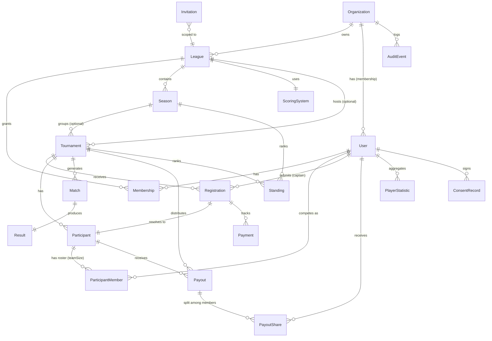

### 9.3 Module Boundaries

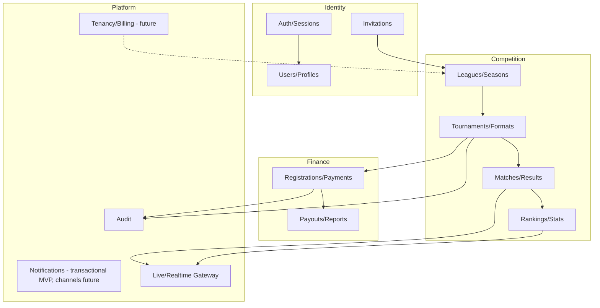

---

## 10. State Machines

### 10.1 Tournament

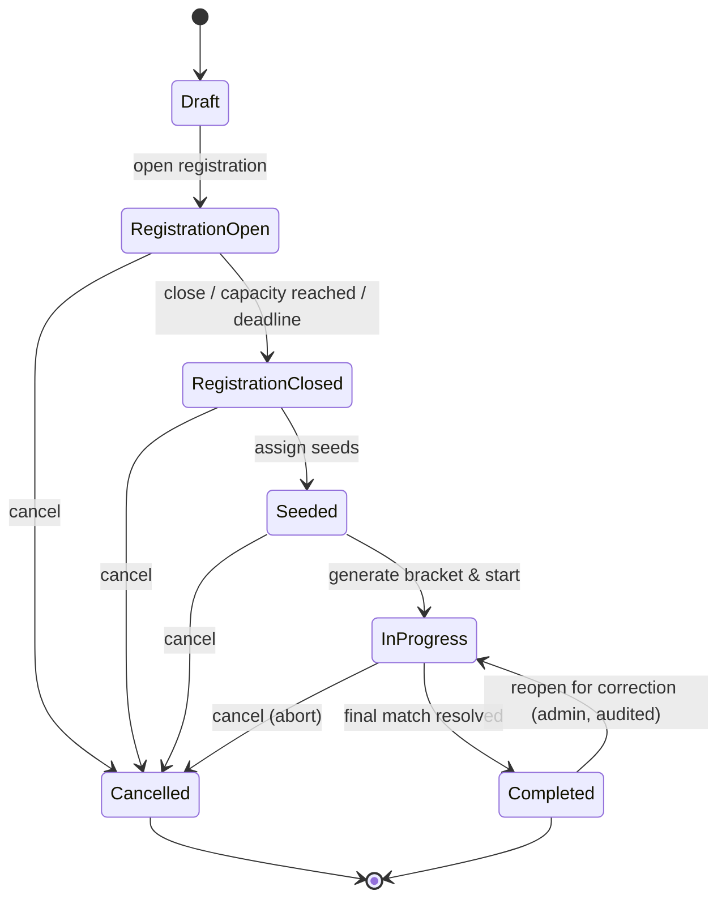

### 10.2 Match

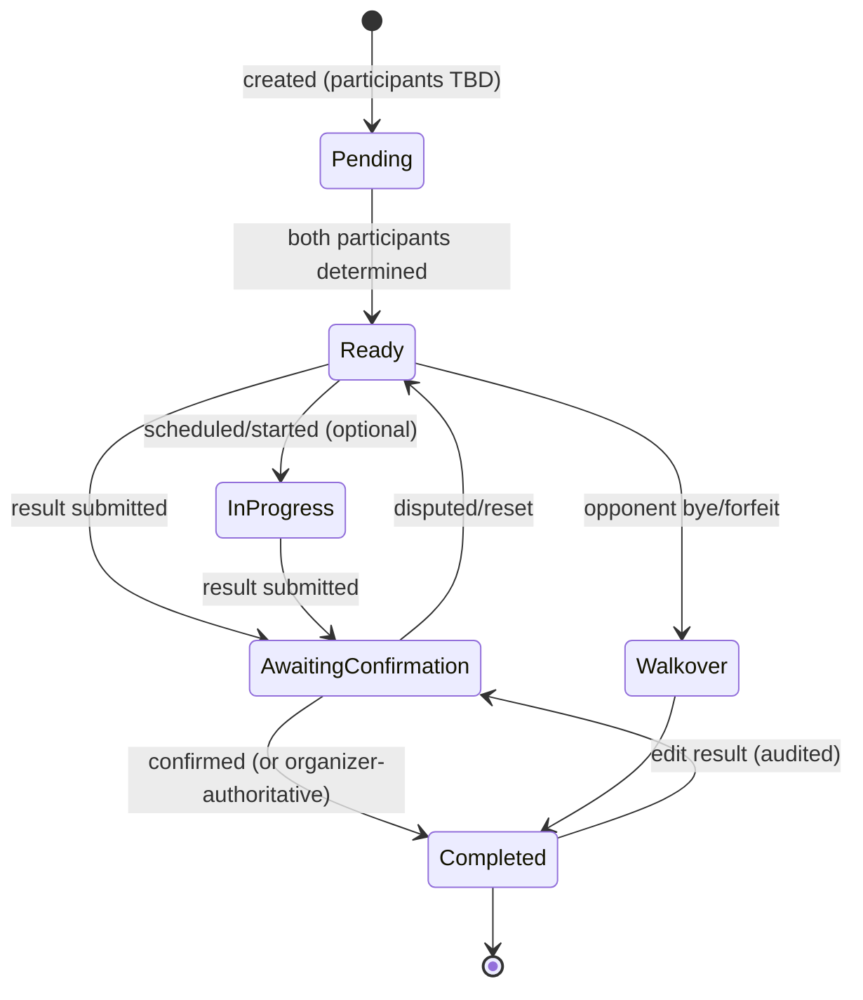

### 10.3 Registration

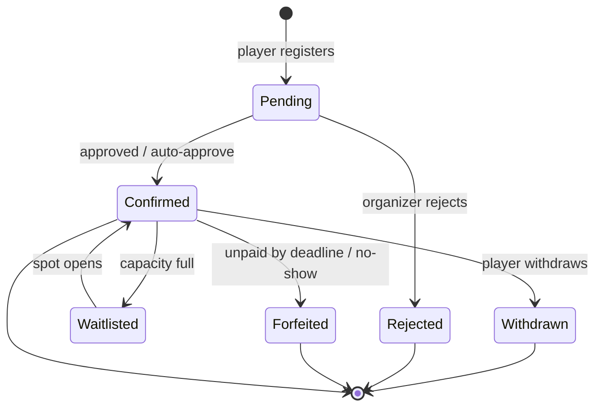

### 10.4 Payment

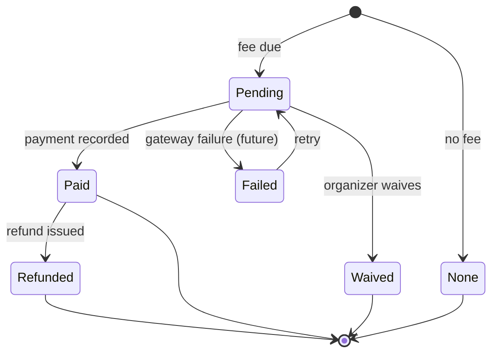

### 10.5 Payout

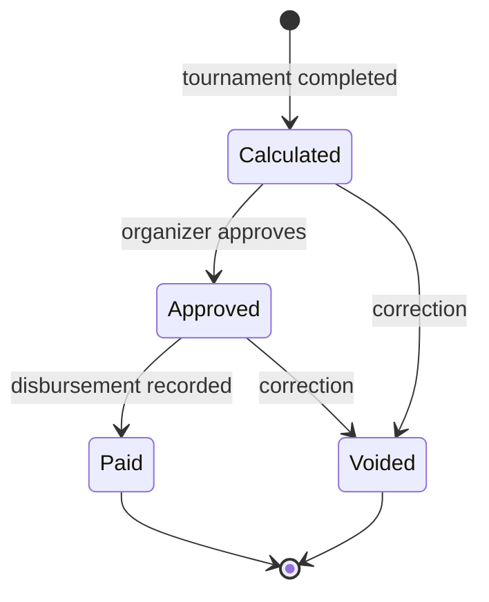

### 10.6 League

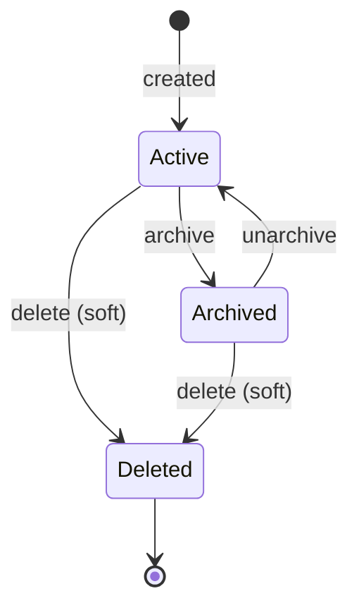

### 10.7 Season

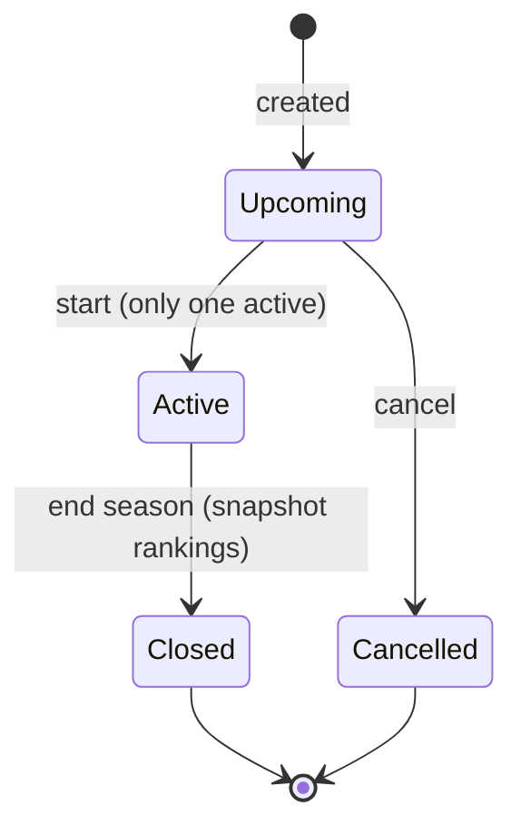

### 10.8 User Account

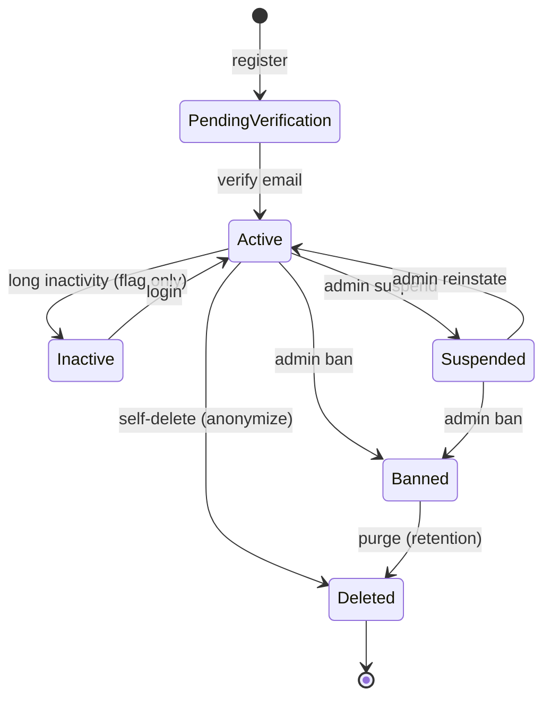

### 10.9 Organization *(tenant lifecycle)*

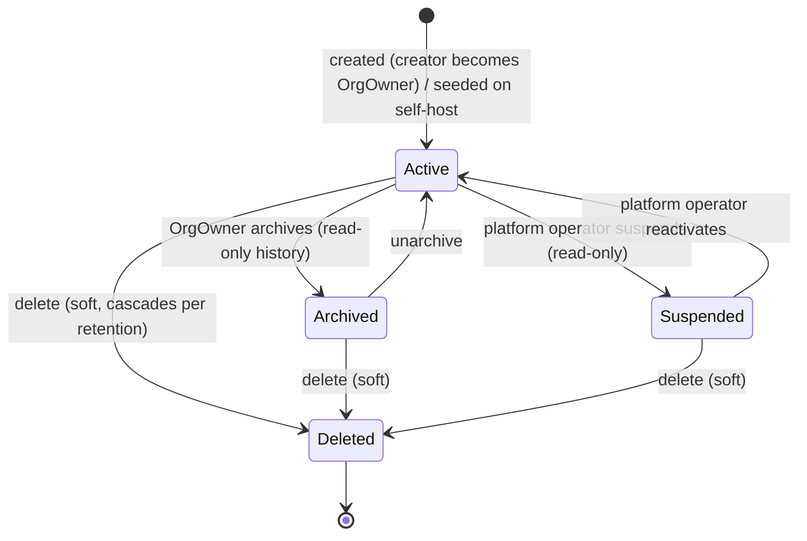

---

## 11. Permissions Matrix

The role model spans three scopes:

- **Platform scope** — **Platform Operator** (hosted) / **InstanceAdmin** (self-host): global to the deployment; manages instance config and organization lifecycle (suspend/reactivate).
- **Organization scope** — **OrgOwner**: owns a tenant; manages org settings, org membership, and org-ownership transfer. Every league lives under an org.
- **League/tournament scope** — **League Owner ⊃ Organizer ⊃ Player ⊃ Spectator** in capability; League Owner is unique per league.

`OrgOwner` is distinct from `League Owner`: an OrgOwner owns the tenant, a League Owner owns one league inside it. On self-host they are often the same person; on hosted they are typically different parties.

**Spectator is a capability level, not an assignable account type (Q-012):** the `Spectator` column represents both anonymous visitors *and* any logged-in user who is not a member of that particular league. No grant or invitation creates a Spectator.

### 11.1 Organization-scoped capabilities

| Capability | OrgOwner | Platform Operator / InstanceAdmin |
|---|:--:|:--:|
| Create an organization (self-serve signup) | ✅ (becomes OrgOwner) | ✅ |
| Edit org settings (name, slug) | ✅ | ✅ |
| Manage org membership / assign League Owners | ✅ | ✅ |
| Transfer org ownership | ✅ | ✅ |
| Create leagues within the org | ✅ | ✅ |
| Suspend/reactivate an organization | ❌ | ✅ |
| Manage instance/platform config & tenancy | ❌ | ✅ |

### 11.2 League/tournament-scoped capabilities

| Capability | Spectator | Player | Organizer | Owner | InstanceAdmin |
|---|:--:|:--:|:--:|:--:|:--:|
| View public pages | ✅ | ✅ | ✅ | ✅ | ✅ |
| Follow/favourite a league or tournament | ❌‡ | ✅ | ✅ | ✅ | ✅ |
| Register for tournament | ❌ | ✅ | ✅ | ✅ | ✅ |
| Manage own team roster (as captain) | ❌ | ✅† | ✅ | ✅ | ✅ |
| Submit result for own Participant (if enabled) | ❌ | ✅*† | ✅ | ✅ | ✅ |
| Enter own match result (if enabled) | ❌ | ✅* | ✅ | ✅ | ✅ |
| Confirm/override results | ❌ | ❌ | ✅ | ✅ | ✅ |
| Create tournament | ❌ | ❌ | ✅ | ✅ | ✅ |
| Generate/regenerate bracket | ❌ | ❌ | ✅ | ✅ | ✅ |
| Manage registrations (add/remove) | ❌ | ❌ | ✅ | ✅ | ✅ |
| Configure scoring/format/fees | ❌ | ❌ | ✅ | ✅ | ✅ |
| Record payments/payouts | ❌ | ❌ | ✅ | ✅ | ✅ |
| Issue refunds | ❌ | ❌ | ✅** | ✅ | ✅ |
| Invite players | ❌ | ❌ | ✅ | ✅ | ✅ |
| Create/edit league | ❌ | ❌ | ❌ | ✅ | ✅ |
| Start/close season | ❌ | ❌ | ✅ | ✅ | ✅ |
| Archive league | ❌ | ❌ | ❌ | ✅ | ✅ |
| Transfer ownership | ❌ | ❌ | ❌ | ✅ | ✅ |
| Delete league | ❌ | ❌ | ❌ | ✅ | ✅ |
| Manage organizer roles | ❌ | ❌ | ❌ | ✅ | ✅ |
| Ban/suspend user | ❌ | ❌ | ❌ | ❌ | ✅ |
| View audit log | ❌ | ❌ | scoped | scoped | ✅ |
| Manage instance config/tenancy | ❌ | ❌ | ❌ | ❌ | ✅ |

\* Player result entry is gated by FR-051 config (organizer-authoritative vs player-confirm). 
\** Organizer refund rights may be restricted by Owner config. *(A-013)* 
† **Captain** is not a separate role: it is the Player who registered a given Participant (`teamSize > 1`). Captain rights apply only to *their own* Participant — roster management (until registration close) and result submission on the team's behalf. *(Q-006)* 
‡ **Following requires an account.** Anonymous spectators can view public pages but cannot follow/favourite; a logged-in non-member can (they operate at Spectator capability but have an identity). *(Q-012)*

---

## 12. Scoring & Tournament Format Design

### 12.1 Configurable Scoring (FR-025, NFR-020)

A `ScoringSystem` is data, evaluated by a pure function `score(result, config) → points`. Recommended config shape:

```jsonc
{
  "winPoints": 3,
  "drawPoints": 1,
  "lossPoints": 0,
  "byePoints": 3,          // points awarded for a bye (configurable)
  "allowDraws": true,
  "participationPoints": 0,
  "bonus": { "perPointScored": 0 },  // optional fine-grained bonus
  "tieBreakers": ["headToHead", "pointsScored", "wins", "random"]
}
```

- **R-011:** Provide presets (Chess 1/0.5/0, Football 3/1/0, Winner-takes-rank). Custom is V1.
- Tie-breakers are an ordered list applied until ties resolve; final fallback is deterministic (seed/random with stored RNG).
- **Team play (Q-006):** `score()` is evaluated **per Participant** from the match result; the resulting points are then **credited to every member** of that Participant for individual league/season rankings (FR-090a). The scoring config is unchanged by `teamSize`.

### 12.2 Pluggable Formats (FR-042, NFR-003)

Each format implements a common interface:

```
interface TournamentFormat {
  validateConfig(config): void
  generateMatches(participants, seed): Match[]          // initial structure
  onResultRecorded(match, state): StateMutation[]       // advancement
  computeStandings(state, scoringSystem): Standing[]
  isComplete(state): boolean
}
```

- **SingleElimination:** pad to power of two with byes (top seeds), winners advance, optional 3rd-place match (config).
- **RoundRobin:** all pairings (single/double), standings by points then tie-breakers.
- Future formats register into a `FormatRegistry`; **no core code changes** required (Open/Closed Principle).

### 12.3 Seeding (FR-046)

- `random` uses a **stored RNG seed** so generation is reproducible/auditable (NFR-018).
- `manual` lets organizer order participants.
- `ranking-based` (V1) seeds from current season ranking.

---

## 13. GDPR & Data Lifecycle

| Concern | Approach |
|---|---|
| Minimisation (FR-134) | Collect email, password hash, display name. Avatar/bio optional. No real name required. |
| Consent (FR-132) | Capture `ConsentRecord` with policy version at signup; re-prompt on policy change. |
| Export (FR-131) | Endpoint returns JSON of all user-linked PII + participation. |
| Deletion (FR-130) | Soft-delete + anonymize: replace PII with tombstone, keep results attributed to "Deleted player #id" to preserve competition integrity (BR-105 analog). |
| Retention (FR-133) | Configurable: audit logs default 365 days; deleted-account purge after grace period (default 30 days). *(A-014)* |
| Right to object/restrict | Profile visibility controls (FR-135); suspend processing on request. |
| Controller/Processor (hosted) | On the **hosted** service the operator acts as **data processor** for each Organization (the org is controller for its members' data); a DPA and sub-processor list are required before hosted launch (Q-002a). On **self-host**, the operator is the sole controller/processor. |
| Data residency | Per-tenant region pinning is **Future**; documented for self-host. Hosted MVP runs a single documented region. |

**Conflict note (R-006):** "Right to erasure" vs "competition integrity / others' results". **Resolution (Q-002, confirmed):** On erasure, **sever the `User`↔`Participant` link and hard-delete identity PII** (email, password hash, real name, avatar, bio, IP); **retain match and financial facts** attributed to an anonymized tombstone (`"Deleted player #id"`). Once de-linked from a natural person, retained match data is anonymous historical fact and outside GDPR scope (Recital 26). Audit/IP logs containing PII purge on a configurable retention timer (default 365 days, **pausable during an active dispute/legal claim**). Tombstoning is **irreversible** (no identity re-link). This policy MUST be stated explicitly in the privacy policy. **Residual action: legal counsel review before EU public launch (tracked as Q-002a).**

---

## 14. Security

| Risk | Mitigation |
|---|---|
| Credential theft | Strong password hashing (Argon2id preferred, or ASP.NET Core Identity PBKDF2 with high iterations); breached-password check (R-001); rate limiting; lockout/backoff on auth (NFR-009). |
| Session hijacking | Secure, HttpOnly, SameSite cookies or short-lived JWT + refresh; rotate on privilege change. |
| Broken access control | Centralised authorization layer (policy/guard per resource); deny-by-default; tenant scoping checks (NFR-004). |
| Cross-tenant data leak (multi-tenancy) | **P0.** Server-resolved `organization_id` on every query via the central scoping layer; deny-by-default tenant guard on API, realtime channels, background jobs, exports, caches, and admin tooling; automated isolation tests. A cross-org leak is a release-blocking defect (NFR-024, FR-152). |
| IDOR | Object-level authorization on every read/write; never trust client-supplied scope. |
| CSRF | CSRF tokens for cookie auth; SameSite. |
| XSS | Output encoding; CSP; sanitise user content (league names, bios). |
| Injection | Parameterised queries/ORM; input validation. |
| Privilege escalation via invites | Invitation role is immutable post-issue; acceptance grants only the invited role. |
| Financial tampering | All money changes audited (FR-120); server-authoritative computation; optimistic locking (NFR-023). |
| Live-channel data leak | Channel authorization (FR-064); public channels carry only public data. |
| Abuse / spam registrations | Email verification gate (FR-004), rate limits, optional CAPTCHA (R-012). |
| Secrets exposure | Env-based secrets; never log secrets (NFR-021); rotate. |

---

## 15. UX Principles

- **Mobile-first** (NFR-011): result entry must be one-thumb friendly (large tap targets for win/lose).
- **Public read-only pages** are SEO-friendly, fast, shareable links (FR-028, FR-061).
- **Live feedback:** optimistic UI with clear "syncing/confirmed" states (FR-062).
- **Progressive disclosure:** Casual Organizer (P1) sees a 3-step create flow; advanced config behind "Advanced".
- **Accessibility** (NFR-010): keyboard nav, ARIA labels, sufficient contrast, focus management on bracket navigation.
- **Dark mode** (V1) via design tokens, not duplicated CSS.
- **Empty/edge states:** explicit UI for "no participants yet", "awaiting results", "tie needs manual resolution".
- **Bracket UX:** horizontal scroll/zoom on mobile; highlight a player's path; live-updating current match.

---

## 16. Real-Time Architecture (FR-060–064)

**Recommendation (R-013) — implemented with SignalR (Q-004):**

- Transport: **SignalR** (WebSocket primary, with automatic Server-Sent Events / Long-Polling fallback, FR-063).
- **Server-authoritative** state; clients join SignalR **groups** scoped by **organization + resource + visibility**: `org:{orgId}:tournament:{id}:public`, `org:{orgId}:tournament:{id}:organizer`. Group authorization enforces both tenant isolation (NFR-024) and visibility (FR-064) — a client can never subscribe to another org's channels.
- Cross-instance fan-out via the **SignalR Redis backplane** so horizontal scaling works (NFR-007).
- Events are **domain events** emitted after DB commit (outbox pattern recommended) to avoid lost/duplicate updates.
- Clients reconcile via event versioning; on reconnect, fetch a snapshot then resume the stream.
- **Optimistic updates** only for the actor entering a result; spectators always receive server-confirmed state.

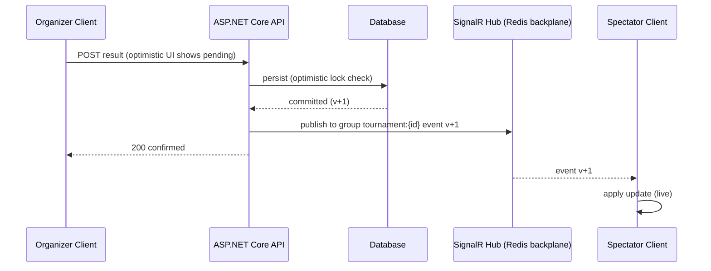

---

## 17. API Considerations

- **Style (R-014, Q-003 resolved):** **REST + JSON only through MVP and V1.** GraphQL is explicitly **not** adopted — the app has a small, stable set of well-known views, so REST keeps HTTP caching, idempotency, and ETags simple. To prevent over/under-fetching without GraphQL, REST MUST support **sparse fieldsets/expansion** (`?include=`, `?fields=`) on key resources and provide **composite read endpoints** for heavy public views (e.g. `GET /tournaments/{id}/overview` returning bracket + standings + meta in one call). GraphQL MAY be added later as an additive, non-breaking layer over the same domain services if a third-party ecosystem with unpredictable query shapes emerges.
- **Versioning:** URI versioning `/api/v1/...`; never break v1 without bumping.
- **Auth:** Bearer tokens (JWT access + refresh) or session cookies for the first-party web app; **API keys/PAT** for third-party/self-host automation (Future).
- **Authorization & tenancy:** policy checks per endpoint; the active **organization context is resolved server-side** (from the authenticated user's membership / active org), never from client input. Every tenant-scoped read/write is filtered by `organization_id`; cross-org access returns 404/403 (NFR-024, FR-152).
- **Pagination:** cursor-based for large/append-heavy lists (matches, audit); page/limit acceptable for small lists.
- **Filtering/Sorting:** explicit allow-listed query params (`?status=&sort=-createdAt`); reject unknown params.
- **Idempotency:** `Idempotency-Key` header on POST for registration/payment/payout to prevent duplicates (FR-045 support).
- **Concurrency:** ETag/`If-Match` (version) on match/registration updates (NFR-023).
- **Errors:** RFC 7807 Problem Details; stable error codes.
- **Rate limiting:** per-IP and per-user; stricter on auth/finance.
- **Docs:** OpenAPI 3 generated from code; published (NFR-015).
- **Webhooks (Future):** for third-party/hosted integrations (registration created, tournament completed).

### 17.1 Representative Endpoints (illustrative, not exhaustive)

```
POST   /api/v1/auth/register
POST   /api/v1/auth/login
POST   /api/v1/auth/verify-email
POST   /api/v1/auth/password-reset
GET    /api/v1/leagues
POST   /api/v1/leagues
POST   /api/v1/leagues/{id}/seasons
POST   /api/v1/leagues/{id}/invitations
GET    /api/v1/tournaments?leagueId=&status=
POST   /api/v1/tournaments
POST   /api/v1/tournaments/{id}/registrations          (Idempotency-Key)
POST   /api/v1/tournaments/{id}/seed
POST   /api/v1/tournaments/{id}/generate-bracket
PATCH  /api/v1/matches/{id}/result                      (If-Match: version)
GET    /api/v1/tournaments/{id}/standings
GET    /api/v1/tournaments/{id}/overview                 (composite: bracket+standings+meta, public)
GET    /api/v1/public/leagues/{slug}                    (no auth)
GET    /api/v1/users/me/export                          (GDPR)
DELETE /api/v1/users/me                                 (GDPR)
```

---

## 18. Data Model Considerations

- **Tenant column:** **non-null** `organization_id` on all tenant-scoped tables from day one (NFR-004); enforced in every query via a central scoping layer. Self-host seeds a **single default organization row** at setup — there is no nullable/implicit tenancy. Index `(organization_id, ...)` composites for tenant-scoped lookups.
- **Soft deletion:** `deleted_at` for leagues/tournaments/users; queries filter by default; hard purge per retention.
- **Immutability/history:** closed seasons store **ranking snapshots**; match results keep an edit history (or rely on audit + event log).
- **Event logging / outbox:** domain events table for live fan-out and auditability (NFR-017).
- **Indexing:** index FKs (`tournament_id`, `league_id`, `user_id`), `(organization_id, ...)` composite for tenant scoping, `state` columns used in filters, `email` unique, `registration (tournament_id, participant_id)` unique, and **`participant_member (tournament_id, user_id)` unique** to enforce "a player appears in at most one Participant per tournament" (BR-004/FR-045, team-aware).
- **Money:** integer `amount_minor` + `currency` columns; never float.
- **Concurrency:** `version` (int) column on mutable competition/finance entities for optimistic locking.
- **Scalability:** read-heavy public pages → cache standings/brackets (R-004); write path remains authoritative. Partition audit/event tables by time if needed (Future).
- **Determinism:** persist `rng_seed` on tournament for reproducible seeding (NFR-018).
- **Referential integrity:** `Participant` decouples bracket from `User` so deleted/anonymized users don't break historical brackets (R-010).

---

## 19. Hosted Platform: Core Now vs Deferred

The product is **hosted-first and multi-tenant from day one**, so most of what was once "SaaS readiness" is now **core MVP** (see §4.1). This section separates what ships as core from what stays deliberately deferred (RK-01 guards against pulling the deferred column into MVP).

### 19.1 Core now (MVP)

| Capability | How it is delivered at MVP |
|---|---|
| Multi-tenancy | **Non-null** `organization_id` on all scoped entities (NFR-004); scoping enforced centrally. Self-host = one seeded default org (no implicit tenancy). |
| Tenant isolation | Server-resolved org scope + deny-by-default guards across API, realtime, jobs, exports (NFR-024, FR-152); automated isolation tests. |
| Organization management | Self-serve org creation, OrgOwner, org settings, ownership transfer (FR-150–154). |
| Onboarding / self-signup | Auth + invitations are tenant-aware; sign up → create org → run competitions. |
| Platform operations | Platform operator can suspend/reactivate orgs (FR-155); managed transactional email (NFR-025). |

### 19.2 Deferred (V1 / Future)

| Capability | Phase | Foundation reserved today |
|---|---|---|
| Inbound entry-fee payments | V1 | `IPaymentProvider` seam (FR-082); `ManualProvider` at MVP. |
| Plan entitlements / quotas | V1 | `Organization.plan` + `IEntitlementService` seam (FR-156); per-tenant rate limiting. |
| Subscriptions / billing / invoicing / tax | Future | Finance module isolated; entitlements behind a service interface. |
| Custom branding / white-label / custom domains | Future | `Organization.branding` field reserved; theming tokens. |
| Automated outbound payouts / KYC | Future | Payout/PayoutShare model; provider seam. |
| Per-region data residency, enterprise SSO/SCIM | Future | Central scoping layer allows schema/db-per-tenant migration later. |

**Principle:** never query a tenant-scoped table without going through the scoping layer; **never assume "one tenant" in domain code**, even on self-host (self-host simply has exactly one org).

---

## 20. Edge Cases

| # | Edge case | Handling |
|---|---|---|
| E-01 | Player withdraws mid-tournament | Auto-forfeit remaining matches; prior results stand; standings recomputed (BR-105). |
| E-02 | Duplicate registration attempt | Rejected by unique constraint + idempotency (FR-045, BR-004). |
| E-03 | Organizer deletes their account while owning a league | Blocked until ownership transferred/league archived (BR-106). |
| E-04 | Sole participant / fewer than 2 confirmed | Cannot start tournament (BR-100); UI explains. |
| E-05 | Unfinished tournament abandoned | Stays `InProgress`; organizer can cancel or complete; does not pollute rankings until completed/cancelled rules applied. |
| E-06 | Tie in round-robin standings | Apply ordered tie-breakers; if unresolved, deterministic fallback + flag for optional manual resolution (FR-057). |
| E-07 | Invalid score entered | Validation rejects (range, draw policy) (FR-052). |
| E-08 | Editing a finalized result | Allowed (audited), triggers downstream recompute of advancement/standings/payouts (BR-104). |
| E-09 | Season migration / starting new season | Snapshot old rankings, reset standings, carry membership per config (FR-024). |
| E-10 | Concurrent edits to same match | Optimistic lock conflict → 409; client refetches (NFR-023). |
| E-11 | Payment failure (future gateway) | Registration stays `pending`; retry allowed (Payment FSM). |
| E-12 | Deleted user appearing in old brackets | Shown as "Deleted player #id" via Participant decoupling (R-010, FR-130). |
| E-13 | Archived league accessed | Read-only; writes blocked with clear message (FR-029). |
| E-14 | Odd number of participants (single elim) | Byes to top seeds (BR-101). |
| E-15 | Bye-vs-bye impossible | Generation algorithm guarantees byes never paired. |
| E-16 | Registration after capacity reached | Waitlist (Registration FSM). |
| E-17 | Refund exceeding paid amount | Rejected (BR-107). |
| E-18 | Currency mismatch in one tournament | Disallowed (BR-007, FR-080). |
| E-19 | Rounding leftover in prize split | Remainder to top rank; total payouts == prize pool (BR-008). |
| E-20 | Forfeit in round-robin | Counts as a loss for the forfeiter; opponent gets win/byePoints per config. |
| E-21 | Reopening completed tournament | Admin-only, audited, recompute downstream (FR-059). |
| E-22 | Live transport drops | Fallback to polling; reconnect fetches snapshot (FR-063, R-013). |
| E-23 | Invitation to already-member | No-op with friendly message. |
| E-24 | Banned user's public content | Hidden from public, retained for audit (BR-110). |
| E-25 | Player joins league mid-season | Allowed per config; starts with zero season points (A-007). |
| E-26 | Cancelled tournament with paid fees | Trigger refund flow per policy (FR-076). |
| E-27 | 3rd-place match config in single elim | Optional, configurable; generates extra match between semifinal losers. |
| E-28 | Two players, single elimination | Valid: one final match. |
| E-29 | Team roster incomplete at registration close (partner never accepted) | Participant stays `incomplete` → not confirmed/seeded; captain notified; organizer may complete manually or remove (FR-044a). |
| E-30 | Same player invited to two different teams in one tournament | Second acceptance rejected — a User belongs to at most one Participant per tournament (FR-045). |
| E-31 | One member of a 2v2 team withdraws mid-tournament | Whole Participant withdraws (auto-forfeit remaining); both members' prior results stand. Substitutions are Future, not MVP. *(Q-006)* |
| E-32 | Team wins a prize | Payout split equally across members as `PayoutShare`; remainder (after equal integer-minor-unit split) to captain; Σ shares == payout (FR-075a, BR-008 analog). |
| E-33 | Captain deletes/anonymizes account mid-tournament | Captaincy auto-transfers to another roster member; Participant continues; identity anonymized via tombstone (R-010, FR-130). |
| E-34 | Member of a team is banned | Participant forfeits remaining matches unless organizer substitutes (Future); prior results stand; banned member hidden from public (BR-110). |

---

## 21. Technology Stack *(Resolved Q-004)*

The stack below is **confirmed**, chosen for fit to the realtime + finance + hosted multi-tenant requirements and for the Prague hiring market (strong, well-paid .NET pool driven by SaaS + cybersecurity demand).

| Layer | Decision | Rationale |
|---|---|---|
| Backend language/runtime | **C# / .NET 8** | Strong typing for a finance/audit domain; native `decimal` type ideal for money rules (§11); large Prague talent pool. |
| Backend framework | **ASP.NET Core** (modular / clean-architecture or vertical slices) | Enforces module boundaries (NFR-001); first-class DI, OpenAPI, Identity. |
| API | REST + OpenAPI (via Swashbuckle/NSwag) | Broad compatibility (§17); REST-only per Q-003. |
| DB | **PostgreSQL** | Relational integrity, JSONB for config, window functions for rankings. |
| ORM | **EF Core** | Migrations, type safety, parameterised queries; raw SQL escape hatch for heavy stats. |
| Realtime | **SignalR** + automatic transport fallback, **Redis backplane** | Best-in-class managed realtime; groups map to `tournament:{id}` channels (FR-064); backplane for multi-node fan-out (§16, NFR-007). |
| Cache / Backplane | **Redis** | Caching (R-004) + SignalR backplane (NFR-007). |
| Frontend | **React + Vite + TypeScript** (SPA) | Per stakeholder decision; large React pool. |
| Public-page SEO | **Prerender / SSG for public read-only routes** *(R-017)* | Recovers SSR/SEO lost by dropping Next.js; public league/tournament pages emit pre-rendered HTML + OpenGraph meta. |
| Styling | Tailwind + CSS variables (design tokens) | Dark mode (V1), per-tenant branding/white-label (Future). |
| Auth | **ASP.NET Core Identity** (argon2id/PBKDF2) + optional OAuth | NFR-009. |
| Testing | **xUnit** (unit) + **Testcontainers** (integration) + **Playwright** (e2e) | NFR-013. |
| Deploy | **Primary:** hosted, managed services (managed PostgreSQL, Redis, transactional-email provider, later a payment provider), 12-factor config, horizontal app scaling. **Secondary:** Docker Compose for self-host, same codebase. | NFR-016, NFR-007. |

**Note on money type:** use .NET `decimal` for computation but persist as integer minor units + currency (§11, BR-008); never `double`/`float`.

---

## 22. Testing & Quality Strategy (NFR-013)

- **Domain unit tests (highest value):** bracket generation (all participant counts incl. byes), round-robin pairing, scoring & tie-breaks, prize split & rounding, ranking recomputation determinism.
- **State-machine tests:** every transition in §10, including illegal transitions rejected.
- **API integration tests:** authz matrix (§11), idempotency, optimistic locking conflicts.
- **E2E critical flows:** register → create tournament → register players → seed → generate → enter results → complete → standings.
- **Property-based tests (R-016):** "total payouts == prize pool", "bracket has exactly N−1 matches in single elim", "no participant plays twice in a round". (Use FsCheck for .NET property-based testing.)
- **Tooling (Q-004):** xUnit (unit), Testcontainers (integration against real PostgreSQL/Redis), Playwright (e2e), FsCheck (property-based).
- **CI gates:** build, analyzers/format check, tests, OpenAPI validity, EF Core migration check.

---

## 23. Risks

| ID | Risk | Type | Impact | Likelihood | Mitigation |
|---|---|---|---|---|---|
| RK-01 | Hosted-first pulls commercial SaaS scope (billing, branding, enterprise, payouts) into MVP | Product | High | High | MVP = **tenancy + isolation + onboarding only**; keep subscriptions/billing/branding/custom-domains/outbound-payouts/SSO deferred to V1/Future (§4.3, §19.2). Multi-tenancy itself is core, but commercial mechanics are not. |
| RK-02 | Format/scoring config complexity explodes | Technical | Med | High | Start with 2 formats + presets; pluggable interface; defer custom. |
| RK-03 | Money handling disputes/legal | Product/Legal | High | Med | MVP is manual tracking only (no processing); clear audit; disclaimers (A-010, Q-005). |
| RK-04 | GDPR erasure vs competition integrity conflict | Legal | Med | Med | Anonymize person, retain match facts; document policy (R-006, Q-002). |
| RK-05 | Realtime scaling / lost updates | Technical/Scale | Med | Med | Outbox + SignalR Redis backplane; snapshot-on-reconnect; degrade to polling. |
| RK-06 | Concurrent result edits corrupt standings | Technical | High | Med | Optimistic locking; deterministic recompute; audit (NFR-023). |
| RK-07 | Security breach (auth/finance) | Security | High | Low/Med | OWASP mitigations, strong password hashing (NFR-009), rate limits, audit, tenant-isolation tests (NFR-024), pen-test before hosted launch. |
| RK-08 | Open-source adoption/maintenance burden | Product | Med | Med | Strong docs, clear contribution guide, modular code, tests. |
| RK-09 | Bracket algorithm bugs damage trust | Technical | High | Med | Property-based + exhaustive unit tests; deterministic seeds. |
| RK-10 | Scope creep from "configurable everything" | Product | High | High | Configuration limited at MVP to scoring/format/fees/visibility/`teamSize`/`resultModel`/`resultEntryMode`; everything else hardcoded sensible defaults. |

---

## 24. Open Questions

| ID | Question | Owner | Blocking? |
|---|---|---|---|
| Q-001 | ✅ **RESOLVED:** AGPL-3.0 + CLA (preserves dual-licensing). | Product/Legal | Resolved |
| Q-002 | ✅ **RESOLVED:** Sever User↔Participant link, hard-delete identity PII, retain anonymized match/financial facts (Recital 26); audit/IP logs purge on retention timer (default 365d, pausable during disputes); policy stated in privacy policy; tombstoning irreversible. | Legal | Resolved |
| Q-002a | **Residual:** Legal counsel review of the §13 erasure policy before EU **hosted** launch (the hosted service processes EU personal data as an operator). | Legal | Before EU hosted launch |
| Q-003 | ✅ **RESOLVED:** REST-only through V1 with `?include=`/`?fields=` expansion + composite read endpoints; GraphQL deferred (additive if ever needed). | Architecture | Resolved |
| Q-004 | ✅ **RESOLVED:** Backend **C#/.NET 8 + ASP.NET Core** (SignalR, EF Core, PostgreSQL, Redis backplane, ASP.NET Identity); Frontend **React + Vite + TS**, public pages prerendered/SSG for SEO (R-017). | Architecture | Resolved |
| Q-005 | ✅ **RESOLVED (hosted-first):** **Manual ledger remains the MVP** for both hosted and self-host via the `IPaymentProvider`/`ManualProvider` seam (FR-082). **Hosted inbound entry-fee collection through one payment provider moves to V1** (FR-083). **Outbound payouts, KYC/Connect-style flows, and automated disbursement remain Future+.** Self-host stays manual (organizer owns real money movement; disclaimer shown). | Product | Resolved |
| Q-005a | **Residual:** Legal review of money-tracking/transmission implications before the **hosted paid-entry rollout** (V1 inbound entry-fee collection). Free hosted use and self-host ship before this. | Product/Legal | Before hosted paid-entry rollout |
| Q-006 | ✅ **RESOLVED:** Teams **in MVP** via tournament `teamSize` (configurable **1–10**; `>10` Future). **Ad-hoc** rosters (persistent named teams = Future), **captain** role, equal-split team payouts, and **per-player** league points / per-User standings (FR-040a/044/044a/045/075a/090a). | Product | Resolved |
| Q-007 | ✅ **RESOLVED:** Strictly **one `active` season per league** (A-006 kept); one `upcoming` + many `closed` may coexist. Parallel competitions = separate leagues; per-league **divisions** are a possible Future addition (invariant stays). | Product | Resolved |
| Q-008 | ✅ **RESOLVED:** Multi-discipline product (`Game`→`Discipline`). MVP result models = **`winner` + `score`** (2-sided), free-text discipline name, no catalog; **`placement`/free-for-all + Discipline catalog = Future** (FR-040b/040d). | Product | Resolved |
| Q-013 | ✅ **RESOLVED:** Best-of-N matches record **aggregate result only** at MVP (winner + e.g. `2–1`); per-set/map/leg `MatchGame` capture = Future (FR-040c). | Product | Resolved |
| Q-009 | ✅ **RESOLVED:** Per-tournament `resultEntryMode` ∈ {`organizer` (default, P0), `playerSelfReport` (P1)}; self-report = captain submits + opposing captain confirms, dispute/timeout → organizer, organizer can always override (FR-051/051a/051b). | Product | Resolved |
| Q-010 | ✅ **RESOLVED (hosted-first):** MVP ships **transactional** notifications only (verification, reset, invitations, roster invites, self-report confirmations) via the `INotificationChannel`/`EmailChannel` seam (FR-140–143, R-019). **Hosted uses a managed transactional-email provider as the primary delivery path** (deliverability, retries, bounce visibility); **self-host SMTP remains a fully supported secondary path** (FR-142). Engagement notifications, extra channels (web push, Discord/webhooks), digests, preferences = Future. | Product | Resolved |
| Q-011 | ✅ **RESOLVED (hosted-first):** **Primary (hosted) model** — the platform operator holds platform/instance admin out-of-band (via deployment), and each new **Organization's creator becomes that org's Owner** (FR-009d). **Secondary (self-host) model** — env-configured bootstrap admin is the default (`TOURNEYHUB_ADMIN_EMAIL` pre-seed + optional one-time token); first-user-becomes-admin only behind explicit `ALLOW_FIRST_USER_ADMIN` on an empty instance; one-shot, audited, always ≥1 InstanceAdmin (FR-009a–c, R-020). | Architecture | Resolved |
| Q-012 | ✅ **RESOLVED:** Spectator is a **capability level, not an assignable role** (anonymous visitors + logged-in non-members); MVP adds **follow/favourite** for logged-in users (FR-028a/028b). A private-`viewer` membership role and social features are Future. | Product | Resolved |

---

## 25. Assumptions Register

| ID | Assumption | Can override? |
|---|---|---|
| A-001 | Product name is "TourneyHub" (placeholder). | Yes |
| A-002 | **All deployments use an explicit Organization from day one.** Hosted runs multi-tenant (many orgs per instance); self-host seeds a single default organization at setup and normally operates as a one-org deployment. No "implicit tenant" / nullable `organization_id`. *(Reframed hosted-first)* | Yes |
| A-003 | Email verification required before organizing/handling money. | Yes |
| A-004 | Inactivity threshold default 540 days (flag only, no delete). | Yes |
| A-005 | Invitation TTL default 14 days. | Yes |
| A-006 | Exactly one active season per league at a time (one `upcoming` + many `closed` may coexist). *(Confirmed Q-007)* | Yes |
| A-007 | Mid-season joiners start at zero; leavers keep earned results, forfeit future. | Yes |
| A-008 | Default result authority = organizer-authoritative; `playerSelfReport` is an opt-in per-tournament mode. *(Confirmed Q-009)* | Yes |
| A-009 | Unpaid-by-deadline default → forfeited (configurable). | Yes |
| A-010 | **MVP money handling remains manual** (organizer records reality) for both hosted and self-host. **Hosted V1** may collect inbound tournament entry fees through **one payment provider**; payouts stay manual at MVP/V1 and automated outbound payouts remain Future+. *(Reframed hosted-first, Q-005)* | Yes (Q-005) |
| A-011 | One currency per financial scope; no mixing. | Yes |
| A-012 | Reference-deployment scale target: ≤ 10k users, ≤ 50 concurrent tournaments (per hosted cluster or per self-host instance). | Yes |
| A-013 | Organizer refund rights may be limited by Owner config. | Yes |
| A-014 | Deleted-account purge grace = 30 days; audit retention 365 days. | Yes |
| A-015 | MVP teams are **ad-hoc** (roster defined per tournament at registration); persistent named teams are Future. | Yes |
| A-016 | In team play, league points are awarded **per player** and standings are per-User; team-based standings are Future. *(Confirmed by stakeholder)* | Yes |
| A-017 | A team member withdrawal withdraws the whole Participant (no in-tournament substitutions at MVP). | Yes |
| A-018 | MVP is **multi-discipline** and **head-to-head only**; `teamSize` configurable 1–10. Free-for-all/`placement` and `>10`-player teams are Future. *(Confirmed Q-008)* | Yes |
| A-019 | MVP uses a **free-text discipline name** per tournament; a managed Discipline catalog is Future. | Yes |
| A-020 | Best-of-N matches store only the **aggregate** result at MVP; per-set/map/leg detail is Future. *(Confirmed Q-013)* | Yes |
| A-021 | MVP notifications are **transactional email only** (via `INotificationChannel`/`EmailChannel`). **Hosted uses a managed email-delivery provider as the primary path**; **self-host SMTP remains supported secondary**. Engagement notifications and extra channels are Future. *(Reframed hosted-first, Q-010)* | Yes |
| A-022 | **Hosted (primary):** platform-operator admin is provisioned out-of-band and each Organization's creator becomes **OrgOwner**. **Self-host (secondary):** instance admin is **env-configured** by default; first-user-becomes-admin is opt-in only. *(Reframed hosted-first, Q-011)* | Yes |
| A-023 | Spectator is a **capability level, not an assignable role**; MVP adds follow/favourite for logged-in users. Private-`viewer` role and social features are Future. *(Confirmed Q-012)* | Yes |

---

## 26. Implementation Sequencing (suggested for AI coding agents)

1. **Foundation & tenancy:** project scaffolding, modular structure (NFR-001), DB + migrations, **Organization model + non-null `organization_id` + central tenant scoping/isolation layer** (NFR-004, NFR-024, FR-151–152), auth (FR-001–005), audit (FR-120). Self-host seeds one default org; hosted supports many.
2. **Organizations, users & profiles** (FR-006–010, FR-150–156) — org self-signup, OrgOwner, ownership transfer, platform-operator suspend; hosted admin model (FR-009d) + self-host bootstrap (FR-009a–c); GDPR export/delete seams (FR-130–132) + **notification seam** (`INotificationChannel`/`EmailChannel`, managed hosted email + self-host SMTP, FR-140–142).
3. **Leagues & seasons** (FR-020–029, all org-scoped) + invitations (FR-014–017, transactional emails) + permissions layer (§11).
4. **Scoring system config** (FR-025, §12.1).
5. **Tournaments + `teamSize`/Participant+roster model + Single Elimination format** (FR-040–053, §12.2) — including bracket gen tests and roster-completeness (FR-044a).
6. **Round Robin format** (FR-041, BR-102) + tie-breaks (FR-057).
7. **Match results & validation** (FR-050–055) + recompute (FR-095) + per-player point crediting in team play (FR-090a).
8. **Rankings & standings** (FR-090–095, per-User standings) + public pages (FR-028, FR-061).
9. **Live/realtime gateway** (FR-060–064, §16).
10. **Finance: fees, payments, prize pool, payouts** (FR-070–083) including team `PayoutShare` split (FR-075a).
11. **Reporting** (FR-100) + CSV (V1).
12. **Hardening:** accessibility, dark mode, docs, OpenAPI, security review, GDPR finalisation.

Each step ships behind tests (§22) and updates this PRD if reality diverges.

---

*End of PRD v1.0 (Draft). Resolve §24 Open Questions and confirm §25 Assumptions before implementation begins.*
