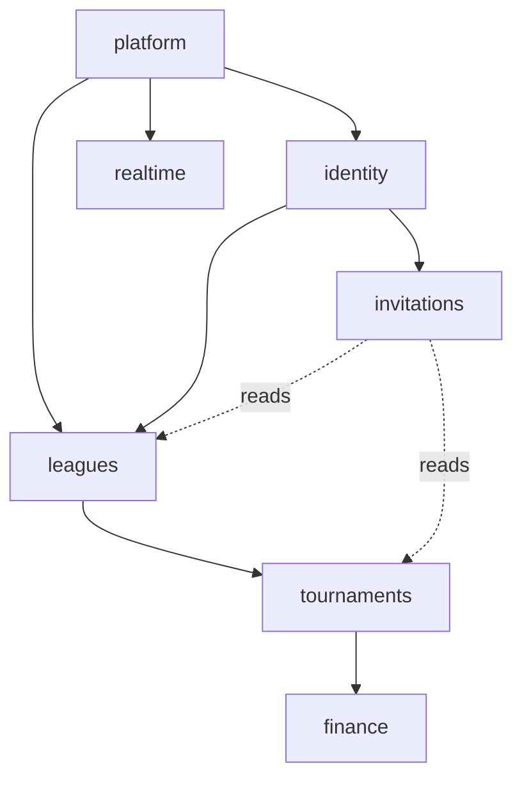
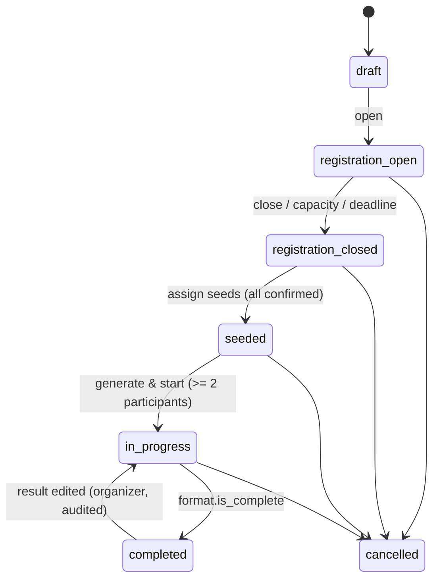
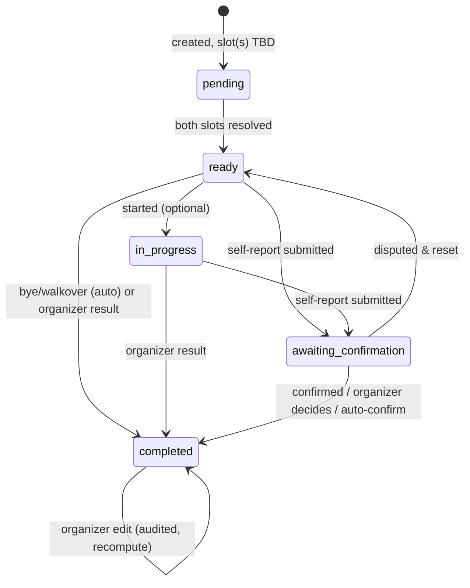

# Product Requirements Document — TourneyHub MVP

**An open-source, hosted-first, multi-tenant platform for running leagues and tournaments for any competitive discipline** — board games, racket and table sports, bar/pub games, esports. Ready-to-use hosted service; self-host the same codebase.

---

## 0. Document Control

| Field | Value |
|---|---|
| Product name | TourneyHub *(working name, A-001)* |
| Document type | PRD — **MVP scope only** |
| Version | 2.0 (Python rewrite) |
| Status | Ready for implementation once `DATA-MODEL.md` is `APPROVED` |
| Audience | Owner, architects, QA, AI coding agents |
| Governs | Implementation. Code conforms to this document; deviations require a documented change here. |

### 0.1 Document set

| File | Purpose |
|---|---|
| **`PRD.md`** (this) | What the MVP does. Requirement IDs `FR-xxx` / `NFR-xxx` / `BR-xxx` are stable and appear in code, tests and commits. |
| **`ROADMAP.md`** | Everything that is **not** MVP (V1 + Future), organised as **modules** with the seams the MVP must reserve. Read it before designing anything the roadmap touches. |
| **`DATA-MODEL.md`** | The PostgreSQL schema, reviewed by the owner before any persistence code. |
| **`ADR.md`** | Why things are the way they are (stack, tenancy, realtime, recompute semantics …). |
| **`CLAUDE.md`** | How agents work in this repo: guardrails, loop, Definition of Done, module-add recipe. |
| `spec/requirements.yaml` | Traceability: status/files/tests per requirement. |
| `spec/test-vectors/*.json` | Golden oracles for brackets, round-robin, tie-breaks, money splits. |
| `spec/error-catalog.md` | Stable RFC 7807 error codes. |

### 0.2 Conventions

- RFC 2119 MUST/SHOULD/MAY. Priority P0 (must ship), P1 (should), P2 (could).
- Money = integer **minor units** + ISO-4217 currency; never floats. Time stored in UTC.
- Requirement IDs from PRD v1 are **preserved**. IDs absent here (e.g. FR-011, FR-076, FR-083) are not deleted — they live in `ROADMAP.md`.
- Diagrams are Mermaid.

---

## 1. Product Vision

### 1.1 Summary

TourneyHub lets hobby groups, clubs and communities run **recurring leagues** and **one-off tournaments** for **any competitive discipline**. It manages the lifecycle end to end: registration, seeding, bracket/schedule generation, result entry, rankings, statistics and manual money tracking (entry fees, prize pool, payouts). Matches are **head-to-head** (two sides, individuals or teams of 1–10).

It is **multi-tenant from day one**: every piece of competition data belongs to exactly one **Organization**. The hosted service runs many organizations on one instance; a self-hosted deployment runs the same code with a single seeded default organization. It is **configuration-first**: scoring, formats, fees and visibility are data, not code.

### 1.2 Problems solved

| Today | TourneyHub |
|---|---|
| Spreadsheets that break, lack history, cannot go live | Purpose-built domain model, seasons, persistent history, live updates |
| Hand-made brackets and tie-breaks | Deterministic, audited generation with configurable tie-break rules |
| Players cannot see standings without asking | Public read-only pages, self-service profiles |
| Informal money tracking, disputes | Explicit, auditable payment and payout records |
| Closed SaaS tools with lock-in | Open source, self-hostable, exportable, GDPR-aware |

### 1.3 Non-goals (explicit)

- Not a live game engine; tracks results, not in-game state.
- No matchmaking between strangers.
- Not a payment processor. MVP only *records* money; the hosted service may collect entry fees via a provider in V1 (`ROADMAP.md` M-PAY) and never holds funds on self-host.
- No rulebooks, game servers or anti-cheat.

---

## 2. Personas

| Persona | Summary |
|---|---|
| **P1 Casual Organizer "Sam"** *(primary MVP persona)* | Weekly game night, ~10 friends, low technical skill. Wants a tournament in < 5 minutes, scores from a phone, a shareable link. |
| **P2 Club Organizer "Dana"** | Seasons, dozens of members, entry fees. Wants configurable scoring, fair tie-breaks, prize pools, audit trail. |
| **P3 Player "Alex"** | Registers, sees schedule, reports/confirms results, tracks stats. Mobile-first. |
| **P4 Spectator "Robin"** | No account. Views public standings, brackets, live updates. |
| **P5 Platform / Instance Operator "Morgan"** | Runs the hosted service (tenant isolation, uptime, email deliverability, abuse, GDPR processor) or a self-host instance (backups, env config, bootstrap admin). |
| **P6 League Owner "Jordan"** | Accountable for one league: transfers ownership, deletes/archives, manages organizers. |
| **P7 Organization Owner "Riley"** | Creates an Organization, owns the tenant boundary: settings, membership, ownership transfer. |

---

## 3. Glossary

| Term | Definition |
|---|---|
| **Instance** | One deployment. Hosted = many organizations; self-host = one default organization. |
| **Organization (tenant)** | The explicit ownership and isolation boundary. Every tenant-scoped row carries a non-null `organization_id` (A-002, NFR-004). |
| **OrgOwner** | Accountable party for an Organization. Distinct from League Owner and Platform Operator. |
| **Platform Operator / InstanceAdmin** | Global admin of the deployment (`users.is_platform_admin`). |
| **League** | Long-lived competition container with seasons and members. |
| **Season** | Bounded period within a league with its own per-player standings. Exactly one `active` per league. |
| **Tournament** | Bounded event with a format, standalone or inside a league season. |
| **Discipline** | The activity played (badminton, foosball, chess, a video game). Free text at MVP. |
| **Format** | Structure of a tournament: `single_elimination`, `round_robin` at MVP; pluggable. |
| **Result model** | `winner` (who won) or `score` (numeric per side, winner derived; draws optional). |
| **Match** | Head-to-head contest between two **slots**, each holding a Participant. Best-of-N is recorded as an aggregate. |
| **Participant** | A competitor entry in a tournament — a roster of exactly `team_size` players (1 = individual). Decoupled from user accounts. |
| **Roster / Captain** | Members of a Participant; the captain registered it and may manage the roster and submit results. |
| **Registration** | The entry record for a Participant (state, payment status). |
| **Seed** | Ranked position used for generation. **Bye** = automatic advancement. |
| **Standing** | A ranked row: per Participant in a tournament, per **User** in a season. |
| **Scoring System** | Data converting results into points (win/draw/loss/bye points, tie-breakers). |
| **Payout / Payout Share** | Prize disbursement per final rank; split among a team's members. |
| **Spectator** | A capability level (anonymous or logged-in non-member), not a role. |

---

## 4. Scope

### 4.1 MVP boundary (authoritative)

The MVP is the smallest product that lets P1 and P2 run real competitions end to end on a shared hosted instance or on self-host:

1. **Tenancy & organizations** — self-serve org creation, OrgOwner, org settings, ownership transfer, platform suspend/reactivate, self-host default org and bootstrap admin, isolation everywhere.
2. **Identity** — register, verify email, login, refresh, reset password, profile, account states, GDPR export/delete, consent, platform admin ban.
3. **Leagues & seasons** — CRUD, visibility (`public`/`unlisted`/`private`), membership roles, invitations (email/link), one active season, immutable season snapshots, scoring-system presets, per-player season standings, public league pages, discovery listing, follow/favourite.
4. **Tournaments** — standalone or in a season; discipline + `result_model` (`winner`/`score`) + `team_size` 1–10 + `best_of` (aggregate); registration window/capacity/waitlist; participants and rosters with captain; seeding (random with stored seed, manual); **single elimination** (byes to top seeds, optional 3rd-place) and **round robin** (single/double); deterministic generation; result entry (organizer mode and player self-report with confirmation/dispute/timeout); validation; forfeits, withdrawals, cancellation; tournament standings with ordered tie-breakers; completion detection.
5. **Live updates** — public and organizer SSE channels, polling fallback, server-authoritative reconciliation.
6. **Finance (manual ledger)** — entry fee, payment status per registration, organizer fee (percentage or fixed), prize pool, prize distribution presets, payout records with approval, team payout shares. No gateway.
7. **Platform services** — append-only audit, transactional outbox, transactional email (managed provider on hosted, SMTP on self-host), health endpoints, structured logs.
8. **Frontend** — responsive mobile-first SPA, light theme, keyboard-navigable core flows, public pages with OpenGraph meta.

Everything else is in **`ROADMAP.md`** (V1: payments gateway, refunds, reports/CSV, configurable scoring/prize distribution, OAuth/2FA, quotas, dark mode, WCAG audit, prerender; Future: more formats, free-for-all, persistent teams, divisions, Elo, PDF, outbound payouts, billing, branding, i18n, mobile).

### 4.2 Delivery milestones inside the MVP

The MVP ships in milestones so there is always a working product. Each milestone is a set of vertical slices (`CLAUDE.md` §6). Requirements below carry their milestone in the **M** column.

| Milestone | Delivers | First usable outcome |
|---|---|---|
| **M0 Foundation** | Repo scaffold, module registry, settings, DB/RLS, tenant session, auth, organizations, audit, outbox, email, health, CI, web shell | A user can sign up, verify, create an org, invite a member. |
| **M1 Core loop** | Leagues, seasons, scoring presets, tournaments (individual, organizer-run), single elimination, results, tournament standings, per-player season standings, public pages | P1 runs a complete single-elimination night and shares a public link. |
| **M2 Breadth** | Round robin + tie-breaks, teams/rosters, player self-report, invitations UX, discovery, follow, league stats | P2 runs a doubles round-robin season with players reporting results. |
| **M3 Live & money** | SSE realtime + polling fallback, fees/payments, prize pool, payouts, shares | Spectators watch live; organizers track entry fees and prizes. |
| **M4 Compliance & polish** | GDPR export/delete/anonymize, consent versioning, retention job, platform admin tooling, report views, accessibility pass on core flows, self-host docs | Hosted launch readiness (pending Q-002a). |

---

## 5. User Stories (MVP)

Format: *As a role, I want capability, so that benefit.* → requirements.

**Account & organization**
- US-A1 Visitor registers with email + password → FR-001, FR-003. US-A2 verifies email → FR-004. US-A3 resets password → FR-005. US-A4 edits profile → FR-006. US-A5 deletes account → FR-008, FR-130. US-A6 exports data → FR-131.
- US-O1 New user creates an organization → FR-150. US-O2 OrgOwner manages membership / assigns league owners → FR-007, FR-153. US-O3 transfers org ownership → FR-153. US-O4 Platform operator suspends an abusive org → FR-155. US-O5 Self-hoster starts with one ready org → FR-150, A-002.

**League**
- US-L1 create a league → FR-020. US-L2 set visibility → FR-026. US-L3 start a new season keeping history → FR-022, FR-024. US-L4 invite players → FR-027. US-L5 join/leave → FR-023. US-L6 configure scoring → FR-025. US-L7 public league page → FR-028. US-L8 archive → FR-029. US-L9 transfer ownership → FR-021. US-L10 follow/favourite → FR-028b. US-L11 browse public leagues → FR-026a.

**Tournament**
- US-T1 create standalone or in-league → FR-040. US-T2 choose format → FR-041. US-T2a set discipline/result model/team size → FR-040a/b. US-T3 open/close registration → FR-043. US-T4 register → FR-044. US-T4a captain registers a team and invites teammates → FR-044, FR-044a. US-T5 seed → FR-046. US-T6 generate → FR-047. US-T7 enter/confirm results → FR-050, FR-051. US-T7a self-report with opponent confirmation → FR-051a. US-T7b organizer overrides → FR-051b. US-T7c aggregate best-of-N → FR-040c. US-T8 byes → FR-053. US-T9 forfeits/withdrawals → FR-054/055. US-T10 cancel → FR-056. US-T11 public live bracket → FR-060/061.

**Live** — US-V1 spectator sees live standings → FR-060. US-V2 organizer's entry appears immediately → FR-062.

**Finance** — US-F1 set entry fee → FR-070. US-F2 mark payments → FR-071. US-F3 configure fee + prize preset → FR-073/074. US-F6 team prize split → FR-075a.

**Rankings** — US-R1 automatic rankings → FR-090. US-R2 my history and W/L → FR-092/093. US-R3 historical seasons → FR-091. US-R4 per-player points in team play → FR-090a.

**Admin / GDPR / notifications** — US-AD1 audit logs → FR-120. US-AD2 ban a user → FR-009. US-AD3 privacy policy + consent → FR-132. US-AD4 env-configured bootstrap admin → FR-009a/b. US-N1 invitation email → FR-140. US-N2 roster invite email → FR-140. US-N3 confirmation-request email → FR-140. US-N4 first-class SMTP for self-host → FR-142.

---

## 6. Functional Requirements (MVP)

> Columns: ID · Requirement · Module (ADR-004) · Milestone · Priority.

### 6.1 Identity & accounts

| ID | Requirement | Mod | M | Pri |
|---|---|---|---|---|
| FR-001 | Self-registration with email + password. | identity | M0 | P0 |
| FR-002 | Password policy: min 12 chars, no composition rules, breached-password check (HIBP k-anonymity, fail-open with warning). | identity | M0 | P0 |
| FR-003 | Authenticate with email + password; issue access + refresh tokens per ADR-008; refresh rotation; logout revokes the family. | identity | M0 | P0 |
| FR-004 | Email verification required; unverified accounts cannot organize or handle money (BR-009) → 403 `email_not_verified`. | identity | M0 | P0 |
| FR-005 | Password reset via single-use, time-limited (1 h) hashed token; success revokes all sessions. | identity | M0 | P0 |
| FR-006 | Profile: display name, avatar URL, locale, timezone, bio, profile visibility. | identity | M0 | P0 |
| FR-007 | Roles scoped to an **organization** (`owner`,`member`) and to a **league** (`owner`,`organizer`,`player`), plus a global platform-admin flag. No other global roles. | platform/leagues | M0 | P0 |
| FR-008 | Users can delete their account → anonymization flow (§13). Blocked while sole owner of an org or league (BR-106). | identity | M4 | P0 |
| FR-009 | Platform admins can suspend/ban a user: sessions revoked, login blocked, data retained for audit, public content hidden (BR-110). | identity | M4 | P1 |
| FR-009a | **Self-host bootstrap:** on startup, if `TOURNEYHUB_ADMIN_EMAIL` is set and no platform admin exists, pre-create/elevate that user (password via reset flow); optional one-time `TOURNEYHUB_ADMIN_BOOTSTRAP_TOKEN`. | identity | M0 | P0 |
| FR-009b | First-user-becomes-admin only when `TOURNEYHUB_ALLOW_FIRST_USER_ADMIN=true` **and** the instance has zero users. | identity | M0 | P0 |
| FR-009c | Bootstrap is one-shot (disabled once an admin exists) and audited (`platform_audit_events`, `users.bootstrap_source`). The system always retains ≥ 1 platform admin. | identity | M0 | P0 |
| FR-009d | Hosted: platform admin provisioned out-of-band; each org creator becomes that org's **owner**, never platform admin. | platform | M0 | P0 |
| FR-010 | Account states `pending_verification`, `active`, `inactive`, `suspended`, `banned`, `deleted` (§10.8). `inactive` flagging job is V1. | identity | M0 | P0 |

### 6.1a Organizations & tenancy

| ID | Requirement | Mod | M | Pri |
|---|---|---|---|---|
| FR-150 | Authenticated verified user creates an Organization (name, slug); creator becomes `owner`. Self-host seeds one default org (`is_default`) on first start and makes the bootstrap admin its owner. | platform | M0 | P0 |
| FR-151 | Every tenant-scoped entity has a non-null, immutable `organization_id` (see `DATA-MODEL.md`). | all | M0 | P0 |
| FR-152 | Tenant isolation on every access path: API, SSE channels, worker jobs, exports, caches, admin tooling (ADR-006). Cross-org access is a P0 defect. | all | M0 | P0 |
| FR-153 | OrgOwner edits name/slug/settings and transfers ownership; ≥ 1 owner always (BR-013); owners can remove members. | platform | M0 | P0 |
| FR-154 | A user may belong to many orgs; every tenant-scoped request resolves exactly one org **server-side** from URL + membership (ADR-006). | platform | M0 | P0 |
| FR-155 | Platform admins list, suspend and reactivate organizations; suspended org = read-only + hidden from discovery (BR-014). | platform | M4 | P1 |
| FR-156 | `organizations.plan` column and an `EntitlementService` port with a permissive default implementation exist; no enforcement, no billing UX (ROADMAP M-ENT). | platform | M0 | P1 |

### 6.2 Invitations & following

| ID | Requirement | Mod | M | Pri |
|---|---|---|---|---|
| FR-014 | Organizers invite users to a league by email or shareable link with a role (`organizer`/`player`). | invitations | M0 | P0 |
| FR-015 | Invitation states `pending`, `accepted`, `declined`, `revoked`, `expired`; default TTL 14 days (A-005); expiry evaluated on read and by the worker. | invitations | M0 | P0 |
| FR-016 | Accepting grants exactly the invited role (immutable); declining/expiry grants nothing; inviting an existing member is a friendly no-op (E-23). | invitations | M0 | P0 |
| FR-017 | Inviting a non-registered email creates a pending invite resolved automatically on signup with that email. | invitations | M0 | P1 |
| FR-028b | Logged-in users follow/unfollow leagues and tournaments; `GET /me/following` lists them. | invitations | M2 | P1 |

### 6.3 Leagues, seasons, scoring

| ID | Requirement | Mod | M | Pri |
|---|---|---|---|---|
| FR-020 | League create/edit/soft-delete within an organization by org owners (create) and league owners (edit/delete). | leagues | M1 | P0 |
| FR-021 | League owner transfers league ownership to another member; exactly one owner (BR-001). | leagues | M1 | P1 |
| FR-022 | Multiple seasons per league; at most one `active` (BR-002, DB partial unique index). | leagues | M1 | P0 |
| FR-023 | Players join (per `join_policy`: `open`, `approval`, `invite_only`) and leave a league; leaving mid-season keeps earned results (FR-032). | leagues | M1 | P0 |
| FR-024 | Closing a season writes an immutable `season_snapshot` (standings + frozen scoring config); a new season starts at zero. | leagues | M1 | P0 |
| FR-025 | Each league references a scoring system created from a preset (`chess`, `football`, `winner_takes_rank`); seasons may override. Editing custom values is V1. | leagues | M1 | P0 |
| FR-026 | Visibility `public` (listed, viewable by anyone), `unlisted` (viewable by URL), `private` (members only). | leagues | M1 | P0 |
| FR-026a | Public discovery endpoint/page lists `public` leagues and their public tournaments of `active` orgs, paginated, no auth. | leagues | M2 | P1 |
| FR-027 | Leagues support invitations (§6.2). | leagues | M1 | P0 |
| FR-028 | Public league page (info, current standings, upcoming/past tournaments) for `public`/`unlisted`, no auth. | leagues | M1 | P0 |
| FR-028a | Spectator is a capability level, not a role: anonymous visitors and logged-in non-members get read access per visibility. | leagues | M1 | P0 |
| FR-029 | League owner archives (read-only) and unarchives a league (E-13). | leagues | M2 | P1 |
| FR-030 | Season standings computed automatically from completed tournament matches per the scoring system (§12.1). | leagues | M1 | P0 |
| FR-031 | League statistics: participation count, matches played, current leaders. | leagues | M2 | P1 |
| FR-032 | A player leaving mid-season keeps earned points; their future matches are forfeited per BR-105. | leagues | M2 | P1 |

### 6.4 Tournaments, participants, formats, results

| ID | Requirement | Mod | M | Pri |
|---|---|---|---|---|
| FR-040 | Tournaments are created standalone or attached to a league season (org-scoped either way). | tournaments | M1 | P0 |
| FR-040a | `team_size` 1–10; every Participant has exactly `team_size` accepted members. | tournaments | M2 | P0 |
| FR-040b | `discipline_name` free text; `result_model` `winner` or `score`; for `score`: per-slot scores, winner derived, `allow_draws`, `min`/`max` bounds. | tournaments | M1 | P0 |
| FR-040c | Optional `best_of` N flag; only the aggregate result is recorded (e.g. `2–1`). | tournaments | M1 | P1 |
| FR-040d | Matches are head-to-head; competitors are stored as **ordered slots** (`match_slots`) so N-slot formats are additive. | tournaments | M1 | P0 |
| FR-041 | Formats at MVP: `single_elimination`, `round_robin`. | tournaments | M1/M2 | P0 |
| FR-042 | Formats implement the `TournamentFormat` protocol (§12.2) and register via the module manifest; adding a format changes no core code. | tournaments | M1 | P0 |
| FR-043 | Registration window: open/close (manual or scheduled), optional capacity with waitlist (E-16), optional deadline. | tournaments | M1 | P0 |
| FR-044 | A player registers a Participant (self, or organizer adds); for `team_size > 1` the registrant is captain and invites members by email/handle; organizers edit rosters. | tournaments | M1 (individual) / M2 (teams) | P0 |
| FR-044a | A Participant is `incomplete` until exactly `team_size` members accepted; incomplete participants cannot be confirmed or seeded; rosters lock at registration close (E-29). | tournaments | M2 | P0 |
| FR-045 | A user appears in at most one Participant per tournament (unique index, E-30). | tournaments | M1 | P0 |
| FR-046 | Seeding `random` (from `rng_seed`) or `manual` (organizer order). Ranking-based is V1. | tournaments | M1 | P0 |
| FR-047 | Bracket/schedule generation is deterministic from (confirmed participants, seeds, `format_config`, `rng_seed`) and matches `spec/test-vectors/single-elimination.json` and `round-robin.json`. | tournaments | M1/M2 | P0 |
| FR-048 | Generation is idempotent before start; after start it is blocked unless `force=true` by an owner, which is audited and resets results (BR-011). | tournaments | M1 | P0 |
| FR-049 | Per-match scheduling metadata: `scheduled_at`, `venue_label`; no enforcement. | tournaments | M2 | P1 |
| FR-050 | Authorised users enter results per `result_model`: winner, or per-slot scores (+ optional `best_of` aggregate). | tournaments | M1 | P0 |
| FR-051 | `result_entry_mode` ∈ {`organizer` (default), `player_self_report`}. In `organizer` mode only organizers/owners enter and finalize. | tournaments | M1 | P0 |
| FR-051a | In `player_self_report`, a captain submits (`ready → awaiting_confirmation`); the opposing captain confirms (→ `completed`) or disputes (→ organizer queue). On `confirm_timeout` the match is flagged for the organizer; `auto_confirm_on_timeout` is opt-in. | tournaments | M2 | P1 |
| FR-051b | Organizers/owners can override any result in any mode; overrides are audited with before/after; server is authoritative (BR-010). | tournaments | M1 | P0 |
| FR-052 | Result validation: scores within bounds, no draw unless allowed, winner consistent with scores, both slots resolved (BR-103), tournament `in_progress`. Violations → 422 `invalid_result`. | tournaments | M1 | P0 |
| FR-053 | Single elimination pads to the next power of two; byes go to top seeds; bye matches complete as walkovers; never bye-vs-bye (BR-101, E-14/15). | tournaments | M1 | P0 |
| FR-054 | Forfeit: one slot loses a specific match (`result_kind='forfeit'`); counts as loss/win per scoring config (E-20). | tournaments | M1 | P0 |
| FR-055 | Withdrawal: a Participant exits the tournament; remaining matches auto-forfeit; prior results stand (BR-105, E-01/E-31). | tournaments | M1 | P0 |
| FR-056 | Cancel a tournament (terminal, reason required, audited); cancelled tournaments do not count toward season standings (BR-108). | tournaments | M1 | P1 |
| FR-057 | Tie-breakers: ordered list from the scoring config applied within tied groups; MVP ships the preset order; deterministic `random` fallback per ADR-002 §2.4; optional manual override (audited). Matches `spec/test-vectors/tie-breaks.json`. | tournaments | M2 | P0 |
| FR-058 | Completion detection: when the format reports `is_complete`, the tournament becomes `completed`, final standings are persisted, `participants.final_rank` set, payouts calculated (if fee configured). | tournaments | M1 | P0 |

### 6.5 Live updates

| ID | Requirement | Mod | M | Pri |
|---|---|---|---|---|
| FR-060 | Bracket, standings and match state changes are pushed to connected clients (ADR-007) within 2 s of commit (NFR-006). | realtime | M3 | P0 |
| FR-061 | Public spectators receive updates on `public`/`unlisted` tournaments without auth on the `public` channel. | realtime | M3 | P0 |
| FR-062 | Server is authoritative; clients may render optimistic state for their own action but reconcile to the server response/event. | web | M3 | P0 |
| FR-063 | Degrade to ETag polling of the overview endpoint when the stream is unavailable. | web | M3 | P1 |
| FR-064 | Channels are org- and visibility-scoped; `organizer` payloads never leak on `public`; private tournaments have no public channel. | realtime | M3 | P0 |

### 6.6 Finance (manual ledger)

| ID | Requirement | Mod | M | Pri |
|---|---|---|---|---|
| FR-070 | Optional entry fee per tournament: `currency` + `entry_fee_minor`. | finance | M3 | P0 |
| FR-071 | Organizers record payment status per registration: `pending`, `paid`, `waived`, `failed`, `refunded` (`none` when no fee). Each change is audited. | finance | M3 | P0 |
| FR-072 | Prize pool = Σ(paid entry fees) − organizer fee, integer minor units (BR-005). | finance | M3 | P0 |
| FR-073 | Prize distribution presets at MVP: `winner_takes_all`, `70_20_10`, `60_30_10`, `50_30_20`; custom per-rank basis points is V1. | finance | M3 | P0 |
| FR-074 | Organizer fee = percentage (basis points) **or** fixed minor amount, never both (BR-006). | finance | M3 | P0 |
| FR-075 | On completion, payout rows are calculated per final rank; organizer approves and marks paid; states per §10.5; approved/paid rows immutable (ADR-002 §2.1). | finance | M3 | P1 |
| FR-075a | For `team_size > 1`, each payout is split into `payout_shares` per member: equal integer split, remainder to captain, Σ shares = payout. | finance | M3 | P1 |
| FR-079 | Money handling is manual at MVP (organizer records reality) for hosted and self-host; a disclaimer is shown on finance screens. | finance | M3 | P0 |
| FR-080 | One currency per tournament; payments must match it (BR-007) → 422 `invalid_currency`. | finance | M3 | P0 |
| FR-081 | All money math on integer minor units; percentage splits use banker's rounding and assign residual to the top rank; verified against `spec/test-vectors/payout-split.json`. | finance | M3 | P0 |
| FR-082 | `PaymentProvider` port with a single `ManualProvider`; provider key stored on `payments.provider` so a gateway is a drop-in module (ROADMAP M-PAY). | finance | M3 | P0 |

### 6.7 Rankings & statistics

| ID | Requirement | Mod | M | Pri |
|---|---|---|---|---|
| FR-090 | Season standings recomputed automatically from completed matches of `completed` tournaments in that season. | leagues | M1 | P0 |
| FR-090a | Team play credits each member with the Participant's points; season standings are per **user**. | leagues | M2 | P0 |
| FR-091 | Closed seasons are immutable snapshots (FR-024). | leagues | M1 | P0 |
| FR-092 | Per-player match history (all matches via roster membership) with pagination. | tournaments | M1 | P0 |
| FR-093 | Win/loss/draw statistics per player: overall, per league, per discipline (view `v_player_statistics`). | leagues | M2 | P1 |
| FR-094 | Tournament history per player. | tournaments | M2 | P1 |
| FR-095 | Recompute on result entry/edit/override, forfeit, withdrawal, cancellation, deterministically and inside the write transaction (ADR-002). | tournaments/leagues | M1 | P0 |

### 6.8 Reporting, audit, GDPR, notifications

| ID | Requirement | Mod | M | Pri |
|---|---|---|---|---|
| FR-100 | Report views (JSON + UI) for a tournament (participants, results, standings, finance summary), a league season, and a player. CSV/PDF are roadmap. | tournaments/leagues | M4 | P1 |
| FR-120 | Audit rows for security, finance, admin and result-override events: actor, action, target, before/after, ip/ua, time (`audit_events`, `platform_audit_events`). | platform | M0 | P0 |
| FR-121 | Audit tables are append-only (no UPDATE/DELETE grants for the app role). | platform | M0 | P1 |
| FR-122 | Consent events recorded with policy kind + version (`consent_records`); re-prompt when the configured version changes. | identity | M0 | P0 |
| FR-130 | Account deletion anonymizes: hard-delete email/password/avatar/bio/ip, tombstone display name `Deleted player #xxxx`, sever links where possible, keep match/finance facts; irreversible; captaincy auto-transfers (E-33). | identity | M4 | P0 |
| FR-131 | `GET /me/export` returns machine-readable JSON of all personal data and participation. | identity | M4 | P0 |
| FR-132 | Privacy policy shown and consent captured at registration. | identity | M0 | P0 |
| FR-134 | Data minimisation: email, password hash, display name required; everything else optional. | identity | M0 | P0 |
| FR-135 | Profile visibility `public`/`members_only`/`private` respected on all profile reads. | identity | M2 | P1 |
| FR-140 | Transactional emails: verification, password reset, league invitation, roster invitation, result-confirmation request, dispute notice to organizer. | platform | M0–M2 | P0 |
| FR-141 | All notifications flow domain event → outbox → `NotificationChannel` (`EmailChannel` only at MVP). | platform | M0 | P0 |
| FR-142 | Hosted uses a managed provider adapter; self-host uses SMTP; config validated at startup; Mailpit in dev. | platform | M0 | P0 |
| FR-143 | Transactional emails are not subject to marketing opt-out; the template registry marks each template `transactional=True` so engagement templates (roadmap) can honour preferences. | platform | M0 | P1 |

---

## 7. Non-Functional Requirements

| ID | Requirement | Pri |
|---|---|---|
| NFR-001 | **Modularity:** modules per ADR-004 with an explicit DAG enforced by import-linter; domain code has no framework/IO imports. | P0 |
| NFR-002 | **API-first:** every UI capability is backed by a documented endpoint in `api/openapi.json`; the SPA uses the same API as third parties. | P0 |
| NFR-003 | **Extensibility:** formats, scoring presets, payment providers, notification channels are registry plugins, not conditionals. | P0 |
| NFR-004 | **Multi-tenancy:** non-null `organization_id` on every tenant-scoped table; server-resolved scope; RLS (ADR-006). | P0 |
| NFR-005 | **Performance:** P95 < 300 ms reads, < 600 ms writes at ≤ 50 concurrent tournaments / ≤ 10k users per instance (A-012). | P1 |
| NFR-006 | **Live latency:** ≤ 2 s from commit to client. | P1 |
| NFR-007 | **Scalability:** stateless API processes; Redis fan-out for SSE; worker leader election. | P1 |
| NFR-008 | **Availability:** no in-memory state that prevents restart; 99.5 % target guidance for self-host. | P1 |
| NFR-009 | **Security:** Argon2id, breached-password check, rate limiting + lockout on auth, OWASP Top 10 mitigations, CSRF-safe refresh, secure headers/CSP. | P0 |
| NFR-010 | **Accessibility:** core flows keyboard-navigable and labelled at MVP; WCAG 2.1 AA audit in V1. | P1 |
| NFR-011 | **Mobile-first:** all primary flows usable at 360 px. | P0 |
| NFR-012 | **i18n-ready:** no hard-coded user-facing strings (react-i18next); locale-aware number/date/money formatting. | P1 |
| NFR-013 | **Testability:** unit (pytest), property (hypothesis), integration (testcontainers Postgres+Redis), contract drift, e2e (Playwright); CI gate. | P0 |
| NFR-014 | **Observability:** structlog JSON with correlation id, `/health/live`, `/health/ready` (DB + Redis), basic metrics. | P1 |
| NFR-015 | **Documentation:** OpenAPI published, self-host install + config reference, contribution guide. | P0 |
| NFR-016 | **Portability:** documented `pg_dump`/restore; no proprietary lock-in. | P0 |
| NFR-017 | **Auditability:** state-changing events recorded sufficiently to reconstruct history. | P1 |
| NFR-018 | **Determinism:** bracket, seeding, ranking and tie-break outputs are pure functions of inputs + stored `rng_seed`. | P0 |
| NFR-019 | **License:** AGPL-3.0 + CLA. | P0 |
| NFR-020 | **Configuration over code:** scoring, format, fees, visibility, tie-breaks are data. | P0 |
| NFR-021 | **Privacy by design:** minimisation, TLS, secrets and PII never logged. | P0 |
| NFR-022 | **Time:** `timestamptz` UTC only; localisation in the UI. | P0 |
| NFR-023 | **Concurrency:** `version` + `If-Match` on mutable aggregates; 409 on conflict. | P0 |
| NFR-024 | **Tenant isolation tests:** automated two-org isolation test for every tenant-scoped endpoint, channel and job. | P0 |
| NFR-025 | **Email deliverability:** hosted via managed provider with retries and failure visibility (`notification_deliveries`); self-host SMTP validated at startup. | P1 |

---

## 8. Business Rules

**Explicit**
- BR-001 A league has exactly one owner. · BR-002 One `active` season per league. · BR-003 Closed seasons are immutable. · BR-004 A user is in at most one Participant per tournament. · BR-004a A Participant needs exactly `team_size` accepted members to be confirmed/seeded; points credit every member. · BR-004b Team payouts split equally, remainder to captain, Σ shares = payout. · BR-005 Prize pool = Σ paid fees − organizer fee. · BR-006 Organizer fee is percentage **or** fixed. · BR-007 One currency per tournament. · BR-008 Integer minor units; banker's rounding; residual to top rank. · BR-009 Verified email before organizing or money. · BR-010 Server authoritative for results. · BR-011 No regeneration after start without audited force. · BR-012 Every tenant-scoped row belongs to exactly one org. · BR-013 ≥ 1 OrgOwner always. · BR-014 Suspended org is read-only and hidden. · BR-015 Tenant scope is server-resolved.

**Implicit (enforced)**
- BR-100 A tournament needs ≥ 2 confirmed participants to start. · BR-101 Single elimination pads to a power of two; byes to top seeds. · BR-102 Round robin has N(N−1)/2 matches (×2 for double). · BR-103 No result before both slots are resolved. · BR-104 Editing a finalized result triggers recompute + audit. · BR-105 Withdrawal forfeits remaining matches; played results stand. · BR-106 Sole owner cannot delete their account until ownership is transferred. · BR-108 Cancelled tournaments do not count for seasons. · BR-109 Draws only where allowed. · BR-110 Banned users' content hidden publicly, kept for audit. · BR-111 Every confirmed participant must be seeded before generation. · BR-112 Payouts cannot be paid before `completed`. *(BR-107 refunds → ROADMAP.)*

---

## 9. Domain Model & Modules

The authoritative schema is **`DATA-MODEL.md`**. Summary of aggregates per module (ADR-004):

| Module | Aggregates | Notes |
|---|---|---|
| `platform` | Organization, OrganizationMembership, AuditEvent, OutboxEvent, NotificationDelivery, IdempotencyKey | Tenant root; cross-cutting services. |
| `identity` | User, AuthToken, RefreshToken, ConsentRecord | Global (not tenant-scoped). |
| `invitations` | Invitation (league / roster), Follow | |
| `leagues` | League, LeagueMembership, Season, ScoringSystem, SeasonStanding (per user), SeasonSnapshot | |
| `tournaments` | Tournament, Participant, ParticipantMember, Registration, Match, MatchSlot, TournamentStanding | Formats plug in here. |
| `finance` | Payment, Payout, PayoutShare | `PaymentProvider` port. |
| `realtime` | — | SSE gateway over outbox events. |



---

## 10. State Machines

### 10.1 Tournament


### 10.2 Match


### 10.3 Registration
`pending → confirmed | rejected`; `confirmed → waitlisted` (capacity) `→ confirmed` (spot opens); `confirmed → withdrawn | forfeited`.

### 10.4 Payment
`pending → paid | waived | failed`; `failed → pending`; `paid → refunded`. (`none` when no fee.)

### 10.5 Payout
`calculated → approved → paid`; `calculated | approved → voided` (recompute/correction, `replaced_by_payout_id`).

### 10.6 League · 10.7 Season · 10.8 User · 10.9 Organization
- League: `active ⇄ archived`; either `→ deleted` (soft).
- Season: `upcoming → active → closed`; `upcoming → cancelled`.
- User: `pending_verification → active ⇄ inactive`; `active ⇄ suspended`; `active | suspended → banned`; `active → deleted` (anonymize); `banned → deleted` (purge).
- Organization: `active ⇄ suspended` (platform admin); `active ⇄ archived` (owner); any `→ deleted` (soft).

Every transition is implemented as an explicit method on the aggregate that raises `InvalidTransition` (→ 409 `invalid_*_state`) for illegal moves; each state machine has an exhaustive transition test.

---

## 11. Permissions Matrix

Three scopes: **platform** (platform admin), **organization** (`owner` > `member`), **league/tournament** (`owner` ⊃ `organizer` ⊃ `player` ⊃ spectator capability). A tournament inherits its league's roles; a standalone tournament's creator is its owner, and org owners are implicit owners of everything in their org.

| Capability | Spectator | Player | Organizer | League Owner | Org Owner | Platform Admin |
|---|:-:|:-:|:-:|:-:|:-:|:-:|
| View public pages / live public channel | ✅ | ✅ | ✅ | ✅ | ✅ | ✅ |
| Follow league/tournament | ❌ (needs account) | ✅ | ✅ | ✅ | ✅ | ✅ |
| Register / manage own roster (captain) | ❌ | ✅ | ✅ | ✅ | ✅ | ✅ |
| Self-report / confirm own match (mode-gated) | ❌ | ✅ | ✅ | ✅ | ✅ | ✅ |
| Enter / override / confirm any result | ❌ | ❌ | ✅ | ✅ | ✅ | ✅ |
| Create tournament, generate bracket, manage registrations, configure fees, record payments/payouts, invite players, start/close season | ❌ | ❌ | ✅ | ✅ | ✅ | ✅ |
| Organizer live channel | ❌ | ❌ | ✅ | ✅ | ✅ | ✅ |
| Create/edit/archive/delete league, manage organizer roles, transfer league ownership | ❌ | ❌ | ❌ | ✅ | ✅ | ✅ |
| Org settings, org membership, transfer org ownership | ❌ | ❌ | ❌ | ❌ | ✅ | ✅ |
| View audit log | ❌ | ❌ | scoped | scoped | org | all |
| Suspend org, ban user, platform config | ❌ | ❌ | ❌ | ❌ | ❌ | ✅ |

Permissions are **capability keys** (`tournament.result.override`, `league.archive`, …) declared in each module's `permissions.py` with default role grants; the authorization dependency evaluates `(user, org, league/tournament) → set[capability]`. Object-level checks happen on every read/write (no IDOR).

---

## 12. Scoring & Format Design

### 12.1 Scoring system (FR-025, FR-057, NFR-020)

```jsonc
{ "v": 1,
  "win_points_milli": 3000, "draw_points_milli": 1000, "loss_points_milli": 0,
  "bye_points_milli": 3000, "allow_draws": true, "participation_points_milli": 0,
  "tie_breakers": ["head_to_head", "points_scored", "wins", "random"] }
```

Presets: `chess` (1000/500/0), `football` (3000/1000/0), `winner_takes_rank` (elimination placement only). `score(result, config) → points_milli` is a pure function evaluated per Participant, then credited to each member for season standings (FR-090a). Tie-breakers are applied in order within the tied group only; `head_to_head` uses a mini-table of matches among tied participants; `random` is the deterministic splitmix64 fallback (ADR-002 §2.4).

### 12.2 Pluggable formats (FR-042, NFR-003)

```python
class TournamentFormat(Protocol):
    key: str                                   # "single_elimination"
    def validate_config(self, config: FormatConfig) -> None: ...
    def generate(self, participants: Sequence[SeededParticipant], config: FormatConfig,
                 rng_seed: UUID) -> GeneratedStructure: ...          # matches + slots + feeders
    def on_result(self, structure: Structure, match: MatchResult) -> Advancement: ...
    def compute_standings(self, structure: Structure, scoring: ScoringConfig,
                          rng_seed: UUID) -> list[Standing]: ...
    def is_complete(self, structure: Structure) -> bool: ...
```

- `SingleElimination`: recursive seed slot order (`[1,8,4,5,2,7,3,6]` …), byes to top seeds, optional third-place match, standings by elimination round.
- `RoundRobin`: circle method, single/double round, standings by points then tie-breakers.
- New formats register through `ModuleManifest.format_plugins`; the core never branches on `format_type`.

### 12.3 Seeding (FR-046)

`random` = Fisher–Yates over participants sorted by id, driven by splitmix64 seeded from `rng_seed` (sub-seed index 0); `manual` = organizer-supplied order. Both produce `participants.seed`.

---

## 13. GDPR & Data Lifecycle

| Concern | Approach |
|---|---|
| Minimisation (FR-134) | Email, password hash, display name; avatar/bio optional; no real name. |
| Consent (FR-122/132) | `consent_records` with policy kind + version at signup; re-prompt on version change. |
| Export (FR-131) | JSON of profile, memberships, registrations, match history, payments/shares, consents, follows. |
| Erasure (FR-130) | Anonymize in place: null email/password/avatar/bio/ip, `display_name = "Deleted player #<id-suffix>"`, `anonymized_at`, revoke sessions, nullify `payout_shares.user_id` & `participants.captain_user_id` (auto-transfer captaincy first), keep `participant_members` rows so brackets render the tombstone. Irreversible. Blocked by BR-106 until ownership transferred. |
| Retention (A-014) | Worker: purge audit `ip`/`user_agent` after 365 d; hard-anonymize soft-deleted accounts after 30 d; delete published outbox rows after 7 d. Pausable per org during disputes (`organizations.settings.retention_hold_until`). |
| Roles | Hosted: operator is processor, each org is controller (DPA before hosted launch, Q-002a). Self-host: operator is controller and processor. |

---

## 14. Security

| Risk | Mitigation |
|---|---|
| Credential theft | Argon2id, HIBP check, per-account + per-IP backoff, rotating refresh tokens with reuse detection. |
| Session hijacking | 15-min access JWT in memory; refresh cookie `HttpOnly Secure SameSite=Strict` path-scoped; revoke on privilege change. |
| Broken access control / IDOR | Capability checks per endpoint + object ownership; deny by default; 404 for cross-org ids. |
| Cross-tenant leak | Three layers (ADR-006); isolation tests in DoD. |
| CSRF | Bearer auth for API; refresh endpoint requires custom header; no other cookie auth. |
| XSS | React escaping; sanitize markdown-ish fields on output; strict CSP; no `dangerouslySetInnerHTML`. |
| Injection | SQLAlchemy parameters only; Pydantic `extra="forbid"`; allow-listed sort/filter params. |
| Privilege escalation via invites | Role immutable post-issue; acceptance grants only that role. |
| Financial tampering | Server computes all amounts; `If-Match`; audit before/after; approved/paid rows immutable. |
| Live-channel leak | Channel auth at connect; public payload allow-list. |
| Abuse | Verification gate, rate limits, per-org quotas (roadmap), optional CAPTCHA seam. |
| Secrets | Env only; structlog scrubber; `bandit` + `pip-audit` in CI. |

---

## 15. UX Principles

Mobile-first one-thumb result entry; shareable, fast public pages with OpenGraph meta; optimistic UI with explicit *syncing/confirmed/conflict* states; progressive disclosure (P1 sees a 3-step create flow, advanced config behind "Advanced"); keyboard navigation and ARIA labels on core flows; explicit empty/edge states ("no participants yet", "awaiting confirmation", "tie resolved randomly — override?"); bracket with horizontal scroll/zoom and player-path highlight; design tokens in `design/tokens.css` (light theme at MVP).

---

## 16. Realtime

See ADR-007. Producers: outbox events `tournament.*`, `match.*`, `standings.*`. Channels: `public` (visibility-gated, anonymous OK) and `organizer` (role-gated). Client protocol: snapshot via `GET …/overview` (ETag = version) → `EventSource` with `Last-Event-ID` → apply events with `aggregate_version` > last → on gap refetch snapshot → fallback polling with `If-None-Match`.

---

## 17. API

Conventions per ADR-005. Representative MVP surface (final list in `api/openapi.json`):

```
POST   /api/v1/auth/register | login | refresh | logout | verify-email | password-reset/request | password-reset/confirm
GET    /api/v1/me            PATCH /api/v1/me           GET /api/v1/me/export      DELETE /api/v1/me
GET    /api/v1/me/organizations                        GET /api/v1/me/following
POST   /api/v1/organizations                           GET|PATCH /api/v1/orgs/{org}
GET|POST /api/v1/orgs/{org}/members                    POST /api/v1/orgs/{org}/transfer-ownership
GET|POST /api/v1/orgs/{org}/leagues                    GET|PATCH|DELETE /api/v1/orgs/{org}/leagues/{league}
POST   /api/v1/orgs/{org}/leagues/{league}/seasons     POST .../seasons/{season}/activate | close
GET    /api/v1/orgs/{org}/leagues/{league}/seasons/{season}/standings
GET|POST /api/v1/orgs/{org}/leagues/{league}/members   POST .../leagues/{league}/invitations
POST   /api/v1/invitations/{token}/accept | decline
GET|POST /api/v1/orgs/{org}/tournaments                GET|PATCH /api/v1/orgs/{org}/tournaments/{t}
POST   .../tournaments/{t}/registration/open | close   POST .../tournaments/{t}/registrations   (Idempotency-Key)
POST   .../tournaments/{t}/participants/{p}/members    POST .../tournaments/{t}/seed   POST .../tournaments/{t}/generate
POST   .../tournaments/{t}/start | cancel              GET  .../tournaments/{t}/overview   (composite, ETag)
GET    .../tournaments/{t}/matches                     PUT  .../matches/{m}/result   (If-Match)   POST .../matches/{m}/confirm | dispute
POST   .../tournaments/{t}/participants/{p}/withdraw   GET  .../tournaments/{t}/standings
GET|POST .../tournaments/{t}/payments                  PATCH .../payments/{id}   (If-Match)
GET    .../tournaments/{t}/payouts                     POST .../payouts/{id}/approve | mark-paid   (If-Match)
GET    /api/v1/orgs/{org}/tournaments/{t}/events?channel=public|organizer     (SSE)
GET    /api/v1/public/leagues                          GET /api/v1/public/orgs/{org}/leagues/{league}
GET    /api/v1/public/orgs/{org}/tournaments/{t}/overview
GET    /api/v1/admin/organizations                     POST /api/v1/admin/organizations/{id}/suspend | reactivate
POST   /api/v1/admin/users/{id}/ban                    GET  /api/v1/orgs/{org}/audit
GET    /health/live | /health/ready
```

---

## 18. Testing & Quality Strategy (NFR-013)

- **Domain unit tests (highest value):** every case in `spec/test-vectors/` (bracket sizes 2–16 incl. byes, round-robin N=4/5, tie-break cases, money splits) plus state-machine transition tables.
- **Property tests (hypothesis):** Σ payouts = pool; Σ shares = payout; single-elim has N−1 real matches; no participant twice in a round; recompute is idempotent and deterministic; splitmix64 vectors equal the TypeScript implementation.
- **Integration (testcontainers Postgres + Redis):** authz matrix, tenant isolation (two orgs, every endpoint), RLS presence on every tenant table, idempotency replay, 409/428 concurrency, outbox at-least-once + dedup, SSE resume, migration apply + `alembic check`.
- **Contract:** OpenAPI drift gate; optional schemathesis run.
- **E2E (Playwright):** register → org → league → tournament → register players → seed → generate → results → complete → public standings.
- **CI gates:** ruff, mypy strict, import-linter, bandit, pip-audit, pytest, drift checks, web typecheck/lint/build, Playwright smoke.

---

## 19. Edge Cases (MVP subset)

E-01 withdrawal mid-tournament → auto-forfeit, recompute · E-02 duplicate registration → unique + idempotency · E-03 owner deletes account → blocked (BR-106) · E-04 < 2 participants → cannot start · E-05 abandoned tournament stays `in_progress` · E-06 round-robin tie → ordered tie-breakers, deterministic fallback, optional manual override · E-07 invalid score → 422 · E-08 edit finalized result → audited recompute · E-09 new season → snapshot + reset · E-10 concurrent edits → 409 · E-12 deleted user in old bracket → tombstone · E-13 archived league → read-only · E-14/15 byes to top seeds, never bye-vs-bye · E-16 capacity reached → waitlist · E-18 currency mismatch → 422 · E-19 rounding leftover → top rank · E-20 round-robin forfeit → loss/win per config · E-21 reopening completed → audited · E-22 stream drops → polling + snapshot · E-23 invite existing member → no-op · E-24 banned user → hidden, retained · E-25 mid-season joiner → zero points · E-27 third-place match optional · E-28 two players → one final · E-29 incomplete roster at close → not seeded, captain notified · E-30 same user in two teams → rejected · E-31 one member withdraws → whole team withdraws · E-32 team prize → shares, remainder to captain · E-33 captain erased → captaincy transfers · E-34 banned member → team forfeits remaining.

---

## 20. Risks

| ID | Risk | Mitigation |
|---|---|---|
| RK-01 | Hosted-first pulls billing/branding/SSO into MVP | Scope wall: `ROADMAP.md`; MVP = tenancy + isolation + onboarding only. |
| RK-02 | Config complexity explodes | Two formats, three scoring presets, four prize presets; everything else fixed defaults. |
| RK-03 | Money disputes / legal | Manual ledger only; audit; disclaimer; Q-005a before V1 gateway. |
| RK-04 | Erasure vs integrity | Tombstone policy (ADR-001 #2); Q-002a. |
| RK-05 | Lost/duplicate live updates | Outbox + versioned events + snapshot-resume + polling fallback. |
| RK-06 | Concurrent edits corrupt standings | `If-Match`, transactional recompute, determinism tests. |
| RK-07 | Cross-tenant leak | Three-layer isolation + mandatory isolation tests + RLS scan test. |
| RK-08 | Module boundaries erode | import-linter gate; public-service-only imports. |
| RK-09 | Bracket bugs damage trust | Golden vectors + property tests. |
| RK-10 | Async SQLAlchemy pitfalls | Repository layer, explicit eager loading, integration tests on real Postgres. |

---

## 21. Assumptions Register

| ID | Assumption |
|---|---|
| A-001 | Name "TourneyHub" is a placeholder. |
| A-002 | Every deployment has explicit Organizations; self-host seeds one default org. |
| A-003 | Verified email before organizing/money. |
| A-005 | Invitation TTL 14 days. |
| A-006 | One active season per league. |
| A-007 | Mid-season joiners start at zero; leavers keep earned points. |
| A-008 | Default result authority = organizer; self-report opt-in per tournament. |
| A-010 | MVP money is manual for hosted and self-host. |
| A-011 | One currency per tournament. |
| A-012 | Scale target ≤ 10k users, ≤ 50 concurrent tournaments per instance. |
| A-014 | Deleted-account purge grace 30 d; audit IP/UA retention 365 d. |
| A-015 | Teams are ad-hoc per tournament. |
| A-016 | Season points per player; team standings are roadmap. |
| A-017 | A member's withdrawal withdraws the whole team. |
| A-018 | Head-to-head only; `team_size` 1–10. |
| A-019 | Free-text discipline name. |
| A-020 | Best-of-N stores aggregate only. |
| A-021 | Transactional email only; managed provider on hosted, SMTP on self-host. |
| A-022 | Hosted admin out-of-band; self-host env bootstrap. |
| A-023 | Spectator is a capability level; follow requires an account. |
| A-024 *(new)* | Backend is Python (ADR-003); frontend unchanged (ADR-011). |
| A-025 *(new)* | Public-page prerender/SSG is V1; MVP serves the SPA with server-injected meta tags. |

---

## 22. Implementation Sequencing

Work slices in this order (each slice = one PR, `CLAUDE.md` §6). Persistence slices wait for gate **G1** (`DATA-MODEL.md` approved).

**M0** — 0.1 repo scaffold (uv, FastAPI app factory, module registry, settings, ruff/mypy/import-linter, CI) · 0.2 core errors (RFC 7807 + catalog), correlation id, health · 0.3 pure domain kernel: ids (UUIDv7), money, splitmix64, time · **G1** · 0.4 DB session, Alembic, `TenantScoped` mixin, RLS helper, tenant session, isolation test harness · 0.5 organizations + memberships + audit + outbox + worker skeleton · 0.6 identity (register/verify/login/refresh/reset/profile/consent) + email channel (SMTP/Mailpit) · 0.7 bootstrap admin + default org seed · 0.8 invitations (league) · 0.9 web shell (auth, org switcher, layout, i18n, generated client).

**M1** — 1.1 leagues + memberships + visibility · 1.2 seasons + scoring presets · 1.3 tournaments (individual) + registration window + registrations · 1.4 single-elimination format (pure, vectors) · 1.5 seeding + generate + start · 1.6 results (organizer mode) + validation + recompute + tournament standings · 1.7 forfeit/withdraw/cancel/complete · 1.8 season standings (per user) + snapshots · 1.9 public pages + overview endpoint · 1.10 web: league/tournament management, bracket, result entry, public pages.

**M2** — 2.1 round robin (pure, vectors) · 2.2 tie-breakers + manual override · 2.3 teams: rosters, captain, roster invites, completeness · 2.4 player self-report + confirm/dispute/timeout job · 2.5 discovery + follow · 2.6 league stats + player stats view + histories · 2.7 archive/unarchive · 2.8 web for all of the above.

**M3** — 3.1 SSE gateway + Redis fan-out + resume · 3.2 web live + polling fallback · 3.3 fees + payments + `ManualProvider` · 3.4 prize pool + payouts + shares (vectors) · 3.5 web finance screens + disclaimer.

**M4** — 4.1 GDPR export · 4.2 deletion/anonymization + retention job · 4.3 platform admin: org suspend/reactivate, user ban · 4.4 report views · 4.5 accessibility pass, OpenGraph meta, self-host docs, security review.

---

*End of PRD v2.0 (MVP). Non-MVP requirements: `ROADMAP.md`. Schema: `DATA-MODEL.md`. Decisions: `ADR.md`.*
