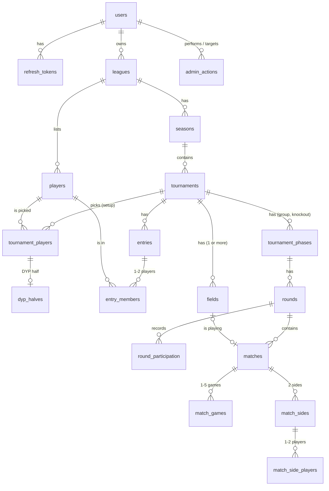

# TourneyHub — MVP Data Model

| | |
|---|---|
| Status | Proposed — awaiting review by another developer |
| Date | 2026-10-17, revised 2026-10-20 after the first review, 2026-11-05 (§2, §5: decisions of the style-guide review), 2026-11-10 (D9–D11: ordered phases, fields, games, match formats and league defaults, decided while the lead reviewer is away) and 2026-11-11 (§4.3, §4.4: the tournament tables of P7a, with the picked players in `tournament_players` and the halves method on the tournament; §2, §4.3, §4.4, §5 after the independent review: entry members reference the picks, a partial index on `source_entry_id`, two same-row CHECKs, and `dyp_halves` loses its own reference to `players`), 2026-11-11 (§2, §4.5, §4.6, §5: the round and match tables of P7b, starting with the expected draw counter, going back to setup with the expected state, the result-time CHECK, the indexes on the references and two more invariant queries), 2026-11-11 (§2, §4.5, §5: the results, standings and finishing of P8: the empty result clears, finishing expects `in_progress`, when a sit-out counts, and the invariant queries on games), 2026-11-11 (§2, §4.3, §4.5: the knockout of P10b with no new column: starting expects the current phase, deleting names the phase, the knockout's format defaults to the league's, the result locks and the field a knockout match leaves), 2026-11-11 (§4.4: `sit_out_points` default to 0, only for `swiss` and `monster_dyp`, and `sit_out_points_set_by_hand` goes, as the PRD owner's review of PR #46 decided; PR #65), 2026-11-11 (§4.2, §4.4, §4.5, §4.6, §5: changes from issue #48, each marked "decided in #48": 1000 active players, the share-link confirmation, held matches and top players after BR-061), 2026-11-11 (§5: at most 256 entries in a knockout without a group phase), 2026-11-12 (D4, §4.2, §4.3, §4.5, §5: after dejvicek's review of #56: player names stay unique on `(league_id, lower(name))`, with no note; tournament names stay at 100 characters; a round robin takes at most 16 entries; a held or requeued match keeps that state when a late entry's reschedule changes its round; D4 cites §7.17 as BR-140–BR-157), 2026-11-13 (D4, D5, §4.4, §4.5, §5: the Lord have mercy re-mix without replacements, step 1 of issue #63: a stored draw per knockout round, with no new table or column) |
| Scope | PostgreSQL schema for the MVP in `PRD.md`: the tables, their relationships and the key decisions behind them. Column lists show what matters for review; exact types, names and the first Alembic migration are settled during implementation within these rules. |

The schema follows the proposed ADRs in `ADR.md`, in particular ADR-002 (PostgreSQL), ADR-006 (authentication), ADR-007 (instance admin), ADR-008 (API conventions and locking), ADR-009 (pure engine, derived data computed on read), ADR-010 (lots) and ADR-011 (pairing). Requirement IDs (FR-, BR-) refer to `PRD.md`.

## 1. Key decisions

| # | Decision | Why |
|---|---|---|
| D1 | **Only source data is stored.** Standings, BH1, BH2, score difference, places, season standings, the league ranking and the sides of later matches in a fixed-pair knockout (D4) are computed by the engine on every read. | ADR-009. Derived data can never drift from results; corrections need no recalculation. |
| D2 | **A match side is a list of players**, optionally tied to an entry. Fixed entries (a player or a pair) exist for seeding and standings; Monster DYP group rounds have sides with players and no entry. | One model covers Singles, Doubles, DYP and Monster DYP, whose teams change every round (BR-060). |
| D3 | **Tournament settings are typed columns**, and each phase (group, knockout) is a row in `tournament_phases`. | MVP settings are few and fixed; CHECK constraints reject impossible combinations. |
| D4 | **Knockout progression is derived from positions; a Lord have mercy knockout stores the draw of every round instead.** In a fixed-pair knockout all bracket matches are created when the knockout is generated, but sides are stored only for the first round; later sides are computed from winners. A Lord have mercy knockout (PRD §7.17, BR-140–BR-157; issue #63) pairs the players again before every later round, so its later sides cannot be computed from winners. Only its round 1 is created when the knockout starts; each later round is stored when the organizer draws it (FR-049, BR-140), with its matches and both sides of every match. A side of a later round is two players without an entry, like a team of a Monster DYP group round (D2). In step 1 of issue #63, without replacements, this needs no new table or column (§4.5); replacements are stored with the draw in step 2 (D5). | Fixed pairs: no cascade on result changes (BR-094) and no cyclic foreign keys. Lord have mercy: each round is drawn before it is played (BR-140) and never drawn again by itself (BR-146), so it is stored like every other draw (D8, ADR-010). Drawing a round locks the winners of the round before (BR-146), so a stored round always fits the results it was drawn from. |
| D5 | **Per-round participation is stored** for group phases: played, sat out, disabled, not yet joined. A knockout stores none, a Lord have mercy knockout without replacements (step 1 of issue #63) included: who plays a round is the round's stored sides (D4), and whether a player is disabled is the current `is_disabled` flag of the player's `main` entry (§4.4). A disabled player who is still in has left (BR-147). | Sit-out counts and points (BR-058, BR-063, BR-071, BR-076, BR-077) and the missed rounds of disabled and late players (BR-064, BR-067) depend on why an entry did not play in each past round. A missed round counts as a sit-out for the sit-out order only, never in the sat-out column or for points. In a Lord have mercy knockout without replacements (step 1 of issue #63) the flag changes no draw, result or place: a player who has left stays in the draw and plays in the pair drawn for them (BR-149), the walkover is a result the organizer records (BR-149, BR-157), and places come from the stored results (BR-145). The current flag is therefore enough. It marks a player who has left in the draw preview (FR-049) and the round-by-round view (BR-155), and keeps a disabled player out when the knockout starts again (BR-080, BR-152). Replacements (BR-148, BR-151–BR-154) depend on who had left when a round was drawn, so they are stored with the draw; how is decided with step 2 of issue #63. |
| D6 | **Hard delete, except players.** Deleting a league or a tournament removes everything under it (FR-013, FR-038). A removed player is only marked removed and keeps their history (BR-002). | Matches the PRD; no `deleted_at` filters everywhere. |
| D7 | **History only for admin actions.** `admin_actions` records who did what to whom and when (ADR-007). Matches keep only the time of the last result entry. | The organizer is the only person changing a league in the MVP. |
| D8 | **Draws are stored, lots are seeded.** Tournaments carry an immutable random seed and a draw counter; every lot, including the league ranking's (BR-020), uses the tournament's seed (ADR-010). | Reproducible draws; lots inside computed standings give the same answer on every read. |
| D9 | **Phases are ordered.** A tournament's phases carry a `position`; the MVP's rule of at most one group phase and one knockout is a partial unique index on `kind`, not a unique key on the tournament. | Later formats add phases (RM-05, RM-06). With the order in the first tournament migration, no stored tournament needs a backfill when they arrive, and the tournament tables do not wait for the review of the post-MVP ADRs. |
| D10 | **Field assignments are stored; the waiting list is computed.** Each field holds the match being played on it. Placements are written in the same transaction as the event that causes them: a result, a field added or removed, a match placed or taken off by hand (BR-130–BR-134). The waiting list is computed on read (FR-092). | Which match is on which field depends on the order of events, not on the stored results alone. Recomputing it on read would need a log of field changes and would move a match being played whenever an earlier result is corrected (ADR-009). |
| D11 | **A result is an outcome plus its games.** Every game played has a row with its winner and, if entered, its score; a BO1 match has one. `matches.outcome` is written from the games, or is the walkover's winner. | One path for BO1–BO5 and for score difference over games (BR-073, BR-092). The outcome stays a column because a walkover has no games (BR-124) and the result lock (BR-094) and finishing (FR-037) only need to know whether a match has a result. |

## 2. Conventions

- **Naming:** `snake_case`, plural table names, foreign keys named `<singular>_id`, timestamps end in `_at`.
- **Primary keys:** `uuid`, UUIDv7, generated by the application with `uuid.uuid7()` from Python's standard library. No `serial`, no database default. Creating a league or a tournament takes its id from the client, so that a repeated request hits the existing primary key: the API returns the existing row only if it belongs to the same organizer, has the same parent (the organizer for a league, the season for a tournament) and, for a tournament, the same type; otherwise it answers 409 (ADR-008). The API accepts only UUIDv7 values there and does not trust the timestamp inside them: `created_at` is set by the server, and nothing relies on the order of client-supplied ids.
- **Enumerations:** `varchar` without a length and a named `CHECK (col IN (…))`, not PostgreSQL enums, so adding a value needs no `ALTER TYPE`. PostgreSQL treats `varchar` without a length like `text`; it is what `str_enum()` creates through SQLAlchemy's non-native `Enum`, while `text` would need a custom type (`docs/style/python-style.md` §7). A test checks that each CHECK matches its Python `StrEnum`.
- **Time:** instants are `timestamptz`, stored in UTC. The tournament date (FR-030) is a plain `date`.
- **Numbers:** scores and placement points are `int`. Season points are whole numbers because BR-111 rounds down.
- **Timestamps:** `created_at` on every table; `updated_at` on tables whose rows are edited, set by the application.
- **Deletes:** two kinds of foreign keys.
  - A child that its parent owns is `ON DELETE CASCADE`: league → season → tournament → phase → round → match → side → side players, and below a tournament also its entries, their members, the DYP halves, the round participation rows and the fields; below a match also its games.
  - A reference that does not own anything is `NO ACTION DEFERRABLE INITIALLY DEFERRED`: the three references to `players` (`tournament_players`, `entry_members`, `match_side_players`), the reference of `entry_members` to `tournament_players` and `match_sides.entry_id`. `dyp_halves` has no reference to `players` of its own: its pick has one. The check runs at commit, after the cascades have removed every referencing row. Deleting a league, a tournament or a knockout therefore succeeds whatever the order of its statements, while deleting a player who still has history, or an entry that still has match sides, fails. This makes D6 a database rule: a player with history disappears only with its league, because removing a player only sets `removed_at`. The application never issues a `DELETE` on `players` outside the league delete.
  - With an immediate check (`RESTRICT` or plain `NO ACTION`), deleting a league or a tournament fails, because the cascade reaches `players` and `entries` before the rows that reference them (verified on PostgreSQL). With `CASCADE` on these references, a stray `DELETE` of one player or entry would silently take match sides and side players with it.
  - The API treats a foreign-key violation raised at commit as a bug: it returns 500 with a stable code and logs the constraint name.
  - ORM relationships along these foreign keys use `passive_deletes='all'` or have no back-reference. By default SQLAlchemy sets a nullable foreign key to `NULL` when the parent is deleted, which would let a stray delete of an entry pass the deferred check on `match_sides.entry_id`.
  - Integration tests that run in a transaction and roll it back never reach a real commit. The test session's commit (a savepoint release in that pattern) therefore runs `SET CONSTRAINTS ALL IMMEDIATE` and then `SET CONSTRAINTS ALL DEFERRED`, so a violation shows up at the operation that caused it, as it would at a real commit. Running `SET CONSTRAINTS ALL IMMEDIATE` at the start of a transaction instead would make the cascading deletes fail like an immediate check.
  - A field's current match (`fields.match_id`) is `ON DELETE SET NULL`: deleting a round, a knockout or every round when going back to setup frees the fields, and the application then fills them (§4.6).
  - References to `users` are `ON DELETE RESTRICT` unless noted. Until organizers can delete their own account (RM-31), the instance admin deletes an account by hand: first the organizer's leagues, then the user, then the `auth_attempts` rows whose `key` is the user's email, since they reference nothing. Refresh tokens go with the user, and `admin_actions` keeps its rows with the reference set to `NULL`.
- **Concurrency:** no version columns. Every operation that changes data inside a league locks the league row first and then, if it touches a tournament, the tournament row (`SELECT … FOR UPDATE`, ADR-008). Rules spanning a season and its tournaments depend on this (BR-010, BR-011, BR-095, FR-038), and the fixed order rules out deadlocks; with one organizer per league there is almost no waiting. With only the tournament lock, clearing a result in a finished tournament and starting a new season can both commit and leave a tournament in progress inside a closed season (reproduced on PostgreSQL).
- **Repeated requests:** the locks do not help when a client repeats a request whose response was lost after the first attempt had committed, or when a second device acts on a stale screen. Operations that are unsafe to repeat state what they expect; the application checks it under the lock and answers 409 on a mismatch (ADR-008):
  - a round is deleted by `rounds.id`, never as "the newest round" (FR-046);
  - adding a round carries the expected `round_no`, and the unique `(phase_id, round_no)` also catches a duplicate (FR-040);
  - starting a season carries the current season's `number` (FR-021);
  - "shuffle again", "new DYP draw" and "generate and start" (FR-035) carry the expected `draw_counter`, and "generate and start" also the seed order the preview showed (`expected_seed_order`); a tournament already started gets 409 `tournament_not_in_setup`, and seeds reordered since the review get 409 `seed_order_changed`;
  - "back to setup" (FR-036) carries the state it expects, `in_progress`; any other gets 409 `tournament_not_in_progress`, so a repeat changes nothing;
  - finishing a round robin without a knockout (FR-040) carries the state it expects, `in_progress`, the same way; a match still without a result is 422 `group_phase_not_done`;
  - creating a league or a tournament uses a client-supplied id (see Primary keys);
  - adding a field carries the number the client expects it to get, the lowest free one (BR-132); the unique `(tournament_id, number)` also catches a duplicate;
  - starting the knockout after a group phase (FR-045) carries the phase the screen saw as current, the group phase: once the knockout exists it is 409 `current_phase_changed`, and it carries the group-phase entries the preview showed going through, in seed order (`expected_qualifier_ids`), so a group result that changed the cut or the seeds is 409 `qualifiers_changed`; the partial unique index on `(tournament_id, kind)` also catches a duplicate;
  - the knockout is deleted by its phase id (FR-046), like a round: a repeat is 404 `phase_not_found`.

  Changing the entries in setup carries no expected state: the picked players, the Doubles pairs and the hand-set DYP halves are each sent whole, as the target state, so a retry changes nothing; only a change to them draws again and increments `draw_counter`. The unique `(tournament_id, stage, player_id)` still keeps a player in one entry (BR-003).

  Every other operation is safe to repeat: it sets a target state (`disabled: true`, never a toggle; the full seed order, never "move up"; a whole result with every game or the walkover, never one game, where the empty result (no walkover, no games) clears it and a result equal to the stored one changes nothing, its time included; "match M on field F" or "match M waiting", and a swap that names both matches with their new fields, so a repeated swap changes nothing; the number of fields in setup), deletes by id (a field by `fields.id`), or is refused under the lock by a uniqueness check or by the tournament state. A full seed order that does not list exactly the current entries of the stage gets 409. A repeated delete by id gets 404, which the frontend treats like a 409: it reloads the state instead of showing an error.
- **Case-insensitive text:** email addresses and player names are compared with `lower()`. The database is created with PostgreSQL 17's built-in locale provider: `initdb --locale-provider=builtin --builtin-locale=C.UTF-8`, passed as `POSTGRES_INITDB_ARGS` to the image. `lower()` then uses Unicode case mapping, so `Č` folds to `č`, and the `lower()` unique indexes do not depend on the image's glibc version. The behaviour is stable within a PostgreSQL major version, so the release notes are checked before a major upgrade. Text sorts by code point; a query that must list names in Czech order uses `COLLATE "cs-x-icu"`. A test checks the folding: a database created with the plain `C` locale does not fold `Č` at all.
- **What the database checks:** single-row and same-table invariants (CHECK, UNIQUE, foreign keys). Rules spanning several rows or tables — e.g. "no new season while a tournament is unfinished" (BR-010) or "a closed season cannot change" (BR-011) — are enforced by the application under the league and tournament locks and covered by tests, including invariant queries run after every integration test (§5).

## 3. Overview

Standalone tables: `instance_settings` (one row) and `auth_attempts` (rate limiting).

## 4. Tables

### 4.1 Accounts and administration

**`users`** — organizers and admins (FR-001–FR-007).

| Column | Notes |
|---|---|
| `id` | |
| `email` | Unique on `lower(email)` (FR-002). |
| `display_name` | |
| `password_hash` | Argon2id (ADR-006). |
| `is_admin` | `bool`, default `false`. Set only by the CLI (ADR-007). Read from this row on every admin request, never from the access token (ADR-006). |
| `must_change_password` | `bool`, default `false`. Set by an admin password reset (FR-006), cleared by a password change. While set, the API allows only `/api/v1/auth/*` and `GET /api/v1/me` and answers everything else with 403 `password_change_required`; it is read from this row on every request (ADR-006). |
| `language` | `en` or `cs`; the remembered UI language (FR-081). |
| `created_at`, `updated_at` | |

**`refresh_tokens`** — rotating refresh tokens (ADR-006).

| Column | Notes |
|---|---|
| `id` | |
| `user_id` | FK `users`, `ON DELETE CASCADE`. Indexed: a password change revokes the user's other families (ADR-006). |
| `family_id` | `uuid`; all tokens of one login share it. Indexed, and a second, partial index `WHERE revoked_at IS NULL` answers the check every authenticated request makes: does the access token's family still have an unrevoked row (ADR-006)? The refresh endpoint locks the family's rows (`SELECT … FOR UPDATE`) before reading them, so presentations within one family are handled one at a time. |
| `parent_id` | FK `refresh_tokens`, nullable, `ON DELETE SET NULL`: the token this one was rotated from. Indexed. Siblings are tokens with the same `family_id` and the same non-null `parent_id`; a normal rotation revokes the presented token's unrotated siblings. A parent expires before its children, hence `SET NULL`. |
| `token_hash` | `bytea`, SHA-256 of the token. Unique. |
| `expires_at` | 90 days after issue; each rotation issues a new token with a new expiry, so a device in use stays logged in (ADR-006). Rows past `expires_at` are deleted regularly; rotated rows stay until then, because reuse detection needs them. |
| `rotated_at` | Set when this token was exchanged for a new one. Presenting it again within 60 seconds of `rotated_at` issues another new token in the same family and leaves `rotated_at` unchanged; this covers two tabs refreshing at once and an immediate retry after a lost response. Only hashes are stored, so the earlier replacement cannot be sent again. Presenting it later revokes the family. |
| `revoked_at` | Set on logout, password change, admin reset, detected reuse or a sibling's normal rotation. A revoked or expired token gets 401 and changes nothing, even within the 60-second window. |
| `created_at` | |

**`auth_attempts`** — counters for login and sign-up limits (ADR-006).

| Column | Notes |
|---|---|
| `id` | |
| `kind` | `login_email`, `login_ip`, `signup_ip`. |
| `key` | The email (lower-cased) or the client IP from `X-Forwarded-For`, trusted only from Caddy (ADR-006); an IPv6 address is stored as its /64 prefix. |
| `succeeded` | `bool`. |
| `created_at` | Index on `(kind, key, created_at)`. Rows older than the longest window are deleted by the application. |

**`instance_settings`** — exactly one row (`id smallint PRIMARY KEY CHECK (id = 1)`).

| Column | Notes |
|---|---|
| `signup_code` | `text`, nullable. `NULL` means sign-up is closed (ADR-007). Stored in plain text so the admin can see and share it; it gates sign-up only and protects no existing account. Sign-up compares it in constant time with `secrets.compare_digest` on the UTF-8 bytes; on `str` that function raises `TypeError` for non-ASCII input such as a Czech letter. |
| `updated_at` | |

**`admin_actions`** — the record of admin actions (ADR-007).

| Column | Notes |
|---|---|
| `id` | |
| `source` | `web` or `cli`. |
| `admin_user_id` | FK `users`, nullable, `ON DELETE SET NULL`. `NULL` for CLI actions; on a `web` row it means the admin's account was deleted. |
| `action` | `set_signup_code` (web or CLI), `reset_password` (web); `create_admin`, `grant_admin`, `revoke_admin` (CLI). |
| `target_user_id` | FK `users`, nullable, `ON DELETE SET NULL`. `NULL` for `set_signup_code`; on other rows it means the target's account was deleted. |
| `created_at` | |

The CHECK constraints work in one direction only, because `SET NULL` must be able to clear a reference when an account is deleted (§2): `source = 'web' OR admin_user_id IS NULL` (a CLI action has no admin) and `action <> 'set_signup_code' OR target_user_id IS NULL` (setting the code has no target). A web action cannot be recorded without a logged-in admin, so `source` tells a deleted account from a CLI action.

The sign-up code itself is never written to `admin_actions`, and neither is a password: the row says who did what to whom, and when.

- `source` and `action` are `varchar` columns with a named CHECK of the allowed values (§2), like every enumeration. Setting, changing and clearing the code are one action, `set_signup_code`; the row does not tell them apart. The code is never read from this table.
- Reading the sign-up code or the list of accounts is not recorded; only changes are.
- A command or request that changes nothing records nothing: `grant-admin` for an account that is an admin already, `revoke-admin` for one that is not, and setting the sign-up code to the value it has (closing a closed sign-up too). `create-admin` records one row for the new account, `target_user_id` set.
- A row is inserted in the transaction of the action it records, so both commit or both roll back.
- The table has no index besides its primary key: the MVP never queries it, and a foreign key's index would only speed up deleting an account, which the MVP has no screen for.

### 4.2 Leagues, players and seasons

**`leagues`** (FR-010–FR-013, FR-070).

| Column | Notes |
|---|---|
| `id` | |
| `owner_user_id` | FK `users`. One organizer per league in the MVP; co-organizers (RM-01) will add a membership table. |
| `name` | |
| `draws_allowed` | `bool` (FR-011, BR-090). |
| `default_field_count` | `int`, default `1`, CHECK `>= 1 AND <= 32` (FR-011, FR-090). The API refuses more than 32 too. P7's per-tournament field count uses the same cap, because creating a tournament creates that many fields. |
| `default_match_format` | `bo1`, `bo3` or `bo5`, default `bo1` (FR-011, BR-120). Not `bo2`, which only group phases of leagues with draws can play (BR-121), so a default that a knockout cannot take is never copied. |
| `default_goals_per_game` | `int`, default `10`, CHECK `>= 1 AND <= 99` (FR-011, BR-123). The API refuses more than 99 too. |
| `share_token` | `text`, unique; at least 128 random bits, URL-safe (FR-071, ADR-008). |
| `share_link_confirmed_at` | `timestamptz`, nullable. Decided in #48: set when the organizer confirms that the league's players know the share link makes their names and results public (FR-102). The app shows the link only once it is set; the public routes do not depend on it. |
| `created_at`, `updated_at` | |

**`players`** — a league's player list (FR-012, BR-001, BR-002).

| Column | Notes |
|---|---|
| `id` | |
| `league_id` | FK `leagues`, `ON DELETE CASCADE`. |
| `name` | Unique on `(league_id, lower(name))`, **including removed players** (ADR-002). Adding a name that a removed player holds is refused (422 `player_name_taken`, with `removed: true`), and the organizer restores that player explicitly (ADR-002). A restore needs no name check: the index includes removed players, so a name is never freed, and every add and every rename checks against all players. A removed player can be renamed (BR-011: a rename always applies), and the new name must be free like any other. 1 to 100 characters (BR-005), stored in Unicode NFC with leading and trailing whitespace dropped and every run of whitespace (a no-break space too) collapsed to one space, refusing control, format, line-separator and paragraph-separator characters, U+3164 and U+2800; look-alike names are not merged. Decided in #48: a league holds at most 1000 active players (BR-006, `MAX_PLAYERS_PER_LEAGUE`); removed players do not count, and an add or a restore over the limit is refused with 422 `player_limit_reached`, checked under the league lock. (Today: 500, removed ones included, restores not checked.) |
| `removed_at` | `NULL` while the player is on the list. Set when the player is removed (BR-002), cleared when they are restored; a repeated removal keeps the first time. |
| `created_at`, `updated_at` | |

**`seasons`** (FR-020–FR-022, BR-010–BR-012).

| Column | Notes |
|---|---|
| `id` | |
| `league_id` | FK `leagues`, `ON DELETE CASCADE`. |
| `number` | 1, 2, …; unique on `(league_id, number)`. CHECK `ck_seasons_number`: `number >= 1`. |
| `name` | Nullable. `NULL` means the default name, rendered in the UI language from `number` ("Season 2" / "Sezóna 2"); set when the organizer renames it (FR-020). |
| `state` | `active` or `closed`. At most one active season per league: partial unique index on `(league_id) WHERE state = 'active'`. |
| `placement_points` | `int[]`, the season's placement points table, e.g. `{10,8,6,4,2}` (FR-011). CHECK `ck_seasons_placement_points` via an immutable SQL helper function: one-dimensional, not empty, no `NULL` elements, no negative values, non-increasing. At most 256 places (the most entries ADR-009 sizes a tournament for); this limit is enforced only in the API, not in the database, because it is a limit on what a client may send and the CHECK describes what a valid table is, so raising the limit later needs no migration. |
| `started_at`, `closed_at` | `closed_at` is `NULL` while the season is active. CHECK `ck_seasons_closed_at`: `closed_at` is set exactly when `state` is `closed`. |
| `created_at`, `updated_at` | |

The league's defaults are copied, never referenced, like the placement points table below. Creating a tournament (FR-030) copies `default_goals_per_game` to `tournaments.goals_per_game`, creates `default_field_count` fields and gives each phase created in setup `default_match_format`; the create request may set its own values instead. A knockout created after a group phase (FR-045) takes its format from the start request, which the UI fills in from the league's current default. Changing a default never changes an existing tournament.

The placement points table lives only on seasons. The league settings screen edits the active season's table, a new season starts with a copy of the previous season's table, and a closed season's table no longer changes (BR-012). This is the "season keeps its own copy" of ADR-009 without a second copy on `leagues`.

### 4.3 Tournaments and phases

**`tournaments`** (FR-030–FR-039).

| Column | Notes |
|---|---|
| `id` | |
| `season_id` | FK `seasons`, `ON DELETE CASCADE`. |
| `name`, `date` | `date` is the calendar date on the organizer's device, sent by the client, which defaults it to today (FR-030); it is never derived from a UTC timestamp, so a tournament at 23:30 in Prague stays on its day. |
| `type` | `singles`, `doubles`, `dyp`, `monster_dyp`. |
| `state` | `setup`, `in_progress`, `finished`. |
| `seeding_method` | `ranking` or `random` (FR-034), `ranking` when created; not used by Monster DYP. |
| `halves_method` | `ranking` or `by_hand` (FR-033, BR-032), `ranking` when created; used only by DYP, so CHECK `halves_method = 'ranking' OR type = 'dyp'`. It tells which `dyp_halves` rows the app rewrites when the entries change (ranking) and which it keeps (by hand, ADR-010). A new type resets it to `ranking`. |
| `rng_seed` | `bytea`, 16 bytes, immutable (ADR-010). |
| `draw_counter` | `int`, `0` when created, CHECK `>= 0`; incremented on each new draw: "shuffle again", "new DYP draw", "pair the rest" in Doubles (with at least two players without a partner), a change of the seeding method, or a draw forced by a change to the entries in setup (ADR-010). A hand reordering of seeds is not a draw and leaves it. |
| `goals_per_game` | `int`, CHECK `>= 1 AND <= 99` (the league default's cap); copied from the league unless the create request gives its own (FR-030). How many goals the score counter shows, for every phase and the final; a guide, not a rule, so a score above it is accepted and the organizer can change it at any time (BR-123). |
| `created_at`, `updated_at` | |

**`tournament_phases`** — the tournament's phases in order (D9); in the MVP at most one group phase and one knockout (FR-031).

| Column | Notes |
|---|---|
| `id` | |
| `tournament_id` | FK `tournaments`, `ON DELETE CASCADE`. |
| `position` | `1, 2, …`, the order of the phases (D9). Unique on `(tournament_id, position)`. In the MVP the group phase is 1 and the knockout 2, or 1 when there is no group phase. |
| `kind` | `group` or `knockout`. A partial unique index on `(tournament_id, kind) WHERE kind IN ('group', 'knockout')` keeps at most one of each, so the rule still holds when later formats add kinds of their own. |
| `format` | `round_robin`, `swiss`, `monster_dyp` (group) or `single_elimination` (knockout). |
| `round_robin_legs` | `1` or `2`; round robin only. |
| `sit_out_points` | `0`, `1` or `2`; `swiss` and `monster_dyp` group phases only, `NULL` for a `round_robin` (FR-039, BR-071: in a complete round robin every entry sits out equally often, and with a late entry (BR-054) the points would distort the order) and for a knockout phase. The organizer picks it in setup; the default is `0`, whatever the match format and the league's draw setting (FR-039, BR-075). It cannot change while the phase has a result (BR-075, BR-096): the format write is refused once the tournament has started. A change to a round robin, or to no group phase, drops the value, and a change back starts from `0` (BR-071). The migration that brought this rule moved existing tournaments: a round robin's phase got `NULL`; a Swiss or Monster DYP phase with a result (BR-096) kept its value; one without a result kept a value the organizer had picked by hand (the dropped column `sit_out_points_set_by_hand`) and otherwise got `0`. |
| `tiebreakers` | `text[]` of `score_difference`, `bh1`, `bh2` in the organizer's order; Swiss and Monster DYP only (FR-043). CHECK: `tiebreakers <@ ARRAY['score_difference','bh1','bh2']`, and no duplicates via an immutable helper function (a CHECK cannot contain a subquery). |
| `qualifiers` | Number of qualifying entries (FR-045, BR-080). Set only on a knockout that follows a group phase. |
| `third_place_match` | `bool`; knockout only. |
| `monster_knockout_mode` | `seeded_pairs`, `singles`, `a_little_mercy`, `lord_have_mercy` (BR-081–BR-084). Set only on a knockout that follows a Monster DYP group phase. |
| `match_format` | `bo1`, `bo2`, `bo3` or `bo5`, `NOT NULL` (BR-120). The format of every match of the phase except the final; the third-place match plays it too. Copied from the league in setup, or for a knockout after a group phase taken from the start request (§4.2), the league's default when the request leaves it null. The organizer can change it while the phase has no result (FR-054, BR-096). |
| `final_match_format` | `bo1`, `bo3` or `bo5`, nullable; knockout only. `NULL` means the final plays `match_format` (BR-120). The final is the `standard` match of the bracket's last round (D4). The organizer can change it while the final has no result (FR-054, BR-096). |
| `created_at`, `updated_at` | `updated_at` is set when the format step changes the phase in place. |

CHECK constraints tie the columns to `kind` and `format`: e.g. a `swiss` or `monster_dyp` phase has `sit_out_points` (0 to 2), a `round_robin` and a knockout have it `NULL` (BR-071), and a `group` phase has no `third_place_match`; `round_robin_legs` is set only for `round_robin`; `tiebreakers` only for `swiss` and `monster_dyp`; `qualifiers`, `monster_knockout_mode` and `final_match_format` only on `knockout` rows; `match_format = 'bo2'` only on `group` rows (BR-121); a `group` phase has `position = 1` and a `knockout` phase `position` 1 or 2. Rules that need another row, the tournament type or the league are checked by the application: `qualifiers` is set exactly when the tournament also has a group phase, `monster_knockout_mode` exactly when that group phase is `monster_dyp`, Monster DYP always has a `monster_dyp` group phase, a knockout is at position 2 exactly when a group phase exists, `bo2` only in a league that allows draws (BR-121), and a format no longer changes once the phase has a result (FR-054, BR-096).

A knockout without a group phase is created in setup. A knockout after a group phase is created when the organizer starts it (FR-045), so setup holds exactly one phase, at position 1: the format step updates it in place while its kind stays and replaces it when the kind changes. A new Swiss or Monster DYP phase starts with FR-043's tie-breakers (`bh1`, `bh2`, `score_difference`), which stay while the phase keeps its format. Deleting it (FR-046, BR-087) removes the phase row, which cascades to its rounds and matches; its `knockout` entries hang off `tournaments`, so the application deletes them in the same transaction, in either order (§2).

The helper functions used by CHECK constraints are created in the first migration, before the tables that use them.

### 4.4 Entries

**`entries`** — whoever takes a place in a phase: a player or a pair (glossary "Entry").

| Column | Notes |
|---|---|
| `id` | |
| `tournament_id` | FK `tournaments`, `ON DELETE CASCADE`. |
| `stage` | `main` or `knockout`. `main` entries play the tournament's first phase. `knockout` entries are created only when a knockout follows a group phase. |
| `kind` | `player` or `pair`. |
| `seed` | `int`, nullable until seeded. Unique on `(tournament_id, stage, seed)`, `DEFERRABLE INITIALLY DEFERRED` so that seeds can be swapped in one transaction (FR-034). Cleared and set again whenever the entries change in setup, which also discards a hand reordering (ADR-010). |
| `source_entry_id` | FK `entries`, nullable, `ON DELETE CASCADE`. For a knockout entry that continues one group-phase entry — after a round robin or Swiss (BR-085), and in the Monster DYP *Singles* mode (BR-082) — that entry. `NULL` for pairs formed after Monster DYP, whose players are found through `entry_members`. Used to place non-qualifiers after the knockout (BR-103). CHECK `source_entry_id IS NULL OR stage = 'knockout'`: only a knockout entry continues another. Partial index `WHERE source_entry_id IS NOT NULL`, so that deleting a source entry finds its knockout entries without scanning the table. |
| `is_top_player` | `bool`; marked as a top player by the organizer (FR-041). See "Top players" below. |
| `is_disabled` | `bool`; the current state (FR-044, BR-064). The history is in `round_participation`. Deleting a round does not change it; going back to setup clears it, since disabling exists only while rounds are played or a Lord have mercy knockout runs (FR-044, BR-147). In a Lord have mercy knockout the flag of a player's `main` entry says that the player is disabled (FR-044), and a disabled player who is still in has left (BR-147); no history of it is stored (D5), and deleting a knockout round or the knockout does not change it, so a player who is still disabled does not qualify when the knockout starts again (BR-080, BR-152). |
| `created_at` | |

Additional constraint: **`UNIQUE (id, tournament_id, stage)`**, not deferrable, so that `entry_members` can reference it with a composite foreign key. `stage` never changes after an entry is created.

`stage` is used instead of a phase FK because `main` entries exist in setup, before any round, and because a knockout without a group phase also uses `main` entries.

A late entry (BR-067) is an ordinary `main` entry added while the tournament is in progress; which rounds it missed is recorded in `round_participation` (§4.5).

**Top players** (BR-061, FR-041). The number of matches can change between rounds 1 and 2 (a disabled or late player), and BR-063 can draw a top player to sit out, so a fixed set of top players does not always match the number of groups. The rule, which BR-061 states since #46: in rounds 1 and 2 of a Monster DYP, the engine first picks who sits out, then takes as top players the first M playing players, where M is the round's number of matches, in this order: players marked by the organizer, then the others, each in league-ranking order. A top player who sits out or is disabled is replaced by the next one, so every group has exactly one. Without marks this is the league-ranking rule of FR-041. `is_top_player` therefore stores only the organizer's marks.

Decided in #48: the organizer marks top players in a step of the Monster DYP setup (FR-041). BR-061 (#46, per the review of #46) settles that top players are not exempt from sitting out: the sit-outs are picked first and the top players come from those who play, which is how §5.2 step 2 now reads ("the 3 best-ranked of the 12 who play"). When more are marked than a later round has matches, the marked players who play count in league-ranking order (BR-061, FR-041); there is no setting for the order of the top players.

**`entry_members`** — the 1–2 players of an entry.

| Column | Notes |
|---|---|
| `entry_id` | Composite FK `(entry_id, tournament_id, stage)` → `entries (id, tournament_id, stage)`, `ON DELETE CASCADE`. |
| `tournament_id`, `stage` | Copied from the entry so that the next constraint can be expressed. |
| `player_id` | FK `players`, `NO ACTION DEFERRABLE INITIALLY DEFERRED` (§2). Also a composite FK `(tournament_id, player_id)` → `tournament_players`, `NO ACTION DEFERRABLE INITIALLY DEFERRED`: a member is a picked player, whatever the stage. Deferred, because setup unpicks a player before it makes the entries again (ADR-010); the check at commit finds the entries already rebuilt. |

Primary key `(entry_id, player_id)`. **Unique on `(tournament_id, stage, player_id)`**: a player is in at most one entry per stage, which enforces BR-003 in the database. That an entry of kind `player` has one member and of kind `pair` two different members (BR-030) is checked by the application.

`entry_members` also has `created_at`, as every table does (§2).

**`tournament_players`** — the players the organizer picked for a tournament (FR-032).

| Column | Notes |
|---|---|
| `tournament_id` | FK `tournaments`, `ON DELETE CASCADE`. |
| `player_id` | FK `players`, deferred (§2). Primary key `(tournament_id, player_id)`; indexed on `player_id` for BR-002. |
| `created_at` | |

Setup needs the picks apart from the entries, because a picked player can be in no entry yet: a Doubles player without a partner, a DYP player without a half, or every DYP player while fewer than four are picked (BR-031). ADR-010 assumes such players ("the changed player is added to or removed from them") without naming a table. The picks are the input of the entries: Singles and Monster DYP get one `player` entry per pick, Doubles pairs and DYP halves are made from the picks, and the members of every entry are picked players (a composite foreign key from `entry_members`, deferred because setup unpicks before it rebuilds the entries, §2). A removed player cannot be picked, and a picked player of a tournament that is not finished cannot be removed (BR-002), both under the league lock.

**`dyp_halves`** — DYP setup before the pairs are drawn (FR-033, BR-031–BR-033).

| Column | Notes |
|---|---|
| `tournament_id` | Composite FK `(tournament_id, player_id)` → `tournament_players`, `ON DELETE CASCADE`: only a picked player has a half, and unpicking them removes it. The cascade from `tournaments` runs through `tournament_players`. |
| `player_id` | Part of the composite FK above. No reference to `players` of its own: the pick has one. Primary key `(tournament_id, player_id)`. |
| `half` | `top`, `bottom` or `left_out`. |
| `created_at` | |

The drawn pairs are stored as `pair` entries. The left-out player has no entry and does not play (BR-031). When the entries change in setup (ADR-010), halves computed from the league ranking (`tournaments.halves_method = 'ranking'`) are rewritten and drawn again; hand-set rows are kept, an unpicked player's row is deleted, and a new pick has no row until the organizer gives them a half. The partners are drawn as soon as every picked player has a half and the halves are valid (BR-032); until then the tournament has no `pair` entries. With fewer than four players the ranking makes no halves.

### 4.5 Rounds, matches and results

**`rounds`** — a round of a group phase, or a round of the bracket.

| Column | Notes |
|---|---|
| `id` | |
| `phase_id` | FK `tournament_phases`, `ON DELETE CASCADE`. |
| `round_no` | 1, 2, …; unique on `(phase_id, round_no)`, CHECK `>= 1`. A double round robin continues the numbering in its second half. |
| `created_at` | |

**`round_participation`** — group phases only (D5).

| Column | Notes |
|---|---|
| `round_id` | FK `rounds`, `ON DELETE CASCADE`. |
| `entry_id` | FK `entries`, `ON DELETE CASCADE`. Primary key `(round_id, entry_id)`. A `main` entry of the round's tournament; the application ensures this (§5). |
| `status` | `played`, `sat_out`, `disabled`, `not_joined`. |
| `created_at` | |

Indexed on `entry_id`, for the cascade from `entries`.

- Every round of a group phase has exactly one row for every `main` entry that exists. Generating a round writes a row per entry. In a Swiss or Monster DYP, adding a late entry writes `not_joined` rows for every round that already exists, so the rows alone tell which rounds it missed.
- Generating a round robin (FR-035) writes every round at once, from the seeds (BR-050 to BR-052): each main entry has `played` in a round where it has a match and `sat_out` in the round it sits out. Going back to setup (FR-036) is refused once any match in the tournament has a result (FR-036, BR-096; 422 `tournament_has_results`); otherwise it frees the fields, deletes every round with its rows, and keeps the entries, seeds and draws.
- A round robin has its whole schedule from the start, so a late entry (BR-054) is added together with the reschedule, in one transaction. The reschedule moves only matches without a result, keeps every match that has a result in its round, and can add rounds. A match on a field keeps its field assignment; only its round number can change (BR-054). A held or requeued match keeps that state (`held_at`, `requeued_at`) when the reschedule changes its round. Rows of entries whose match in a round already has a result stay. All other rows of the rewritten rounds, the late entry's rows (`not_joined` where it cannot play any more) and every row of a new round are written to match the new schedule.
- Deleting the newest round (FR-046, BR-066) deletes its rows with it. A late entry added before that round keeps its entry and plays from the next round generated. Deleting round 1 takes the tournament back to setup (FR-046): all rounds and their rows are gone, entries added late become ordinary entries of the setup, so the seeding and draws are made again (ADR-010), and every entry's disabled flag is cleared.

**`matches`**

| Column | Notes |
|---|---|
| `id` | |
| `round_id` | FK `rounds`, `ON DELETE CASCADE`. |
| `position` | Order within the round; in a bracket, the slot used to derive progression (D4); in a later round of a Lord have mercy knockout, the order in which the lot placed the pairs (BR-141, ADR-010). Unique on `(round_id, kind, position)`. |
| `kind` | `standard` or `third_place`. |
| `outcome` | `side_1`, `side_2`, `draw`, or `NULL` while there is no result. Written by the application from the games when a result is entered, or the walkover's winner (D11); never edited on its own. |
| `is_walkover` | `bool` (FR-052). |
| `result_entered_at` | `timestamptz`, nullable. |
| `requeued_at` | `timestamptz`, nullable. Set when the field this match was on is removed; a requeued match waits ahead of the schedule order, earliest first (BR-132). Cleared when the match takes a field or gets a result. |
| `held_at` | Decided in #48: `timestamptz`, nullable. Set when the organizer takes the match off its field (FR-093, BR-133, BR-136). A held match stays in the waiting list, marked "held", and the filling skips it. Cleared (set to `NULL`) when the organizer places it on a field or releases it (BR-136), or when it gets a result. |
| `created_at` | |

CHECK constraints keep a result consistent within the row (BR-093, BR-124): no result → not a walkover; a walkover has a winner (`side_1` or `side_2`); `result_entered_at` is set exactly when `outcome` is; a match with a result is not requeued; decided in #48: a match with a result is not held, and a held match is not requeued; `position >= 1`. In a round, the standard matches come before the third-place match, each in `position` order (BR-130). The scores are in `match_games`. Whether draws are allowed (BR-090) and whether the games fit the format (BR-121) depend on the league and the phase, so the application checks them.

**`match_games`** — the games of a result (D11; FR-050, FR-051, BR-120–BR-124).

| Column | Notes |
|---|---|
| `match_id` | FK `matches`, `ON DELETE CASCADE`. |
| `game_no` | `1`–`5`. Primary key `(match_id, game_no)`. Numbers run from 1 without gaps (application). |
| `winner` | `side_1`, `side_2` or `draw`. Picked by the organizer when there are no scores (FR-051). |
| `score_1`, `score_2` | `int`, nullable, `>= 0`: the goals of each side (FR-051). |
| `created_at` | |

CHECK constraints keep a game consistent within the row (BR-092): both scores or neither; `side_1` wins → `score_1 > score_2` when scores are present, and the reverse for `side_2`; a drawn game has equal scores if any and is game 1, because only a BO1 game can be drawn (BR-090, BR-121).

The API takes a whole result: every game played, or a walkover with its winner (§2). The application checks it against the match's format, the phase's `match_format` or, for the final, `final_match_format`, and then writes `outcome` and the games in one transaction. Clearing a result deletes its games.

| Format | Games stored | Outcome (BR-121) |
|---|---|---|
| BO1 | exactly 1 | its winner; a draw only in a group phase of a league that allows draws (BR-090) |
| BO2 | exactly 2, neither drawn | 2:0 a win, 1:1 a draw (group phases of leagues with draws only) |
| BO3 | 2 or 3, none drawn, ending when a side has won 2 | the side that won 2 |
| BO5 | 3 to 5, none drawn, ending when a side has won 3 | the side that won 3 |
| Walkover, any format | none | the winner given (FR-052, BR-124) |

Scores are optional per game, except that every game of a Swiss or Monster DYP round needs them, unless the match is a walkover (BR-092). Score difference (BR-073) sums the games with scores; group-phase points come from `outcome`, not from games (BR-122).

The result is written by `PUT …/matches/{match_id}/result` (P8): the games, a walkover, or the empty result, which clears it. Entering it sets `result_entered_at`; changing it sets the new time; clearing deletes the games and puts a finished tournament back in progress (BR-095); deleting its knockout (FR-046, BR-087) or, in a Lord have mercy knockout, its newest knockout round (BR-146) does too. Goals per game is not checked (BR-123): any whole number from 0 is a score. A refused result is 422 with the rule's code: `result_does_not_fit_format` (detail `format`, `games`), `draws_not_allowed`, `game_score_mismatch` or `scores_required` (detail `game_no`); a match whose sides are not both known, or that has a bye, is 422 `match_sides_unknown` (BR-091). In a fixed-pair knockout the sides of a match after the first round are derived on read (D4) and can change between the screen and the write, so such a result (and the third-place match's) carries `expected_sides`, the two entries the screen saw: others are 409 `match_sides_changed` (detail `entry_ids`, the current ones), none 422 `expected_sides_required`; for stored sides the field is optional and checked when sent. Once a knockout follows the group phase, a group-phase result is 422 `group_phase_locked` (BR-053); a result of a fixed-pair knockout is 422 `result_locked` while a later match it feeds has a result (BR-094, detail `match_ids`), whether the request enters, changes or clears it, and a repeat of the stored result is not refused. In a fixed-pair knockout the result that leaves no knockout match without one, byes aside, finishes the tournament in the same transaction (FR-037). A knockout match on a field whose side is no longer known after such a change leaves the field and waits again once its sides are known (BR-130, §4.6). A Lord have mercy knockout stores its sides, locks results by BR-146 and finishes in its own way (see "A Lord have mercy knockout" below).

The knockout needs no column beyond P1's (D4): `tournament_phases` holds `qualifiers`, `third_place_match` and `final_match_format`; `entries` holds the `knockout` entries with their `seed` and `source_entry_id`; round 1 stores its sides and byes; in a fixed-pair knockout every later side, the third-place match's included, is derived by the engine on every read. A Lord have mercy knockout stores its later rounds in the same tables (see "A Lord have mercy knockout" below).

**Standings** are computed on read from `outcome`, the games' scores and `round_participation` (D1, BR-101). A round robin's participation is written for every round at the start, so a `sat_out` row counts only once every match of its round has a result (BR-101); a round robin has no sit-out points (BR-071); before that the entry has not sat anything out yet. In Swiss and Monster DYP each `sat_out` row earns the phase's `sit_out_points` as points as soon as its round is drawn (BR-076), in Monster DYP for each player who sits out (BR-077). Places and season points follow from the standings and the season's `placement_points` once the tournament is finished (BR-103, BR-110, BR-111); nothing derived is stored.

**`match_sides`** — the two sides of a match, where they are stored.

| Column | Notes |
|---|---|
| `match_id` | FK `matches`, `ON DELETE CASCADE`. |
| `side` | `1` or `2`. Primary key `(match_id, side)`. |
| `entry_id` | FK `entries`, nullable, `NO ACTION DEFERRABLE INITIALLY DEFERRED` (§2). `NULL` for a Monster DYP group-round team, for a side of a later round of a Lord have mercy knockout (D4) and for a bye. The entry belongs to the match's tournament and has the stage the phase plays: `knockout` in a knockout after a group phase, `main` otherwise. The application ensures this (§5). |
| `is_bye` | `bool`. A bye side has no entry and no players (BR-041). CHECK `NOT is_bye OR entry_id IS NULL`; "no players" spans two tables and is checked by the application. |
| `created_at` | |

CHECK `side IN (1, 2)`. Indexed on `entry_id`, for the deferred check when an entry is deleted.

**`match_side_players`** — the players on a side.

| Column | Notes |
|---|---|
| `match_id`, `side` | FK → `match_sides`, `ON DELETE CASCADE`. |
| `player_id` | FK `players`, deferred (§2). Primary key `(match_id, side, player_id)`. Unique on `(match_id, player_id)`: nobody plays on both sides. Indexed on `player_id`. |
| `created_at` | |

Players are listed for every stored side, including sides that have an entry, so that group-phase statistics such as BH1 and BH2 (BR-073), which Monster DYP needs per player, read the same way for every format. They are written together with the side and change later in two cases: when a late entry replaces a bye (BR-045), the side gets its entry and its players are inserted; when a round robin is rescheduled for a late entry (BR-054), the matches without a result are rewritten together with their sides. An invariant query in the integration tests checks that the players of every side with an entry equal that entry's members (§5). In a fixed-pair knockout the sides after round 1 are not stored, so anything listing a player's knockout matches goes through the engine.

**Which sides are stored.** Group-phase matches store both sides. Bracket matches of a fixed-pair knockout store sides only in round 1, including byes. The sides of every later match of such a bracket, including the third-place match, are computed by the engine from the round-1 sides and the stored winners. Because BR-094 forbids changing a result while a later match it feeds has one, a stored result always refers to the sides the engine derives for it.

**Byes.** A round-1 match with a bye side is stored so that the bracket has its full shape, but it is not a match in the PRD's sense (BR-041). It keeps `outcome = NULL`; the engine treats the other side as having gone through. Checks such as "every knockout match has a result" (FR-037) and "every first-round match has a result" (BR-045) skip matches with a bye side. When a late entry replaces the bye (BR-045), only the side is rewritten and the match becomes an ordinary match without a result.

**A Lord have mercy knockout** (D4, PRD §7.17). This is the re-mix without replacements, step 1 of issue #63.

- **Round 1** is stored like the first round of every knockout after Monster DYP rounds: `knockout` entries of kind `pair` drawn by lot (BR-084), the round with its matches, their sides and the byes. No later round exists yet.
- **Drawing a round.** Once every match of the newest round has a result, byes aside, the organizer draws the next round (FR-049, BR-140). One transaction writes the `rounds` row, its matches and both sides of every match. Each side has `entry_id = NULL` and its two players in `match_side_players`. The players are those who went through: the winners of the round before and, after round 1, the pairs that had a bye (BR-141). A later round has no bye. With a third-place match, that match is written in the final's round together with the final, from the four semifinal losers (BR-144).
- **Order.** `position` is the order in which the lot placed the pairs (BR-141, ADR-010), so the schedule order of BR-130 is the stored round and position, as for every other match, with the third-place match after the final (BR-130). A match takes a field only once its round is drawn, so fields stand idle between rounds (§7.17).
- **Results.** Every side is stored, so a result needs no `expected_sides`. Drawing a round locks the winners of the round before (BR-146): a result there can be changed while the same side wins, and cannot be cleared. BR-094 does not apply. The final and the third-place match are one round.
- **Deleting the newest round** (FR-046, BR-146) deletes its `rounds` row with its matches, sides and results, frees their fields and unlocks the round before. Deleting round 1 deletes the knockout (BR-087). Nothing else is stored about a draw, so drawing again from the same players gives the same round (BR-156, ADR-010).
- **Finishing.** The tournament finishes with the result that leaves the final and, with a third-place match, that match with a result (FR-037). "No knockout match without a result" is not the test here: it also holds after round 1, while the later rounds are not drawn. The size of the bracket, which round 1 gives, tells which round holds the final.
- **Back in progress.** Deleting the newest round of a finished tournament puts it back in progress (BR-095, BR-146), as deleting the knockout and clearing a result do.
- **Places** are per player and computed on read from the stored rounds (BR-145, D1). After round 1 a knockout player is found through the sides they played on, not through a `knockout` entry; the `knockout` pair entries describe round 1 only.
- **Replacements** (BR-148, BR-151–BR-154) come with step 2 of issue #63 and are stored with the draw (D5).

### 4.6 Fields

**`fields`** — the places where a tournament's matches are played (FR-090–FR-094, BR-130–BR-135).

| Column | Notes |
|---|---|
| `id` | A field is removed by its id (§2). |
| `tournament_id` | FK `tournaments`, `ON DELETE CASCADE`. |
| `number` | `int`, CHECK `>= 1 AND <= 32` (the league default's cap); unique on `(tournament_id, number)`. Shown as "Field" and its number (FR-091). A new field takes the lowest free number; removing a field keeps the other numbers (BR-132). |
| `match_id` | FK `matches`, nullable, unique, `ON DELETE SET NULL` (§2). Added with the `matches` table (P7b); the P7a migration creates the fields without it. The match being played on this field (D10); `NULL` while the field is free. The unique index keeps a match on at most one field. |
| `created_at`, `updated_at` | |

Creating a tournament creates its fields from the league's default (§4.2). In setup the organizer sends the number of fields, and the rows are rewritten as fields 1 to n; no match exists yet. While the tournament runs, the organizer adds and removes single fields (FR-090). Only the current placement is stored: no history, no flag for a placement made by hand, no stored waiting list.

The application changes placements under the tournament lock, in the same transaction as the write that causes them:

- **Starting.** Generating a round robin fills every field at once: field 1 takes the first match of round 1, and so on, skipping a match whose players are already on a field (BR-131); a field stays free when no match can be played.
- **Filling.** After every write that frees a field or makes a match playable (a result entered, a field added or removed, a match moved or taken off by hand, a held match released, a round or knockout generated, a knockout side becoming known), a pure engine function gets the free fields, the waiting matches in waiting order and the players on fields. It returns the placements of BR-130 and BR-131: each free field, lowest number first, takes the first waiting match whose sides are known, whose players are on no field and, decided in #48, that is not held (BR-133). The application writes them.
- **Waiting order** is computed on read (FR-092): requeued matches first, earliest `requeued_at` first, then the schedule order of BR-130. Decided in #48: a held match keeps its place in that order (BR-136) and is shown as held; the filling skips it while it is held. Waiting matches are those without a result, not on a field and without a bye side (BR-041); a later match of a fixed-pair knockout counts once the engine derives both its sides (D4), and a later match of a Lord have mercy knockout once its round is drawn (see "A Lord have mercy knockout", §4.5).
- **By hand** (FR-093, BR-133): placing, moving and swapping write `match_id` as the request states (§2). The filling never moves a match that is on a field, so a placement made by hand holds until the match has a result without being marked. A placement is refused with 422 if a side is unknown (BR-091) or a player is on another field (BR-131). Taking a match off its field makes it wait in schedule order; the field it left is filled in the same request without that match. Decided in #48: taking it off also sets `held_at`, so no later filling places it either; placing it by hand clears `held_at`, and so does releasing it (BR-136), which leaves it on the waiting list in its place; the free fields are then filled as after any write, so a released match can take a free field at once if it is the first that can be played.
- **Results** (FR-094, BR-134): entering a result frees the match's field and clears `requeued_at` and, decided in #48, `held_at`, and a waiting match with a result never takes a field. Clearing a result does not put the match back on its field: it waits in schedule order, and the free fields are then filled as after any result, so the first match that can be played takes one, this match included.
- **Removing a field** (BR-132): the last field cannot be removed (422). The removed field's match gets `requeued_at` and goes to the front of the waiting list.

Fields change nothing the engine computes for standings, places, points or sit-outs (BR-135).

## 5. What the database enforces, and what the application does

| Rule | Where |
|---|---|
| Unique email, unique player name per league (FR-002, BR-001) | Unique indexes on `lower()` |
| At most 1000 active players per league (BR-006, decided in #48) | Application, under the league lock |
| One active season per league | Partial unique index |
| A player at most once per stage of a tournament (BR-003) | Unique `(tournament_id, stage, player_id)` |
| Unique seeds per stage | Deferrable unique |
| Valid settings per phase kind and format (FR-031, FR-039, FR-043, FR-045) | CHECK on `tournament_phases` |
| `qualifiers` only with a group phase, `monster_knockout_mode` only after Monster DYP (FR-045, BR-081–BR-084) | Application |
| Placement points non-increasing, not negative (FR-011) | CHECK on `seasons` |
| Phases in order: a group phase first, at most one of each kind (D9, FR-031) | CHECK on `position`, unique `(tournament_id, position)` and partial unique on `kind`; a knockout at position 2 exactly when a group phase exists: application |
| Match formats valid per phase kind; BO2 only in group phases (BR-120, BR-121) | CHECK on `tournament_phases`; BO2 only with draws allowed, and no change once the phase has a result (FR-054, BR-096): application |
| Result consistent with walkover (BR-093, BR-124) | CHECK on `matches` |
| A game's winner agrees with its scores; only game 1 can be drawn (BR-092) | CHECK on `match_games` |
| Games fit the format and the outcome; scores in every Swiss and Monster DYP game (BR-090, BR-092, BR-121) | Application, checked by invariant queries |
| A field holds at most one match and a match is on at most one field; field numbers unique per tournament (BR-132) | Unique indexes on `fields` |
| At least one field per tournament; the last field cannot be removed (FR-090, BR-132) | Application, checked by an invariant query |
| A match on a field has both sides, no result and no player on another field (BR-130, BR-131) | Application, under the tournament lock; checked by invariant queries for stored sides |
| A bye side has no entry (BR-041) | CHECK on `match_sides` |
| A CLI action has no admin; setting the sign-up code has no target | One-way CHECKs on `admin_actions` |
| A player row is deleted only with its league (D6); an entry with matches is not deleted on its own | Deferred foreign keys (§2) |
| No new season with an unfinished tournament (BR-010); closed seasons frozen (BR-011) | Application, under the league lock, which every write in a league takes before the tournament lock |
| Draws allowed, scores required, result locking (BR-053, BR-065, BR-090, BR-092, BR-094) | Application, under the league and tournament locks |
| Repeated and stale requests (FR-021, FR-040, FR-046, FR-093, BR-132, new draws, creating a league or a tournament) | Application: expected state checked under the lock, 409 on a mismatch; client-supplied ids for creates (§2) |
| Entries in `round_participation` and `match_sides` belong to the same tournament and have the phase's stage; `source_entry_id` stays in the tournament; a field's match belongs to the field's tournament; players in entries, DYP halves and sides belong to the tournament's league | Application: every id in a request is loaded through the league and tournament the operation locked |
| A side's players equal its entry's members (D2); a bye side has no players | Application, checked by invariant queries |
| Entry sizes per kind (BR-030), DYP half sizes (BR-032), minimum entries (FR-032), at most 16 entries in a round robin (FR-032, decided in #48; the code still allows 64) (422 `too_many_entries_for_round_robin`; the schedule has n(n-1)/2 matches per leg) and 256 in a knockout without a group phase (422 `too_many_entries_for_knockout`; FR-032's technical limit) | Application; entry sizes checked by an invariant query |
| A DYP half only for a picked player | Composite FK `dyp_halves` → `tournament_players` |
| An entry member is a picked player | Composite deferred FK `entry_members` → `tournament_players` |
| `halves_method` other than `ranking` only for DYP; only a knockout entry has a `source_entry_id` | CHECKs on `tournaments` and `entries` |
| A player in an unfinished tournament cannot be removed (BR-002) | Application |
| One `round_participation` row per entry per group round | Application, when generating rounds and adding late entries; checked by an invariant query |
| Deleting a knockout's entries together with the knockout phase (BR-087) | Application, in the same transaction |

Loading every id through the locked league and tournament also stops an organizer from reaching another league with an id that never reaches these tables, for example when disabling an entry (FR-044). A database-only check would need `tournament_id` and the stage copied into `tournament_phases`, `rounds`, `matches`, `round_participation` and `match_sides`, and would still not cover that case.

**Accepted for the MVP: no database check across tournaments.** A side's `entry_id` can point to an entry of another tournament, and `fields.match_id` to a match of another tournament; no foreign key or CHECK stops either. Only the service code, which loads every id through the locked league and tournament, and the invariant queries below keep them apart. This is on purpose: a composite key would copy `tournament_id` into `rounds`, `matches` and `match_sides`, for one organizer per league and every write under the lock. A second writer, or an import tool, would have to add the database check first.

**Invariant queries.** Every integration test ends with a set of SQL queries, each returning the rows that break one rule; all of them must return nothing:

- entries in `round_participation` or `match_sides` from another tournament or with the wrong stage;
- a `source_entry_id` pointing into another tournament;
- players in `tournament_players`, `entry_members`, `dyp_halves` or `match_side_players` from another league;
- entries whose number of members does not fit their kind (BR-030);
- a Monster DYP without a `monster_dyp` group phase, another type with one, and DYP halves in a tournament of another type;
- side players that differ from the members of the side's entry;
- bye sides with players;
- group rounds without exactly one `round_participation` row per `main` entry, and a row that says `played` while the entry has no side in the round's matches, or another status while it has one;
- a group-phase match or a first-round bracket match without two stored sides (with the services of issue #63, also a match of a later round of a Lord have mercy knockout without two stored sides of two players each, and a side that is neither a bye nor tied to an entry in any other knockout match);
- an entry on a side of two matches of one round (BR-051);
- games on a match without a result or on a walkover, a result that is not a walkover and has no games, game numbers with a gap, and games that do not fit the format (the phase's, or the final's own) or the outcome: a BO1 game whose winner is not the outcome, a BO2 with a drawn game or an outcome its two games do not make, a BO3 or BO5 with a drawn game, with a winner short of 2 or 3 games, or whose last game the winner did not win (§4.5);
- a drawn match outside a group phase, and a game of a Swiss or Monster DYP round without a score (BR-090, BR-092);
- a phase at a position that does not fit its kind and the tournament's other phase (D9);
- a tournament without a field, a field whose match is in another tournament or has a result, a requeued match on a field, a held match on a field (decided in #48), and two fields whose matches share a player, for matches with stored sides.

The deferred foreign keys (§2) are checked at each simulated commit, so the invariant queries see a state that passed them.

**Lock tests.** A lock cannot be tested inside one rolled-back transaction (§2). Lock tests (ADR-006, ADR-008) therefore commit on two connections, empty the tables with `TRUNCATE … CASCADE` at the end and carry the `concurrency` marker (`docs/style/python-style.md` §9).

## 6. Left out on purpose

- Organizations, memberships, row-level security, payments, payouts, outbox, notifications and idempotency keys from the earlier data model: none is in the MVP (PRD §4.2). Repeated requests are handled by expected-state checks and client-supplied ids instead (§2).
- Persisted standings and season standings: computed on read (D1).
- A general audit log and a history of result changes (D7).
- Soft delete beyond players (D6).
- Version columns for optimistic locking: the league and tournament locks cover the MVP's single organizer per league (ADR-008).

## 7. Left to the implementation

- Exact column types and lengths beyond what is stated, index names, and the order of migrations.
- Further indexes for the read paths, chosen from query plans once the screens exist.
- The rate-limit windows and thresholds behind `auth_attempts`.
